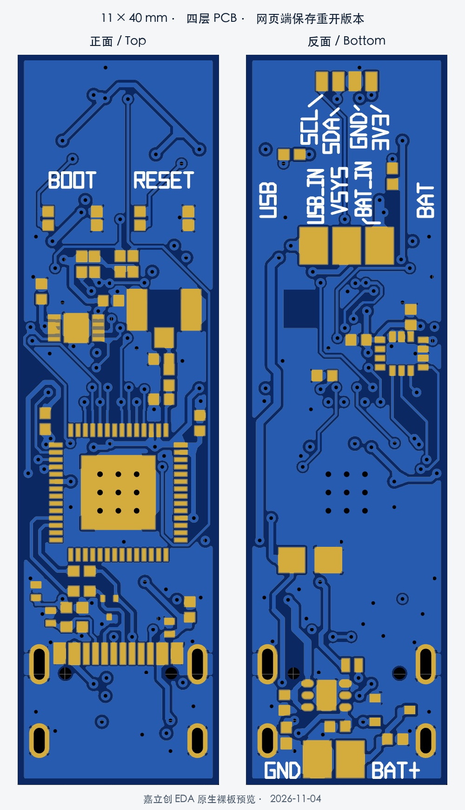

# FYP · 触觉毛笔与书写机器人

本仓库包含触觉毛笔的传感硬件、采集工具及书写机器人相关代码。当前硬件入口已更新为 **11 × 40 mm 四层笔杆传感板**；圆形板和早期双层方案保留为历史资料。

## 当前笔杆板 · 2026-11-04

- [详细信息与操作指南](hardware/pen_sensor_strip_v1/README.md)：器件、接口、GPIO、USB/BAT 供电、接线、烧录、传感器和 BLE 使用。
- [工程交接与检查范围](hardware/pen_sensor_strip_v1/CAD_HANDOFF.md)：正式原理图、PCB、网表、保存重开与检查证据。
- [工程审核包](hardware/pen_sensor_strip_v1/deliverables/pen_sensor_11x40_4layer_3V3_junction_review_20261104.zip)：当前源、指南、正反面图及检查记录。

当前设计采用 ESP32-S3-PICO-1-N8R8、板载 MLX90393、LSM6DSOX 和外接笔头 MLX90393。两颗磁传感器各用一路 I²C，IMU 使用四线 SPI。USB-C 位于笔尾，电池焊盘同端，笔头接口位于另一端。

SW1 强制选择 USB 或电池：所选电源接入即上电，缺失时不自动回退。板上不充电，SW1 不负责切换 USB/BLE 通信模式。

2026-11-04 正式 PCB 已保存并在网页端重开核验，原生 DRC 0、27/27 网络连通，逐脚网表及完整铜检查通过。首板上电、USB、三传感器采集、BLE、温升、射频和制造装配仍待验证。

## 其他项目入口

- [旧单 MLX90393 固件](firmware/mlx90393_sensor/mlx90393_sensor.ino)：旧硬件迁移参考，不是当前笔杆板的完整固件。
- [采集与闭环快速开始](quick_start.md)。
- [MuJoCo 快速开始](quick_start_mujoco.md)。
- [机器人代码说明](src/brushbot/README.md)。
- [圆板历史入口](hardware/round_sensor_v0/README.md)。

原有项目计划和实验记录按其记录日期阅读；当前笔杆板的接线、供电及验收状态以本页链接的长条板工程为准。
