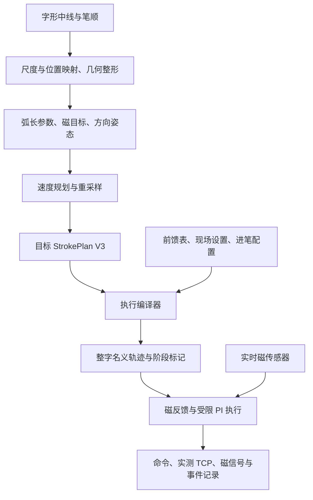

# 字符 StrokePlan 生成与连续书写设计

## 1. 目标与适用范围

本设计将字符的有序笔画几何转换为包含 **XY、时间、磁响应目标和方向姿态** 的 StrokePlan，再结合独立前馈表、现场设置和 PI 参数，生成机械臂连续书写轨迹。

本文对应当前 `directional_character` 整字执行分支，说明生成规则和控制接口。数据格式沿用 [StrokePlan V3 契约](../02-strokeplan/strokeplan.md)；单笔操作入口见 [执行说明](strokeplan-execution.md)，前馈与 PI 原理见 [控制设计总结](nonlinear-feedforward-pi-summary-2026-09-25.md)。旧单笔文档中关于固定姿态、单笔调用的范围描述，不适用于本文的整字分支。

当前已有字符模板读取、合成磁目标、方向姿态、时间重规划和整字执行组件。具体字符的连接关系、磁目标控制点及局部形状仍由配方指定，尚未实现任意字形自动生成可靠笔迹的通用编译器。

## 2. 总体结构与文件边界

| 产物 | 内容 | 职责 |
|---|---|---|
| `character.npz` | 按笔顺排列的目标笔画 | 表达要写的几何、时间、磁目标和姿态。 |
| `stroke_XX.npz` | 可选的单笔目标 | 便于单独预览和执行，保留整字坐标。 |
| `feedforward.json` | 磁响应到名义压深的标定表及适用条件 | 提供设备相关的前馈映射。 |
| `settings.json` | TCP/UCS、原点、接触高度、工作空间及限制 | 描述现场与设备约束。 |
| `entry_profile.json` | 接近、旋转落笔、反向补偿和转移规则 | 把连续书写笔画接成完整动作。 |
| `pi_profile.json` | 增益、积分限幅、修正限幅和抗饱和方式 | 定义实时磁反馈。 |
| 编译轨迹、`protocol.json` | 名义六维位姿、阶段、时长和编译结果 | 作为派生输出，可由目标与配置重建。 |

**目标 StrokePlan 不保存 Z、前馈压深或 PI 修正量。** 这些量由执行层生成。改变前馈表或现场设置后，必须重新编译；运行记录中的实际响应也不能回写成原计划的目标。

## 3. 目标数据契约

一份 StrokePlan 包含有序的 `strokes` 和来源元数据。每笔有以下数组：

| 字段 | 形状与单位 | 含义 |
|---|---|---|
| `xy` | `M × 2`，m | 纸面坐标中的目标轨迹。 |
| `s` | `M`，无量纲 | 由最终 XY 累计弧长归一化得到。 |
| `t` | `M`，s | 每笔从 0 开始、严格递增的局部时间。 |
| `g_target` | `M`，µT | 与几何和时间对齐的磁响应目标。 |
| `orientation` | `M × 3`，rad | 基坐标系下的 RPY 姿态；整字方向执行分支要求显式提供。 |

令第 \(i\) 个样点为 \(\mathbf p_i\)，则：

\[
\ell_i=\sum_{j=1}^{i}\|\mathbf p_j-\mathbf p_{j-1}\|,
\qquad s_i=\ell_i/\ell_{M-1}.
\]

所有数组长度必须一致且数值有限，整笔长度必须大于零。停顿可表现为相邻 XY 相同、时间继续增加；当前方向生成器会去掉重复弧长点并重新规划时间，因此不能用它保留输入中已经设计好的停顿。

元数据明确 `source`、`coordinate_frame`、`feature`、`filter_definition`；带姿态时设置 `orientation_convention=base_rpy_rad`。模板几何配合人工磁目标属于 `mixed` 来源，应分别记录字形出处和合成目标的规则。当前 NPZ 使用 `s0_xy`、`s0_t`、`s0_g`、`s0_rpy` 等逐笔字段，由 V3 loader 校验。

## 4. 从字形得到可书写几何

### 4.1 中线、笔顺与坐标

当前字形入口读取 Make Me a Hanzi 的 `medians`，获得每笔有序中线。该数据提供几何和笔画顺序，不含磁触觉示范、毛笔压深或真实书写时间。

生成时先计算整字包围盒，等比缩放到指定长边尺寸，将包围盒中心平移到局部原点，再放置到目标纸面区域。保持字体坐标的正 Y 朝向，并明确其与机器人基坐标的对应关系。

当前整字执行器对纸面坐标只做 XY 平移：

\[
\mathbf p_{base,xy}=\mathbf p_{paper,xy}+\mathbf o_{xy}.
\]

字符中心可相对纸面原点另设偏置。若需要改变字的朝向，应在生成阶段旋转全部 XY，再重新计算方向姿态；执行器没有自动估计纸面旋转、倾斜或相机外参。

### 4.2 转角与笔画连接

折线尖角需要局部平滑，避免位置切线突变。现有模板配方在角点两侧截取有限长度，再用二次曲线连接，保留主要直线段和端点。

字体中线之间不一定相接；字体轮廓中看起来闭合的位置，转成有限宽度的毛笔轨迹后可能留下空隙。因此，生成规则还需明确：

- 哪些端点需要与其他笔画相交或重叠。
- 起笔和收笔是否有额外的横向段、折返或突出。
- 哪些延长段必须维持接触，哪些位置才开始卸载。

TCP 中心线相交也不能保证纸上笔迹相接：姿态、笔毛变形和 TCP 定义会影响实际接触区域。端点投影、裁短和延长是显式几何配方；方向相关的笔尖补偿仍需实测标定。几何改动后应重新计算弧长、姿态与时间。

## 5. 由书写意图生成磁目标

### 5.1 磁响应的定义

当前控制特征为 `filtered_dBxy_norm_uT`。运行开始时建立三轴磁基线 \(\mathbf B_0\)，对差分向量进行滤波，再计算 XY 幅值：

\[
\mathbf b_f=\operatorname{EMA}(\mathbf B-\mathbf B_0),
\qquad g_{measured}=\sqrt{b_{f,x}^{2}+b_{f,y}^{2}}.
\]

目标、标定与运行应使用相同特征定义和滤波配置。µT 表示磁响应，是接触与变形的代理量；它与力、线宽和颜色之间尚无可直接换算的统一标定。

### 5.2 沿弧长组织提按

以归一化弧长 \(s\) 或实际行程 \(\ell\) 设置磁目标控制点，表达轻触起笔、逐步加载、正文、转折及收笔。用弧长定位这些变化，可使减速后的提按仍发生在预期的纸面位置。

现有配方用五次平滑函数连接相邻目标：

\[
h(u)=10u^3-15u^4+6u^5,\quad u\in[0,1],
\qquad g(u)=g_a+(g_b-g_a)h(u).
\]

该函数在区间两端具有零一阶、二阶导数，适合连接平台和加载段。生成规则包含：

- **轻起笔**：设置较低的初始磁目标，沿一段实际行程渐增，减少静止位置上的集中加载。
- **正文提按**：用若干控制点定义目标包络；需要加宽时可提高这一段目标，但增幅与实际线宽的关系须通过纸面结果判断。
- **转折与连接**：目标变化与转角、重叠位置关联，避免在尚未完成连接时提前卸载。
- **收笔**：根据悬针、停驻或连接需求选择下降目标或维持接触，随后由执行层抬笔。

这些目标是可解释的合成假设。只有 XY 模板时，不能宣称恢复了书法家的真实磁触觉。当前也没有把视觉线宽自动反演为磁目标的模型。

## 6. 姿态随行笔方向变化

### 6.1 提取稳定方向

在弧长轴上对 XY 重采样，计算切线方向：

\[
\theta(\ell)=\operatorname{atan2}\left(\frac{dy}{d\ell},\frac{dx}{d\ell}\right).
\]

方向角先展开以消除跨越 \(\pm\pi\) 的数值跳变，再沿弧长平滑。当前实现采用约 0.1 mm 的几何采样间隔、标准差 1 mm 的高斯核，核截断到两侧各约 3 mm。方向平滑与 XY 转角平滑是两个独立步骤。

### 6.2 从方向与倾角得到 RPY

设倾角为 \(\alpha\)，定义：

\[
R(\theta,\alpha)=R_z(\theta)R_y(\alpha)R_z(-\theta).
\]

该构造让工具局部正 Z 轴的 XY 投影随行笔方向转动，同时避免直接附加一个完整的轴向转角。按 \(R=R_z(yaw)R_y(pitch)R_x(roll)\) 转为基坐标 RPY。

当前书写倾角示例为 15°，对应关系如下：

| 行笔方向 | 书写 RPY（°） |
|---|---|
| +X | `(0, 15, 0)` |
| +Y | `(-15, 0, 0)` |
| −X | `(0, -15, 0)` |
| −Y | `(15, 0, 0)` |

斜向行笔时 Rx、Ry、Rz 联动。它表达的是目标工具姿态；实际笔毛接触中心与方向的关系仍由工具装配和变形决定。

## 7. 时间规划与重采样

时间规划同时考虑 XY 路径和姿态变化，步骤为：

1. 在弧长轴计算路径曲率，以及 RPY 对弧长的一、二阶变化。
2. 根据行笔速度、角变化率和曲率设置局部速度上限；方向变化较快的位置减速。
3. 通过前向、反向传播限制可达速度，使起停和局部速度变化满足加速度约束。
4. 由相邻弧长和速度积分得到时间，再重采样到 20 ms 时间网格。
5. 同步插值 XY、磁目标和方向姿态，并由最终 XY 重新计算 `s`。

当前示例直线行笔上限为 10 mm/s；转角处允许更慢。时长向上取整到 20 ms 的整数倍。重采样后需要重新检查完整六维轨迹，因为局部速度规划本身不保证查表所得 Z 与所有阶段接缝都满足限制。

当前角速度、角加速度检查采用 **RPY 分量差分的范数**，它是实现中的姿态变化约束，并非严格的空间角速度或关节动力学检验。

## 8. 整字执行阶段与旋转落笔

一个字符编译成一条连续轨迹，运行开始采集一次基线。第 \(i\) 笔依次包含：

| 阶段 | 动作 |
|---|---|
| `high_transfer_XX` | 在高位移动到本笔进笔位置。 |
| `rotate_air_XX` | 按首段方向设置较大的进笔倾角。 |
| `lower_fast_XX` | 快速下降到减速高度。 |
| `lower_slow_XX` | 以较低速度下降到旋转接触高度。 |
| `rotate_contact_XX` | 转到书写姿态；可同步执行反向 XY 补偿。 |
| `load_workpoint_XX` | 在笔画起点加载到初始目标对应的前馈位置。 |
| `measure_XX` | 执行目标 XY、姿态与磁目标，启用 PI。 |
| `lift_XX` | 在末端抬到转移高度。 |

笔间直接高位转移到下一笔，最后一笔完成后统一 `return_high` 返回等待位，并执行短暂保持。动作段使用五次平滑插值，实际时长取位置速度、加速度、姿态变化限制和配置最小时长共同要求的值。

### 旋转中的反向 XY 补偿

设笔画起点为 \(\mathbf p_0\)，首段单位方向为 \(\mathbf u_0\)，补偿距离为 \(d\)。先在高位到达：

\[
\mathbf p_{entry}=\mathbf p_0+d\mathbf u_0.
\]

下降到旋转接触高度后，使用同一平滑进度 \(h(u)\)，同时改变姿态和 XY：

\[
\mathbf p_{xy}(u)=\mathbf p_{entry}-d\mathbf u_0h(u),
\qquad
\mathbf r(u)=\mathbf r_{entry}+(\mathbf r_{write}-\mathbf r_{entry})h(u).
\]

这段动作保持 TCP Z 不变，结束在原笔画起点。若行笔方向是 +X，旋转时 TCP 沿 −X 移动。`entry_reverse_mm` 决定 \(d\)，取 0 时为原地旋转。该参数属于接触轨迹补偿，不能直接等同于实际笔尖滑移量。

### 当前整字配置示例

以下是现场试验配置示例，不属于 StrokePlan 格式常量：

| 项目 | 示例值 |
|---|---:|
| 进笔 / 书写倾角 | 30° / 15° |
| 空中旋转 / 接触旋转 / 初始加载的最小时长 | 1.5 / 3 / 3 s |
| 高位转移 / 快速升降上限 | 80 / 60 mm/s |
| 下笔减速高度 / 低位下降上限 | Z=50 mm / 15 mm/s |
| 旋转接触高度 / 转移高度 | Z=36 mm / 130 mm |
| 书写速度上限 | 10 mm/s |
| RPY 变化率 / 变化加速度上限 | 20°/s / 40°/s² |

高度均按现场基坐标与 TCP 定义解释。减速高度是下降阶段分界，初始加载另有自己的平滑时长；整字写完前不会每笔返回等待原点。

## 9. 前馈与受限 PI

### 9.1 编译前馈 Z

设独立前馈表的逆映射为 \(F^{-1}\)，名义接触高度为 \(z_c\)：

\[
d_{ff}(t)=F^{-1}(g_{target}(t)),
\qquad z_{ff}(t)=z_c-d_{ff}(t).
\]

磁目标先按时间插值，再查表。查表禁止超出实测响应范围外推。名义压深是相对配置接触高度计算的 TCP 位移，不能直接当作笔毛实测压缩量。

当前表来自固定姿态和方向条件。整字分支通过显式的 `assume_pose_invariant` 假设，将同一磁响应—压深映射用于其他 XY 方向和倾斜方位。该假设不等于完成了方向、动态姿态或静态加载标定；转弯减速、停驻加载与原标定运动条件也可能存在差异。

### 9.2 实时修正

书写阶段误差为：

\[
e_k=g_{target,k}-g_{measured,k}.
\]

用标定表整体跨度计算比例尺度 \(S_{cal}\)，单位 m/µT。PI 的候选修正为：

\[
P_k=K_pS_{cal}e_k,\qquad
I_k^*=\operatorname{clip}(I_{k-1}+K_iS_{cal}e_k\Delta t,-I_{max},I_{max}).
\]

结合修正幅值、速度、加速度、制动包络、工作空间和总深度约束，确定当前允许的修正区间；若积分变化会继续推动输出超出区间，则拒绝本拍积分增量。最终：

\[
d_{cmd,k}=d_{ff,k}+\Delta d_k,\qquad z_{cmd,k}=z_c-d_{cmd,k}.
\]

当前整字参数示例为 `Kp=1`、`Ki=0.1 s⁻¹`、总修正限幅 ±0.8 mm、积分限幅 ±0.2 mm、修正速度上限 2 mm/s、修正加速度上限 30 mm/s²。

PI 只在各 `measure_XX` 阶段启用。非书写阶段清零积分，修正量归零；每笔首尾通过渐变包络衔接，保留命令历史用于运动约束。一次基线采集与每笔积分清零是两个独立机制。当前 PI 修正 Z，不调整 XY、姿态，也不直接闭环控制笔画宽度。

## 10. 编译、执行与记录

生成后的检查分为三个层次：

1. **目标检查**：V3 读回、来源和单位、弧长一致性、目标与姿态连续性，以及 XY、`g(s)`、`g(t)` 预览。
2. **执行编译**：表与现场上下文、磁目标范围、20 ms 时间网格、工作空间、深度、速度、加速度、单步和阶段接缝。
3. **实际书写评价**：运行是否完成、磁响应误差和限幅、实际 TCP、纸面线宽、起收笔、连接与显色。

执行器按 20 ms 顺序发出轨迹样点，并保留超时、传感器无效/过期、通信和运动边界检查。异常时停止后续笔画，按引擎状态尝试中止抬笔并记录原因。离线编译通过只说明目标与名义命令满足软件检查，不能证明纸面效果。

每次运行保存目标和配置快照、哈希、编译轨迹、`sensor.csv`、`control.jsonl`、`events.jsonl` 与 `manifest.json`。启用独立 TCP 采集时，还保存约 10 Hz 的 `actual_tcp.csv` 及采集质量信息；它不参与 PI。分析时按共同单调时钟对齐，保留异步采样和跟随延迟的解释范围。

## 11. 实现入口

| 组件 | 代码 |
|---|---|
| 字形中线读取与尺度映射 | [`calligraphy/hanzi.py`](../../src/brushbot/calligraphy/hanzi.py) |
| V3 数据校验与读写 | [`target_strokeplan.py`](../../src/brushbot/target_strokeplan.py) |
| 模板几何、转角平滑与磁目标配方 | [`generate_calligraphy_trial.py`](../../scripts/generate_calligraphy_trial.py) |
| 方向平滑、姿态与时间规划 | [`generate_directional_character_trial.py`](../../scripts/generate_directional_character_trial.py) |
| 整字阶段编译与旋转补偿 | [`strokeplan_character.py`](../../src/brushbot/experiments/strokeplan_character.py) |
| 多笔目标、反馈阶段与引擎适配 | [`strokeplan_execution.py`](../../src/brushbot/experiments/strokeplan_execution.py) |
| 前馈查表与上下文检查 | [`feedforward.py`](../../src/brushbot/feedforward.py) |
| 受限 PI 与运动包络 | [`strokeplan_pi_feedback.py`](../../src/brushbot/experiments/strokeplan_pi_feedback.py)、[`strokeplan_feedback.py`](../../src/brushbot/experiments/strokeplan_feedback.py) |
| 当前字符试验执行入口 | [`run_strokeplan_trial.py`](../../scripts/run_strokeplan_trial.py)，`EXPERIMENT="calligraphy"`，`STROKE=None` 为整字 |

目前字符配方脚本绑定具体模板和输入文件。迁移到其他字符时，需要提供新的笔顺、几何及目标配方，再复用姿态、时间规划和整字编译组件；仅修改执行脚本的文件名不会自动生成其他字。
