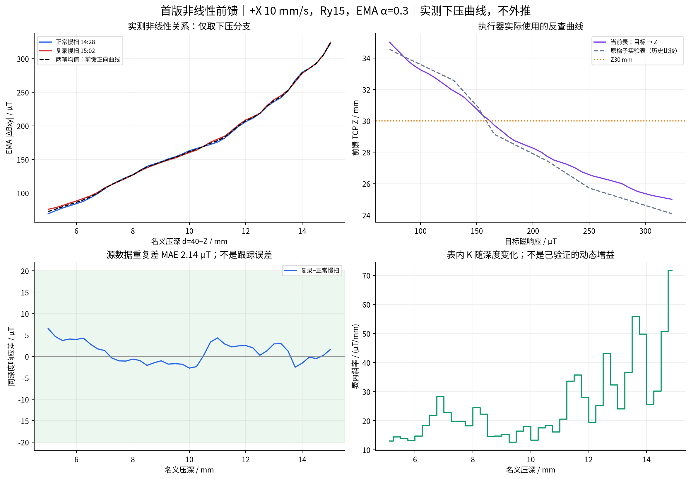

# 非线性前馈＋PI：控制实现说明

更新日期：2026-10-19。本文保留 StrokePlan 执行使用的前馈反查、P／PI、抗饱和、限幅和记录接口。9 月 25 日实验路线、参数比较与实测结果已合入[实验总览 G06–G13](../08-system-evaluation/实验清单.md#z-identification)，不在此重复维护。

## 1. 控制分工与适用范围

非线性前馈承担主要命令压深，P 修正即时磁误差，慢 I 累积残余误差并按综合允许区间执行条件积分。目标是跟踪磁响应代理量，不直接测量法向力、笔锋状态或墨迹质量。

以下 Z40 接触参考、Ry15°、+X 单方向表及数值范围属于 brush2 的历史执行配置。控制机制仍可查阅，但换笔、姿态、特征或前馈表后必须重新匹配。公共 G 校准的语义与接入缺口见[公共前馈分工](../08-system-evaluation/实验清单.md#public-feedforward)，现有单方向表不能冒充公共校准模型。

## 2. 信号、坐标和执行流程

### 2.1 统一定义

| 量 | 定义与单位 |
|---|---|
| `g_target` | StrokePlan 提供的目标磁幅值，µT |
| `g_meas` | 扣除空载基线后的水平磁场分量经 EMA 滤波，再取 `hypot(ΔBx, ΔBy)`，µT |
| `e` | 控制误差 `g_target − g_meas`；正值请求增加压深 |
| `d` | 向下为正的名义压深，mm；不是实测笔毫压缩量 |
| `contact_z` | 当前表的接触参考，固定为 Base 坐标 Z=40 mm |
| `z_cmd` | 命令高度 `40 − d_cmd`，mm；不等于实际 TCP Z |

控制周期为 **20 ms**，磁信号 EMA **α=0.3**。StrokePlan 保存 XY、时间和目标磁响应；前馈表、现场设置及控制参数独立保存。实测磁值、命令及实际 TCP 属于执行记录，不回填成计划数据。

### 2.2 旋转接触与行走加载

后续直线跟踪实验采用：等待位取空载基线 → 高位转到 Ry30° → 下降到 **Z36 mm** → 保持 TCP XYZ，转到 **Ry15°** → 沿 +X 滑动 1 s → 行走中用 3 s 平滑加载到首个目标的前馈 Z → 进入测量段 → 继续短距离行走、抬笔、空中保持、回等待位。

这一流程源于操作者观察：竖直压入可能挤压触角，起步行走后触角逐渐拖动恢复。旋转接触用于改善接触建立方式，但不能据此断言每笔都没有挤压，或进入测量前已经静态稳定。

**Z36/Z38 是进笔高度，Z40 是压深参考，两者不能互换。** 建表的两笔慢扫实际采用 Z38 进笔；后续 Z36 比 Z38 更低 2 mm，其效果不能由 Z38 数据直接证明。后续局部实验没有重现早期上千 µT 的峰值，但仍不能单独归因于这 2 mm 改动。

## 3. 非线性前馈表如何建立

### 3.1 为什么使用非线性表

局部实验显示较深工作点通常更敏感；用一个常数 K 表示全部压深范围会丢失这一变化。另一方面，相同名义深度在不同加载历史、位置和时刻可能对应不同信号，因此首版表只表达**限定条件下的慢扫下压分支**，不把它当作完整的动态或滞回模型。

### 3.2 数据、处理与范围

来源为当天 **14:28:57、15:02:32** 两笔正常慢扫，采用 Z38→24 mm、单程 30 s、Ry15°、+X 10 mm/s。异常慢扫、快扫回升和局部扰动不混入同一条表。

处理过程：

1. 各笔下压段按 **0.25 mm 命令压深**分箱，每箱至少 5 点。
2. 分别插值到 **5–15 mm、间隔 0.25 mm** 的共同网格。
3. 对两笔等权平均，得到 **41 个节点**。两笔及平均曲线已严格单调，无须强行修改节点。
4. 运行时在磁幅值节点之间作分段线性反查，得到 `d_ff`。整体映射为非线性关系，不采用高阶多项式外推。

| 项目 | 当前表 |
|---|---|
| 磁幅值范围 | 72.517–323.539 µT |
| 名义压深范围 | 5–15 mm，对应 Z35–25 mm |
| 标定上下文 | brush2、原安装与 TCP/UCS、Ry15/Rz0、+X 10 mm/s、EMA α=0.3 |
| 当前重点试验范围 | 160–240 µT；不支持外推到 60 µT |

源数据的重复性、内部拟合及独立目标跟踪结果统一见[实验总览 G06](../08-system-evaluation/实验清单.md#g06)；该表的生成过程不产生独立验证成绩。

| 目标 / µT | 前馈压深 / mm | 前馈 Z / mm |
|---:|---:|---:|
| 160 | 9.908 | 30.092 |
| 180 | 11.098 | 28.902 |
| 200 | 11.737 | 28.263 |
| 220 | 12.532 | 27.468 |
| 240 | 13.106 | 26.894 |

160 µT 的 Z 略高于 30 mm，保留原定的 160–240 µT 范围。源表保留候选标志；用于真机批次的独立副本标记为实验采用。采用标志代表允许本次试验，不是跟踪性能认证。



建表方法、源文件哈希和查表数据见[前馈表说明](../../runs/brush2/plans/05_慢扫非线性前馈表/README.md)。

## 4. 当前 PI 控制律及约束

### 4.1 非线性前馈与固定反馈尺度

用 mm 表示压深时，当前全表反馈尺度为：

```text
S = (15 − 5) / (323.5391756 − 72.5172479)
  ≈ 0.039837 mm/µT

d_ff[k] = table(g_target[k])
e[k] = g_target[k] − g_meas[k]
P[k] = Kp × S × e[k]
I_candidate[k] = clip(I[k−1] + Ki × S × e[k] × 0.02, −0.2, +0.2)
```

代码内部使用 m，Kp 无量纲，Ki 单位为 s⁻¹，积分状态本身为压深修正量。**当前 P/I 使用固定的全表 S，并没有按局部 K 调度增益。** 非线性来自前馈查表；不能把当前实现写成“每个深度自动使用理想局部增益”。

局部增益 `K=Δg/Δd` 越大，同样的压深修正通常产生越大的磁响应。当前固定 S 的实际闭环作用仍随工作点变化；后续若要增益调度，需要可靠的局部模型与独立验证，不能直接用不稳定平台的差分替代。

### 4.2 条件积分抗饱和

每拍先计算综合允许反馈区间 `[lower, upper]`。该区间同时考虑总修正幅值、首尾渐变、修正速度和加速度、提前制动、深度、工作空间以及叠加名义轨迹后的 TCP 动态限制。

```text
raw_candidate = P + I_candidate
delta_I = I_candidate − I_previous

若 raw_candidate > upper 且 delta_I > 0：冻结积分
若 raw_candidate < lower 且 delta_I < 0：冻结积分
否则：接受 I_candidate

d_fb = clip(P + I_accepted, lower, upper)
d_cmd = d_ff + d_fb
z_cmd = contact_z − d_cmd
```

因此，积分不仅在 ±0.8 mm 总幅值到顶时冻结；动态限制下也可能冻结。推动请求回到允许区间内的反向积分可以被接受。积分单独限幅与总修正限幅是两个不同约束，**±0.8 mm 是 P＋I 的总额，不是 P 之外另加 ±0.2 mm**。

当前单笔流程只在测量阶段启用反馈，非测量阶段清零积分；新 run 重置控制状态。最终无可行命令或发生执行异常时，由执行层中止，不能靠取消约束继续运行。

### 4.3 推荐候选的命令范围

在 160–240 µT 目标、当前表和总修正 ±0.8 mm 下，仅按幅值计算：

- 名义前馈压深约 9.908–13.106 mm。
- 叠加反馈后的压深包络约 **9.108–13.906 mm**。
- 对应 Z 包络约 **30.892–26.094 mm**。

这只是测量目标范围对应的命令包络，实际逐拍范围还受动态约束；不是实测压深，也不包括整段进退笔路径。换表、目标、现场参考或限幅后必须重新计算。

### 4.4 代码入口

| 部分 | 当前实现 |
|---|---|
| 表校验与反查 | [feedforward.py](../../src/brushbot/feedforward.py)：严格单调、上下文校验、范围内插值，拒绝外推 |
| P 与综合反馈约束 | [strokeplan_feedback.py](../../src/brushbot/experiments/strokeplan_feedback.py) |
| 当前慢 PI 与条件积分 | [strokeplan_pi_feedback.py](../../src/brushbot/experiments/strokeplan_pi_feedback.py) |
| 标定尺度与基础控制器 | [z_control.py](../../src/brushbot/z_control.py)；其历史默认参数不代表当前真机配置 |
| 困难目标 FF/P 入口 | [run_strokeplan_trial.py](../../scripts/run_strokeplan_trial.py)，`EXPERIMENT="nonlinear"` |
| 短平台 P/PI 入口 | [run_strokeplan_trial.py](../../scripts/run_strokeplan_trial.py)，`EXPERIMENT="short_plateau"` |
| Ki 扫描入口 | [run_strokeplan_trial.py](../../scripts/run_strokeplan_trial.py)，`EXPERIMENT="ki_scan"`，修改 `KI_STEP` |

## 5. 参数配置与调参原则

以下是 2026-09-25 的 P 基准及 PI 候选，统一入口可选择相应实验配置；候选筛选结果见[总览 G09–G11](../08-system-evaluation/实验清单.md#g09)。这些值未被证明适用于其他毛笔、方向或快速变化目标。

| 项目 | 已有 P 基准 | PI 对照 | 优先试用 PI |
|---|---:|---:|---:|
| Kp | 1 | 1 | 1 |
| Ki / s⁻¹ | 0 | 0.05 | **0.10** |
| 总修正 / mm | ±0.8 | ±0.8 | ±0.8 |
| 积分限幅 / mm | 不启用 | ±0.2 | ±0.2 |
| 修正速度 / mm/s | 2 | 2 | 2 |
| 修正加速度 / mm/s² | 30 | 30 | 30 |
| 首尾渐变 | 1 s | 1 s | 1 s |

若未饱和平台仍长期同向偏差，应检查工作点、前馈偏差和积分时间尺度；若问题集中在反转或回升，另查加载历史与分支差异。分支前馈和增益调度仍是待验证候选。长时间到达行程或动态限制时，先查约束及接触条件，不能仅增大 Ki 或解除抗饱和。

## 6. 记录与误差解释

实际 TCP 通过独立连接与线程约 10 Hz 读取，仅作诊断，不参与磁 PI；每个 20 ms 控制拍不等待查询。分析以读取起止时间中点与共享主机单调时钟上的已发送命令插值对齐，10 Hz 样本不能排除更高频误差。

各 run 保存 `manifest.json`、`resolved.json`、`sensor.csv`、`control.jsonl`、`events.jsonl`、输入快照及可用实际 TCP 文件。核对最终状态、有效测量段、输入参数、传感引用和限幅；测量后返回中止的记录，只有在确认测量窗口完整后才用于局部分析。

控制公式的误差为“目标−实测”；部分困难目标报告用“实测−目标”，引用有符号误差时须注明。MAE 不受符号方向影响。复算保留原基线与 EMA，不平移曲线或删掉表现较差的首段。

## 7. 阅读入口

| 内容 | 入口 |
|---|---|
| StrokePlan 输入、统一脚本与预检 | [执行说明](strokeplan-execution.md) |
| Z 扫描、动态辨识、FF/P/PI、Ki 及整字结果 | [实验总览](../08-system-evaluation/实验清单.md#z-identification) |
| 早期控制构想 | [历史设计](archive/z-control-design.md)，按原阶段解释 |
