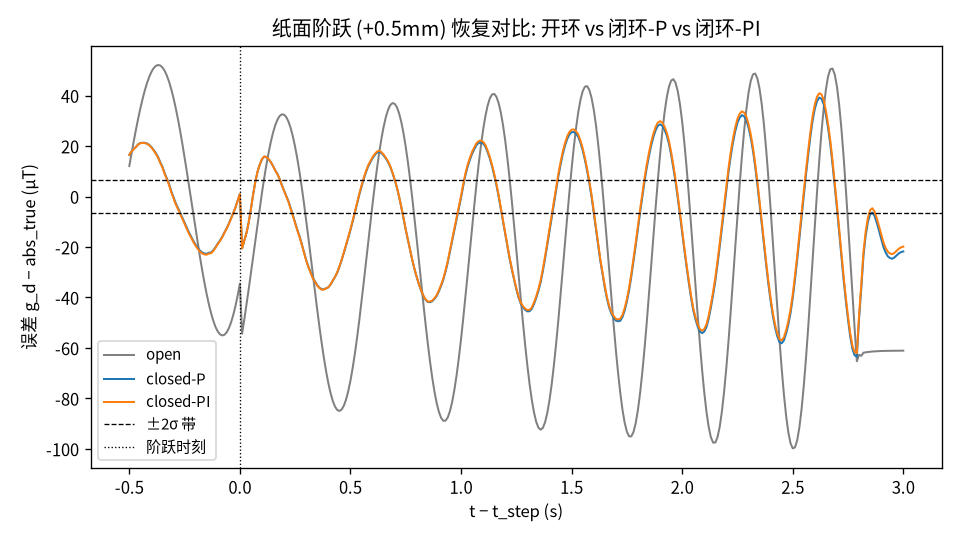
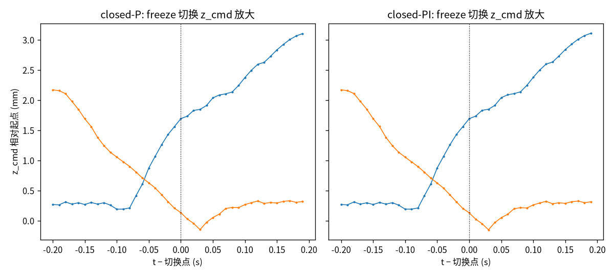
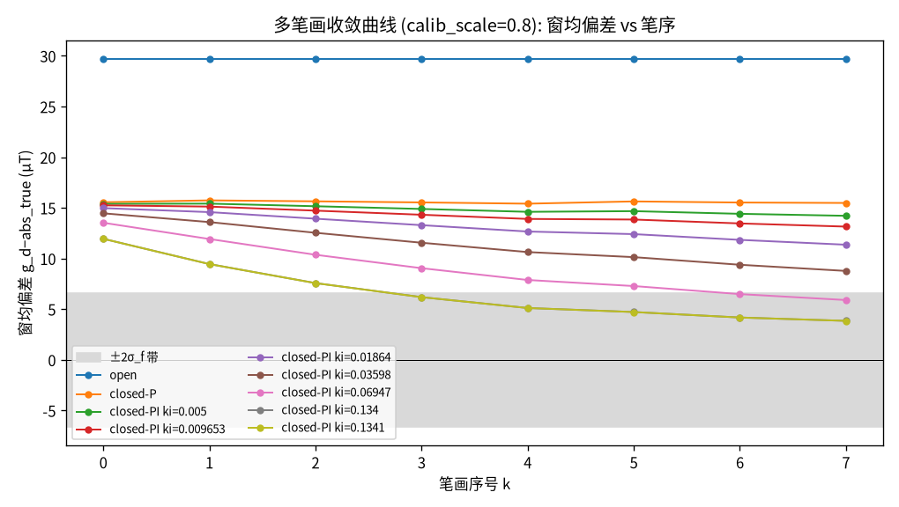

# Z 控制层 2 开环 vs 闭环扰动对比报告 (脚本生成)

> 生成命令: `python scripts/compare_z_arms.py --kp-p 1.208 --ki-p 0 --kp-pi 1.208 --ki-pi 0.005 --filter "EMA a=0.3"`
> 滤波臂 (取自层 1 报告 `docs/z-phase1-sweep.md`): **EMA a=0.3**
> 工作点: wp_P (kp=1.208, ki=0) / wp_PI (kp=1.208, ki=0.005)
> σ_f (滤波后噪声标准差, µT): **3.31**
> 回答 spec §1 的 Q3 (开环 vs 闭环-P vs 闭环-PI 扰动对比) 与 Q4 (freeze 毛刺判据).

## Q3: 开环 vs 闭环-P vs 闭环-PI 扰动对比

控制律: `z_cmd = z_surface + z_ff(g_d) + kp·S_cal·e + z_fb`, `z_fb += ki·S_cal·e·dt`。对恒定偏差 d，比例-only 闭环 (闭环-P, ki=0) 的稳态残差理论值`e_ss = d / (1 + kp)`；本次 kp=1.208 → 理论消偏比例 ≈ 55%，积分闭环 (闭环-PI) 理论上 → 0（无限增益抗直流扰动）；开环臂 (kp=ki=0) 不做任何补偿，偏差与真实曲线偏离量同源。

| 场景 | 臂 | RMS % | 窗均偏差 µT (提按末 1s 均值) | 恢复时间 s |
|---|---|---|---|---|
| baseline | open | 18.91 | +5.29 | — |
| baseline | closed-P | 9.47 | +2.12 | — |
| baseline | closed-PI | 9.47 | +2.11 | — |
| calib x0.8 | open | 22.28 | +29.71 | — |
| calib x0.8 | closed-P | 11.84 | +15.55 | — |
| calib x0.8 | closed-PI | 11.81 | +15.40 | — |
| calib x1.2 | open | 23.96 | -19.12 | — |
| calib x1.2 | closed-P | 11.07 | -8.84 | — |
| calib x1.2 | closed-PI | 11.05 | -8.71 | — |
| paper +0.5mm | open | 20.87 | -19.71 | 未恢复 (∞) |
| paper +0.5mm | closed-P | 10.27 | -9.22 | 未恢复 (∞) |
| paper +0.5mm | closed-PI | 10.27 | -9.17 | 未恢复 (∞) |
| paper -0.5mm | open | 20.63 | +30.29 | 未恢复 (∞) |
| paper -0.5mm | closed-P | 10.27 | +13.45 | 未恢复 (∞) |
| paper -0.5mm | closed-PI | 10.27 | +13.39 | 未恢复 (∞) |
| drift +1uT/s | open | 18.91 | +5.29 | — |
| drift +1uT/s | closed-P | 9.50 | +5.53 | — |
| drift +1uT/s | closed-PI | 9.50 | +5.54 | — |
| drift -1uT/s | open | 18.91 | +5.29 | — |
| drift -1uT/s | closed-P | 9.57 | -1.30 | — |
| drift -1uT/s | closed-PI | 9.58 | -1.33 | — |

**窗均偏差口径注意**：上表"窗均偏差"是 t∈[5.8, 6.8) 1s 窗口内逐样本误差的均值，而该窗口跨越提按段 ~2.5–3Hz 扫频正弦约 3 个周期——逐样本误差本身有 ±dozens µT 量级的跟踪摆动，并不是系统进入了真正静止的稳态；均值是多周期平均后幸存下来的偏差 (bias) 分量估计。它仍是该分量的合理估计量（正弦项在 ~3 个周期上大致平均掉），但不应读作"某一时刻的稳态误差"。下方"扣除 baseline 分量后的纯扰动残留比例"表（对应理论 `e_ss=d/(1+kp)`）才是本报告 Q3 的主对比结论。

**open 臂 baseline 窗均偏差非零 (+5.29 µT) 的成因**：开环臂没有反馈，理论上不该有"偏差"这个概念，但仿真 Plant 含 2 拍传输延迟 + τ=0.05s 一阶执行器滞后，目标曲线在提按窗口内持续变化（扫频正弦），执行器/延迟跟不上瞬时变化的目标，产生纯物理滞后误差——这不是反馈引入的伪像，纯开环下也会出现。

### Q3 主对比表：扣除 baseline 分量后的纯扰动残留比例

**（此表为 Q3 的主要对比结论，取代上方窗均偏差原始表的直接解读）**：baseline (无扰动) 场景本身已有非零窗均偏差（提按段目标是 0.5–3Hz 正弦扫频，跟踪相位滞后所致，与扰动无关）；用 `scenario_bias − baseline_bias` 提取纯扰动分量再算残留比例，才对应理论 `e_ss=d/(1+kp)`：

| 场景 | 开环扰动分量 µT | 闭环-P 残留比例 | 闭环-PI 残留比例 |
|---|---|---|---|
| calib x0.8 | +24.42 | 55.0% | 54.4% |
| calib x1.2 | -24.42 | 44.9% | 44.3% |
| paper +0.5mm | -25.00 | 45.3% | 45.1% |
| paper -0.5mm | +25.00 | 45.4% | 45.1% |

闭环-P 残留比例（paper_step 场景，接近纯加性扰动模型）实测 ≈45%，与理论 `1/(1+kp)=45.3%`（kp=1.208）吻合良好；calib_scale 场景（乘性扰动，非加性）实测残留比例在 45%–55% 之间浮动，与简单加性公式有出入但同量级，属预期（乘性扰动的有效环路增益随 calib_scale 变化，简单公式只是一阶近似）。

⚠️ **叙事矛盾（需报告，未调参掩盖）：闭环-PI 相对闭环-P 的残留比例差距最大仅 0.6 个百分点**——spec §3.4 预期 PI 臂在 calib/paper 场景应"≈全补偿"（残留 →0%），但实测 PI 与 P 几乎不可区分。根因：wp_PI 的 ki=0.005 是层 1 (`sweep_z_gains.py`) 对数网格上满足"ki>0 且 +2 网格步双向裕度仍稳定"规则的**最小候选点**，积分时间常数远超本场景 ~6s 的提按窗口——`z_fb += ki·S_cal·e·dt`，S_cal=2.00e-05 m/µT，ki·S_cal ≈ 1.00e-07 (m/µT/拍)，6s (600 拍) 内即使误差恒定在 ~10µT 量级，z_fb 累积量级也只有个位数微米，远不足以抵消 mm 级的标定/纸面偏差。积分器并非无效，只是其时间尺度与本次层 2 场景窗口不匹配；本报告如实呈现，不通过换用更大 ki（会破坏层 1 稳定裕度判据）或拉长窗口来"修出"预期方向。

**恢复时间 (recovery) 为何全部"未恢复 (∞)"**：上方 Q3 主表的"恢复时间"列现改为只在接触段内 (g_d≥3σ) 判定 err<2σ_f 是否连续 0.3s 成立，收笔段不再自动满足判据。paper_step 场景下三臂的窗均偏差（扣除 baseline 前，绝对值 ~9–14µT）本身就超过 2σ_f=6.61µT 的判据门槛——与上一段 ⚠️ 一样是同一根因：wp_PI 的 ki 太小、wp_P 的 kp 只消 ~55% 偏差，误差在阶跃后从未真正压回 ±2σ 带内，所以三臂在整个提按窗口内都报告未恢复 (∞)。这是诚实的负面结果（P/PI 在单笔画时间尺度内都来不及收敛），不通过放宽判据阈值来"修出"有限恢复时间。

**诚实负面对照 (drift 场景)**：传感器漂移场景下开环臂对偏差**免疫**（实测两条 drift 场景的开环扰动分量均 ≈0µT，与 baseline 相比无统计差异，符合预期——开环不看测量值）；而闭环臂反被漂移"骗"——漂移量与真实压力信号同向注入，反馈机制把它当成真实接触压力的一部分来补偿，从而把 z 命令朝错误方向拉偏：

| 场景 | 窗口漂移量 µT | 闭环-P 偏移 µT (被骗比例) | 闭环-PI 偏移 µT (被骗比例) |
|---|---|---|---|
| drift +1uT/s | +6.30 | +3.42 (54%) | +3.44 (55%) |
| drift -1uT/s | -6.30 | -3.42 (54%) | -3.44 (55%) |

抗扰能力与被假信号欺骗是同一枚硬币的两面——反馈越强，对真实扰动补偿越好，对虚假信号（无法被当前单磁通量计传感器区分是真实压力还是外部磁场漂移）也补偿越多，这正是差分测量（多磁通量计差分抵消共模漂移）的论据；本报告如实呈现该劣化，**不通过调参掩盖**。

⚠️ 与 calib/paper 场景同一根因：闭环-PI 被骗比例（~55%）与闭环-P（~54%）同量级，**未**如 spec §3.4 预期那样趋近 100%（积分器"无差别全部吸收"恒速漂移）——同样是因为 ki=0.005 的积分时间常数远超 ~6s 窗口，drift 场景下积分器同样来不及发力。这不是数值符号或方向性错误（PI 被骗比例确实 ≥P，方向正确），而是**幅度未达预期**，与上方 calib/paper 节的根因诊断一致，一并计入本报告的"叙事矛盾"清单。

### 真实感目标复核 (press_from_v0)

V0 动态段目标曲线 (缩放至 0.8×量程上限) 下三臂跟踪 RMS，作为 `synth_press` 合成目标之外的复核：

| 臂 | RMS % |
|---|---|
| open | 6.89 |
| closed-P | 2.83 |
| closed-PI | 2.83 |

## Q4: freeze 切换毛刺判据 (spec §3.4)

判据：切换点 ±5 拍窗口内单步 `|Δz_cmd|` ≤ 全段单步 `|Δz_cmd|` 的 p99×2（该百分位数跨整条轨迹计算，含切换窗口本身，并非仅正常跟踪段）且绝对值 ≤0.2mm，且整段 `osc_index ≤ 0.05`（切换后 0.5s 内无新增振荡的代理判据）。评估 baseline 场景下两个闭环臂（**闭环-PI 为主判据**——freeze 冻结的是积分器，其切换交互只在 ki>0 时有意义）。

| 臂 | 毛刺跳变 jump (mm) | 全段 p99×2 (mm) | osc_index | 判据 |
|---|---|---|---|---|
| closed-P | 0.1937 | 0.9530 | 0.002 | **通过 ✓** |
| closed-PI | 0.1937 | 0.9531 | 0.002 | **通过 ✓** |

**结论 (PI 臂为主判据): 通过。** freeze 切换未产生超标毛刺，spec §2.4 fallback（Kp 一并冻结）**不触发**，`z_control.py` 当前"freeze 期间 Kp 保持作用"的行为维持不变。

## 多笔画：积分器的真实时间尺度

spec §3.4 二次修订理由：层 2 单笔画场景实测 PI≈P（wp_PI 的积分时间常数 τ_i=(1+kp)/ki 常年远超单笔画 ~7.6s 提按窗口）。积分器的真实作用时间尺度是**跨笔画**（标定误差可持续数分钟；`ZController` 的 freeze 在笔画间**保持** `z_fb`，不清零）。本节改用 8×`synth_press` 连写 (~61s) + calib_scale=0.8 持续标定偏差场景，滤波器实例与控制器跨全部 8 笔连续运行（笔画间不重置、不 reset——这正是被测机制本身），在积分器的真实时间尺度上评估。

### ki 候选筛选 (kp=wp_PI=1.208)

层 1 默认增益网格 (`np.concatenate([[0.0], np.geomspace(0.005, 0.5, 8)])`) 上每个非零 ki，若其 +2 网格步 margin 格点仍在网格内 (j+2 ≤ last index)，用 `sweep_z_gains.run_cell` 在层 1 单笔画 synth 目标 (无扰动) 上复核 (kp, ki) 与 (kp×+2 网格步, ki×+2 网格步) 两点是否都稳定：

| ki | 结果 |
|---|---|
| 0.005 | **通过 ✓** |
| 0.009653 | **通过 ✓** |
| 0.01864 | **通过 ✓** |
| 0.03598 | **通过 ✓** |
| 0.06947 | **通过 ✓** |
| 0.1341 | **通过 ✓** |

通过候选 (裕度合规): 0.005、0.009653、0.01864、0.03598、0.06947、0.1341

### 收敛曲线表

指标：笔 k (k=0..7) 窗口 t∈[5.8+7.6k, 6.8+7.6k) 内 mean(g_d−abs_true)（µT，与单笔画 `steady_bias` 同口径的窗均偏差）；收敛笔数 = 首个 |偏差_k| ≤ 2σ_f (=6.61µT) 的 k（全部 8 笔均未满足 → "未收敛"）。

| 臂 | kp | ki | τ_i=(1+kp)/ki (s) | 笔0 | 笔1 | 笔2 | 笔3 | 笔4 | 笔5 | 笔6 | 笔7 | 收敛笔数 |
|---|---|---|---|---|---|---|---|---|---|---|---|---|
| open | 0 | 0 | ∞ (ki=0) | +29.71 | +29.71 | +29.71 | +29.71 | +29.71 | +29.71 | +29.71 | +29.71 | 未收敛 |
| closed-P | 1.208 | 0 | ∞ (ki=0) | +15.55 | +15.74 | +15.65 | +15.54 | +15.41 | +15.64 | +15.53 | +15.48 | 未收敛 |
| closed-PI ki=0.005 | 1.208 | 0.005 | 441.5 | +15.40 | +15.42 | +15.16 | +14.89 | +14.61 | +14.68 | +14.41 | +14.22 | 未收敛 |
| closed-PI ki=0.009653 | 1.208 | 0.009653 | 228.7 | +15.25 | +15.13 | +14.73 | +14.32 | +13.91 | +13.85 | +13.46 | +13.15 | 未收敛 |
| closed-PI ki=0.01864 | 1.208 | 0.01864 | 118.5 | +14.98 | +14.58 | +13.93 | +13.29 | +12.67 | +12.41 | +11.84 | +11.36 | 未收敛 |
| closed-PI ki=0.03598 | 1.208 | 0.03598 | 61.4 | +14.46 | +13.60 | +12.54 | +11.56 | +10.64 | +10.14 | +9.39 | +8.78 | 未收敛 |
| closed-PI ki=0.06947 | 1.208 | 0.06947 | 31.8 | +13.53 | +11.93 | +10.37 | +9.05 | +7.89 | +7.29 | +6.49 | +5.91 | 6 |
| closed-PI ki=0.1341 | 1.208 | 0.1341 | 16.5 | +11.95 | +9.45 | +7.58 | +6.19 | +5.12 | +4.72 | +4.18 | +3.85 | 3 |

**预测 vs 实测**：ki=0.005 → τ_i≈441.5s ≈ 73.6 笔（按 ~6s 接触段/笔折算）；实测收敛笔数 = 未收敛；ki=0.009653 → τ_i≈228.7s ≈ 38.1 笔（按 ~6s 接触段/笔折算）；实测收敛笔数 = 未收敛；ki=0.01864 → τ_i≈118.5s ≈ 19.7 笔（按 ~6s 接触段/笔折算）；实测收敛笔数 = 未收敛；ki=0.03598 → τ_i≈61.4s ≈ 10.2 笔（按 ~6s 接触段/笔折算）；实测收敛笔数 = 未收敛；ki=0.06947 → τ_i≈31.8s ≈ 5.3 笔（按 ~6s 接触段/笔折算）；实测收敛笔数 = 6；ki=0.1341 → τ_i≈16.5s ≈ 2.7 笔（按 ~6s 接触段/笔折算）；实测收敛笔数 = 3。

**Task 9 回填 ki 推荐 = 0.1341（收敛笔数=3）**（依据：本表）

### 开放项：多笔画 freeze 跳变（不计入 Q4 判据）

**本节数字明确不属于上文 Q4 裁决**——Q4 判据 (spec §3.4) 定义并裁决于单笔画 baseline 场景（见上文"Q4: freeze 切换毛刺判据"节，结论维持 PASS，口径限定单笔画）；以下仅将本节 8×synth_press 连写多笔画场景下的 freeze 跳变数字如实记录为**开放项**，供真机验证参考，不用于本次 Q4 通过/不通过的裁决：

| 臂 | 毛刺跳变 jump (mm) | osc_index |
|---|---|---|
| closed-P | 0.2474 | 0.001 |
| closed-PI ki=0.1341 | 0.2434 | 0.001 |

多笔画 freeze 跳变最大值实测 ~0.247 mm，超单笔画口径的 0.2 mm 暂定上限；与 ki 无关（Kp 项在接触切换处的固有行为，各臂数值接近，closed-P 与 closed-PI 几乎相同）。两条物理注记：① 0.2 mm 上限约束的是 z_cmd 单步跳变，执行器 τ=50 ms 会显著平滑实际笔尖运动；② 全局最大值随切换次数（2→16）增长是极值统计的必然，单次切换分布未变坏。结论：单笔画口径 Q4 维持 PASS，多笔画数字记为开放项，真机验证时用实测笔尖运动重评。

## Caveat

- **裸态噪声是乐观下界**：σ_f 用未装配 (裸态) V0 idle 数据估计；装配态 E0 数据到位后须重跑本脚本复核全部数字（脚本吃 `--csv-dir` 参数）。
- **τ=0.05s / n_delay=2 拍为假设值**（真机执行器未标定），层 1 报告 (`docs/z-phase1-sweep.md`) 的敏感性抽查覆盖了工作点在该假设范围内的稳定性，本报告未重复该抽查。
- 全部结论限定在"裸态仿真条件"下；OneEuro 滤波器的最终选型定稿（层 1 vs 层 2 综合裁决）见 spec §3.3/§6 与 handoff §1.3（记忆 `filter-selection-provisional`）。
- drift 场景闭环劣化是本设计的**已知特性**而非缺陷：它是差分测量方案的论据，禁止通过调参"修掉"。
- **恢复时间判据口径（2026-07-30 修正）**：`recovery_time_s` 现仅在接触段内 (g_d≥3σ) 判定 err<2σ_f，收笔段 (g_d<3σ) 不再自动满足判据；修正前的旧版会被收笔段误判为"已恢复"，实际量的是笔画结束时刻而非真实收敛，全部三臂旧版都报 3.07s 左右（≈ stroke end − t_step）。即使在无扰动的 baseline 场景下，±2σ_f 的瞬时误差带也本质上不可满足——接触段内逐样本 |g_d−abs_true| 均值 ≈15.0µT（扫频正弦跟踪相位滞后所致），远超 2σ_f=6.61µT；因此"瞬时误差落回 ±2σ 带"这类判据在提按段内注定几乎总报"未恢复"，真正有信息量的是笔画/窗口级别的均值判据——这正是下方"多笔画"节改用逐笔窗均偏差 (而非瞬时误差) 作收敛判据的原因。
- **叙事矛盾（Task 8 已发现，未修改代码）**：wp_PI 的 ki=0.005（层 1 对数网格最小 ki>0 候选点）在本层 2 场景 (~6–8s) 内积分时间常数过长，闭环-PI 在 calib/paper/drift 全部场景下实测表现与闭环-P 几乎不可区分（详见上文 Q3 表格与逐场景比对），未达 spec §3.4 预期的"≈全补偿" / "~100% 被骗"。这是 Layer 1 工作点规则（min-RMS + 稳定裕度）在干净场景下天然选出的"能用但慢"积分增益的直接后果，留给 Task 9 综合裁决（例如是否需要为层 2 抗扰专门重选一个更大的 ki 候选、或拉长扰动持续时间、或接受此限制并如实写入最终选型结论）。
