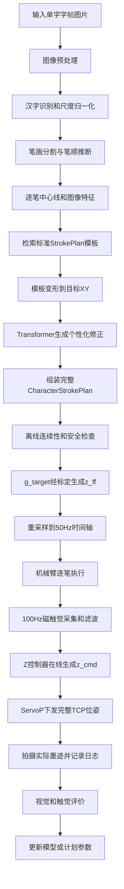

# 从一张汉字图片到机械臂复现汉字的完整流程

## 1. 最终目标

系统输入一张网上获得的单字字帖图片：

\[
I_{target}
\]

经过图像分析和 Transformer 生成该汉字的完整多笔画 `StrokePlan`，再由机械臂和磁触觉闭环执行：

\[
I_{target}
\xrightarrow{\text{图像分析}}
\text{目标笔画结构}
\xrightarrow{\text{Transformer}}
\text{CharacterStrokePlan}
\xrightarrow{\text{触觉闭环}}
I_{robot}
\]

需要准确说明：单张最终图片不能唯一恢复原作者真实动作。系统生成的是一套能够复现相似字形的可执行计划，而不是原作者动作的唯一真值。

## 2. 全流程图



系统分为两个部分：

```text
离线生成：图片 → CharacterStrokePlan → z_ff
在线执行：StrokePlan + 实时触觉 → z_cmd → ServoP
```

## 3. 输入图片和预处理

### 输入

```python
TargetCharacter(
    image,             # RGB或灰度单字图片
    character_id,      # 例如“永”，若已知
    desired_size_m,    # 纸面上的目标尺寸
    source_metadata,
)
```

网上字帖可能包含背景、印章、边框、透视和分辨率差异，因此需要：

1. 裁剪单字区域；
2. 灰度化和背景归一化；
3. 去除明显无关区域；
4. 透视校正；
5. 得到墨迹概率图和二值掩膜；
6. 缩放到统一图像尺寸；
7. 同时保留原始灰度图和处理结果。

输出：

```python
PreprocessedCharacter(
    gray_image,
    ink_probability,
    binary_mask,
    image_transform,
)
```

## 4. 汉字识别、笔画分割和笔顺

完整汉字的笔画会交叉、覆盖和连接。直接对整字骨架化可能在交叉点跳到另一条笔画，所以首先必须确定：

- 笔画数量；
- 每条笔画对应的图像区域；
- 笔画执行顺序；
- 每条笔画的起点和终点方向。

第一版建议：

```text
汉字标签
  ↓
标准笔顺/笔画数据库
  ↓
把标准笔画结构配准到目标字帖图像
```

如果没有汉字标签，则先进行字符识别，再查询候选笔顺。必要时保留多个笔画分解候选，用图像匹配分数选择。

输出：

```python
TargetCharacterStrokes(
    strokes=[
        TargetStroke(mask, order, start_hint, end_hint),
        ...
    ]
)
```

这里的笔顺只是机械臂执行顺序，不需要把笔画分类成起笔、行笔、收笔等书法阶段。

## 5. 逐笔提取目标 XY

对每条笔画：

1. 提取中心线；
2. 根据笔顺确定中心线方向；
3. 删除错误短枝；
4. 使用参数样条平滑；
5. 计算累计弧长；
6. 在归一化弧长上重采样。

定义：

\[
s\in[0,1]
\]

目标图像路径：

\[
\mathbf p_{img}(s)=[u(s),v(s)]^T
\]

通过图像到纸面的标定变换得到以米为单位的路径：

\[
\mathbf p_{xy}(s)
=
\mathbf T_{PI}
\begin{bmatrix}u(s)&v(s)&1\end{bmatrix}^T
\]

同时计算：

\[
\theta(s)=
\operatorname{atan2}\left(\frac{dy}{ds},\frac{dx}{ds}\right)
\]

\[
\kappa(s)=
\frac{x'y''-y'x''}{(x'^2+y'^2)^{3/2}}
\]

它们分别表示路径切线方向和曲率，供速度规划、姿态生成和 Transformer 使用。

## 6. 检索标准 StrokePlan 模板

数采阶段已经为横、竖、撇、捺、点、折、钩等基本笔画建立模板库。每个模板包含：

```python
TemplateStroke(
    t,
    s,
    xy,
    g_target,
    orientation_quat,
    metadata,
)
```

根据目标笔画类型、几何、方向和毛笔规格检索最接近的模板：

\[
\mathcal S_{template}
=
Retrieve(
\text{stroke type},
\text{geometry},
\text{brush metadata}
)
\]

模板为模型提供“这一类笔画通常怎样写”的动作先验。

## 7. 模板先变形到目标 XY

Transformer 不需要从零发现目标位置。先把模板通过平移、旋转、尺度和样条变形对齐目标中心线：

\[
\mathbf p_{base}(s)
=
Warp(
\mathbf p_{template}(s),
\mathbf p_{target}(s)
)
\]

初始时长可按目标长度缩放：

\[
T_{base}\approx\frac{L_{target}}{v_{template}}
\]

高曲率区域可以使用几何减速基线：

\[
v_{base}(s)=
\min\left(
v_{max},
\sqrt{\frac{a_{n,max}}{|\kappa(s)|+\epsilon}}
\right)
\]

这一步输出不使用学习模型也能执行的 `BaseStrokePlan`。

## 8. Transformer 的输入

Transformer 以单条笔画为主要生成单位，同时接收整字上下文。

### 8.1 目标笔画图像

将目标笔画裁剪图输入 CNN 或 Vision Transformer，得到视觉 token：

\[
\mathbf V=[\mathbf v_1,\ldots,\mathbf v_P]
\]

它们描述目标笔画的局部轮廓、墨迹分布和风格。

### 8.2 目标路径序列

沿中心线构造：

\[
\mathbf X_{path,i}
=
[s_i,x_i,y_i,\theta_i,\kappa_i]
\]

### 8.3 标准模板序列

输入已对齐的标准模板：

\[
\mathbf X_{template,i}
=
[s_i,x_i^T,y_i^T,g_i^T,\mathbf q_i^T,v_i^T]
\]

这里上标 \(T\) 表示 template，不表示矩阵转置。

### 8.4 毛笔与系统条件

```python
brush_metadata = {
    "brush_id": ...,
    "hair_length_m": ...,
    "tip_diameter_m": ...,
    "sensor_id": ...,
    "calibration_id": ...,
}
```

### 8.5 整字上下文

可以加入：

- 当前笔画编号和总笔画数；
- 当前笔画在整字中的位置；
- 整张字图的全局视觉特征；
- 其他笔画的低维表示；
- 目标汉字的整体尺度和朝向。

### 8.6 输入总结

\[
Input_{Transformer}
=
\{
I_{stroke},
\mathbf p_{target}(s),
\theta(s),
\kappa(s),
\mathcal S_{template},
\mathbf c_{brush},
\mathbf c_{character}
\}
\]

工程形式：

```python
transformer_input = {
    "target_stroke_image": stroke_crop,
    "target_path": [s, x, y, tangent, curvature],
    "template_plan": template_strokeplan,
    "brush_metadata": brush_metadata,
    "character_context": character_context,
}
```

## 9. Transformer 的输出

### 9.1 对外正式输出

Transformer/生成器对外输出目标汉字的完整 `CharacterStrokePlan`：

```python
CharacterStrokePlan(
    character_id,
    strokes=[
        Stroke(
            t,
            s,
            xy,
            g_target,
            orientation_quat,
            z_ff=None,
        ),
        ...
    ],
    meta,
)
```

它包含：

- 笔画数量、顺序和边界；
- 每条笔画的 XY 参考；
- 每条笔画的时间/速度规律；
- 沿路径变化的 `g_target`；
- 沿路径变化的笔杆姿态；
- 模板、模型、毛笔和坐标元数据。

### 9.2 内部推荐输出

为了降低数据需求并保证平滑，模型内部建议预测模板的低维残差控制点：

\[
\Delta\mathcal S
=
\{
\Delta\mathbf p_j,
\Delta g_j,
\Delta v_j,
\Delta\mathbf r_j
\}_{j=1}^{K}
\]

然后展开：

\[
\mathbf p_d(s)
=
\mathbf p_{base}(s)
+\sum_j\Delta\mathbf p_j\beta_j(s)
\]

\[
g_d(s)
=
g_{template}(s)
+\sum_j\Delta g_j\beta_j(s)
\]

姿态残差在旋转空间中与模板组合，不直接相加 Euler 角。展开后组装为完整 StrokePlan。因此“内部预测残差”和“对外输出完整计划”并不矛盾。

### 9.3 明确不输出

Transformer 不输出：

- 最终 `z_cmd`；
- 实时触觉反馈量；
- 机械臂实际 TCP；
- 实际磁场测量。

这些量只有真机运行时才存在。

## 10. 组装完整 CharacterStrokePlan

逐笔输出按照笔顺组装：

\[
\mathcal S_{char}
=
[\mathcal S_1,\mathcal S_2,\ldots,\mathcal S_N]
\]

整字计划还要保存：

- 图片到纸面的坐标变换；
- 毛笔、传感器和标定编号；
- Transformer 和模板库版本；
- 每个参考的生成来源。

笔间的接近、离开和安全移动由执行器加入，不需要 Transformer 将其作为书法语义生成。

## 11. 离线安全检查

Transformer 输出不能直接发送给真机，必须通过确定性检查。

### 数据检查

- 所有逐点数组长度一致；
- 时间严格递增；
- 无 NaN 或无穷值；
- 四元数单位化且符号连续；
- 笔画起终点有效。

### 运动检查

- XY 位于纸面可写区域；
- TCP 位姿位于机械臂工作空间；
- 逆运动学存在且不会跳解；
- 速度、加速度和姿态角速度不超限；
- `g_target` 位于标定和安全范围；
- 相邻参考连续。

未通过检查的计划应回退到模板基线或重新生成。

## 12. `g_target` 到 `z_ff`

对通过检查的计划，根据当前 `calibration_id` 查询标定模型：

\[
z_{ff}(s)=f_{cal}^{-1}(g_{target}(s))
\]

因此：

- `g_target` 来自 Transformer/模板生成器；
- `z_ff` 来自当前毛笔和磁传感器标定；
- 更换毛笔或装配后重新计算 `z_ff`；
- 不需要重新运行 Transformer；
- 最终 `z_cmd` 仍要等真机执行时生成。

离线计划最终包括：

```python
t
s
xy
g_target
z_ff
orientation_quat
```

## 13. 重采样到真机时间轴

StrokePlan 带时间戳且设备无关。执行前同步重采样到 Elfin 的 50 Hz 时间轴：

\[
t_k=k\times0.02\text{ s}
\]

插值规则：

- XY：线性或平滑样条；
- `g_target`：线性/单调插值；
- `z_ff`：与 `g_target` 同步；
- 姿态四元数：SLERP；
- 所有参考使用同一时间索引。

一秒笔画产生：

\[
N=1\times50=50
\]

个机械臂命令时刻。

## 14. 机械臂如何复现每条笔画

### 14.1 安全执行状态

对每条笔画：

```text
移动到笔画起点上方
下降到安全接触区域
复位Z控制器
执行笔画的XY、触觉和姿态参考
到达终点
冻结/复位积分
抬到安全高度
移动到下一笔起点上方
```

这些是机器人安全状态，不代表项目要分析书法的起笔、行笔和收笔。

### 14.2 磁触觉采集

传感器以 100 Hz 输出：

\[
\mathbf B_k=[B_{x,k},B_{y,k},B_{z,k}]^T
\]

减去无接触基线：

\[
\Delta\mathbf B_k=\mathbf B_k-\mathbf B_0
\]

先分别滤波分量，再计算项目采用的 XY 磁场变化模长：

\[
g_{xy}
=
\sqrt{\Delta B_{x,f}^2+\Delta B_{y,f}^2}
\]

### 14.3 多频率同步

\[
f_{sensor}=100\text{ Hz}
\]

\[
f_{control}=f_{robot}=50\text{ Hz}
\]

每个 20 ms 控制周期：

1. 读取该周期内到达的所有磁场样本；
2. 逐个更新 100 Hz 滤波器；
3. 使用最新滤波结果；
4. 读取当前时刻的 StrokePlan 参考；
5. 计算一次 Z 控制；
6. 下发一次 ServoP 位姿。

### 14.4 Z 控制器生成 `z_cmd`

误差为：

\[
e_{g,k}=g_{target,k}-g_{xy,k}
\]

第一版使用低增益 P：

\[
z_{fb,k}=K_Pe_{g,k}
\]

稳定后加入 PI：

\[
I_k=
\operatorname{clamp}
\left(
I_{k-1}+K_Ie_{g,k}\Delta t,
I_{min},I_{max}
\right)
\]

\[
z_{fb,k}=K_Pe_{g,k}+I_k
\]

内部压深：

\[
d_{cmd,k}=z_{ff,k}+z_{fb,k}
\]

经过压深、速度和单步变化限幅：

\[
d_{safe,k}=SafetyClamp(d_{cmd,k})
\]

转换成真实机器人 Z：

\[
z_{cmd,k}=z_{surface}+s_zd_{safe,k}
\]

其中 \(s_z\in\{-1,+1\}\) 必须通过真机低速实验确定。

### 14.5 生成完整 TCP 命令

从 StrokePlan 得到目标四元数并转换成 Elfin 需要的姿态：

\[
\mathbf q_{d,k}
\rightarrow
(R_{x,k},R_{y,k},R_{z,k})
\]

最终命令：

\[
\mathbf u_k=
[x_k,y_k,z_{cmd,k},R_{x,k},R_{y,k},R_{z,k}]^T
\]

代码形式：

```python
Command(
    tcp_pose=(
        x_ref,
        y_ref,
        z_cmd,
        rx_ref,
        ry_ref,
        rz_ref,
    )
)
```

### 14.6 ServoP 连续执行

启动：

```python
HRIF_StartServo(
    servoTime=0.02,
    lookaheadTime=0.05,
)
```

每 20 ms 下发：

```python
HRIF_PushServoP(pose, user_coord, tool_coord)
```

这里输入的是绝对 TCP 笛卡尔位姿，不是普通 PTP 点，也不是关节角。机器人内部完成逆运动学、前瞻和平滑跟踪。

## 15. 单个控制周期伪代码

```python
for stroke in character_plan.strokes:
    move_above(stroke.xy[0])
    establish_safe_contact()
    z_controller.reset()

    for t in control_timeline(stroke, fs=50.0):
        samples = sensor.read_new()
        for B_raw in samples:
            dB = B_raw - B_baseline
            dB_filtered = filter.update(dB)

        g_measured = hypot(dB_filtered[0], dB_filtered[1])

        x_ref, y_ref = interpolate_xy(stroke, t)
        g_target = interpolate_g(stroke, t)
        z_ff = interpolate_z_ff(stroke, t)
        q_ref = slerp_orientation(stroke, t)

        z_feedback = z_controller.step(
            g_target=g_target,
            g_measured=g_measured,
            dt=0.02,
        )

        depth_cmd = safety_clamp(z_ff + z_feedback)
        z_cmd = depth_to_robot_z(depth_cmd)
        rx, ry, rz = quaternion_to_elfin_euler(q_ref)

        robot.push_servo_p(
            x_ref, y_ref, z_cmd,
            rx, ry, rz,
        )

        execution_log.append(...)

    lift_safely()
```

## 16. 执行日志

每次执行必须保存：

- 时间戳；
- 目标 XY 和实际 XY；
- `g_target` 和 `g_measured`；
- 原始 `Bx/By/Bz`；
- 滤波后的磁场；
- `z_ff`、`z_feedback`、`z_cmd`；
- 目标姿态和实际姿态；
- 限幅、安全状态和周期 overrun。

`ExecutionLog` 与输入图片、模型版本、StrokePlan 和最终墨迹图片使用同一个 `run_id` 关联。

## 17. 复刻结果评价

完成整字后，由固定相机拍摄：

\[
I_{robot}
\]

### 控制层

- XY 跟踪 RMSE；
- 目标磁触觉跟踪 RMSE；
- Z 命令稳定性；
- 姿态跟踪误差；
- 限幅、stale 和 overrun 次数。

### 笔画层

- 中心线距离；
- 轮廓 IoU；
- 边缘距离；
- 折角位置和方向误差。

### 整字层

- 整体结构；
- 笔画间相对位置；
- 重心和包围盒误差；
- 目标与实际图像相似度。

## 18. 视觉反馈如何继续改进

第一次生成：

\[
\mathcal S_0=Generator(I_{target})
\]

执行得到：

\[
I_0=RobotWrite(\mathcal S_0)
\]

根据视觉误差更新：

\[
\mathcal S_1
=
Update(\mathcal S_0,I_{target},I_0)
\]

优先只修正低维、安全的参数：

- 少量 XY 样条控制点；
- `g_target` 样条控制点；
- 局部速度；
- 倾角和倾斜方向控制点。

视觉优化更新下一次执行的 StrokePlan；磁触觉闭环则在每一次执行中稳定接触。两者属于不同层级。

## 19. Transformer 的训练数据

标准笔画数采形成：

\[
(\mathcal S_k,\mathbf b_k,I_k,Log_k)
\]

其中：

- \(\mathcal S_k\)：已知执行计划；
- \(\mathbf b_k\)：毛笔与标定参数；
- \(I_k\)：实际墨迹图像；
- \(Log_k\)：实际轨迹和触觉日志。

训练时：

```text
输入：实际墨迹图像 + 目标中心线 + 标准模板 + 毛笔参数
标签：产生该墨迹的已知StrokePlan
```

损失可包含：

\[
L=
\lambda_{xy}L_{xy}
+\lambda_gL_g
+\lambda_RL_R
+\lambda_vL_v
+\lambda_sL_{smooth}
+\lambda_{safe}L_{safe}
\]

由于图像到动作存在多解，后续可加入前向墨迹预测或机器人试写视觉损失，允许不同但同样有效的动作计划。

训练和实际使用的区别：

```text
训练：已知墨迹图像 + 已知执行计划 → 学习如何修改模板
推理：网上字帖图像 + 标准模板 → 生成新汉字StrokePlan
```

## 20. 示例计划结构

```yaml
character_id: 永
format_version: 3
brush_id: brush_01
sensor_id: mlx90393_01
calibration_id: cal_2026_01
source_image_id: copybook_001
generator_version: transformer_v1
strokes:
  - stroke_id: 0
    order: 0
    t: [...]
    s: [...]
    xy: [[...], [...]]
    g_target: [...]
    z_ff: [...]
    orientation_quat: [[...], [...]]
  - stroke_id: 1
    order: 1
    t: [...]
    s: [...]
    xy: [[...], [...]]
    g_target: [...]
    z_ff: [...]
    orientation_quat: [[...], [...]]
```

## 21. 每个模块的接口

| 模块 | 输入 | 输出 |
|---|---|---|
| 图像分析 | 单字图片 | 有序笔画、XY 和图像特征 |
| 模板检索 | 目标笔画特征 | 标准 StrokePlan 模板 |
| Transformer | 目标图像、XY、模板、毛笔参数 | 完整汉字 StrokePlan |
| 标定模块 | `g_target`、`calibration_id` | `z_ff` |
| 触觉控制器 | `g_target`、实时 `g_measured`、`z_ff` | `z_cmd` |
| ServoP 执行器 | XY、`z_cmd`、目标姿态 | 连续机器人运动 |
| 视觉评价 | 目标和实际墨迹 | 误差及计划修正依据 |

## 22. 最简总结

整个系统可以概括为：

> 从字帖图像中获得“写什么和在哪里写”，从标准笔画模板获得“基本应该怎样写”，由 Transformer 针对目标汉字和毛笔参数生成完整的个性化 StrokePlan；执行时，机械臂按照计划连续跟踪 XY 和姿态，磁触觉控制器根据实时接触误差在线生成 `z_cmd`，最终通过 ServoP 完成复刻。

Transformer 的正式输入：

```text
目标笔画/汉字图像
目标XY路径及几何特征
标准StrokePlan模板
毛笔、传感器和整字上下文
```

Transformer 的正式输出：

```text
目标汉字的完整多笔画StrokePlan
= 每笔XY + 时间 + g_target + 姿态 + 顺序/边界
```

实时控制器的输出：

```text
每20 ms的 [x, y, z_cmd, Rx, Ry, Rz]
```
