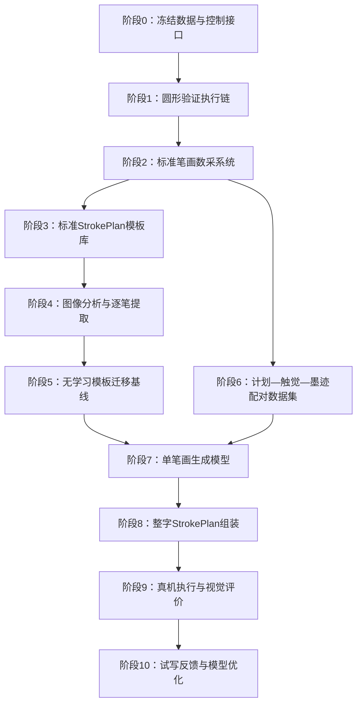

# 从字帖图像生成 StrokePlan 的实现路径图

> 最终目标：输入一张网上字帖中的汉字图像，生成该汉字的完整多笔画 `StrokePlan`；执行器依据计划中的 XY、时间、目标触觉和姿态参考，在运行时生成 `z_cmd`，通过 Elfin ServoP 复现汉字。

## 1. 总体路径图



主线原则：

1. 先证明机械臂能可靠执行计划；
2. 再建立标准笔画动作先验；
3. 先完成模板几何迁移基线；
4. 有可靠配对数据后再训练 Transformer；
5. Transformer 生成计划，实时控制器生成 `z_cmd`。

## 2. 系统模块边界

```text
目标汉字图像
      ↓
Image Analyzer
笔画区域、顺序、XY中心线、局部图像特征
      ↓
StrokePlan Generator
模板检索 + 几何变形 + Transformer修正
      ↓
CharacterStrokePlan
多条 Stroke(t, s, xy, g_target, orientation)
      ↓
Calibration
g_target → z_ff
      ↓
Runtime Executor
50 Hz路径插值 + 100 Hz触觉采集/滤波
      ↓
Z Controller
z_ff + 实时触觉反馈 → z_cmd
      ↓
Elfin ServoP
```

## 3. 阶段 0：冻结 StrokePlan V3 契约

### 目标

先确定所有后续模块共同使用的数据格式，避免数采完成后再次迁移数据。

### 建议结构

```python
@dataclass
class Stroke:
    t: np.ndarray                 # (M,), s
    s: np.ndarray                 # (M,), [0,1]
    xy: np.ndarray                # (M,2), m
    g_target: np.ndarray          # (M,), uT
    orientation_quat: np.ndarray  # (M,4), qw qx qy qz
    z_ff: np.ndarray | None       # (M,), m，标定派生

@dataclass
class CharacterStrokePlan:
    character_id: str
    strokes: list[Stroke]
    meta: dict
```

### Metadata 至少包含

```yaml
format_version: 3
coordinate_frame: paper
position_unit: m
time_unit: s
magnetic_unit: uT
brush_id: ...
sensor_id: ...
calibration_id: ...
source_image_id: ...
plan_source: generated/template/transformer
```

### 设计纪律

- `g_target` 是计划参考；
- `z_ff` 是标定派生量，可以缓存；
- `z_cmd` 绝不写入 StrokePlan；
- 实际 TCP、实际磁场和实际 `z_cmd` 写入 `ExecutionLog`；
- 姿态内部保存四元数，执行前转换为 Elfin Euler 角。

### 验收门

- 保存—加载数据无损；
- 所有逐点数组长度一致；
- 时间严格递增；
- 四元数归一化且符号连续；
- 旧格式可以显式转换到 V3。

## 4. 阶段 1：用圆形验证完整执行链

### 目的

圆形不是最终任务，只用于隔离验证执行器、频率、坐标和触觉闭环。

### 实现内容

- 解析生成圆形 XY；
- 固定姿态；
- 第一轮使用恒定 `g_target`；
- StrokePlan 按时间插值到 50 Hz；
- 传感器保持 100 Hz；
- 每个 20 ms 控制周期消费约两个磁场样本；
- Z 控制器输出 `z_cmd`；
- ServoP 连续下发 TCP 位姿。

### 必须修复的当前代码问题

1. 将单一 `config.FS` 拆分为传感频率和真机控制频率；
2. `ZController.dt` 与 50 Hz 对齐为 0.02 s；
3. 磁触觉量按项目定义使用 XY 模长；
4. 统一压深正方向与机器人世界 Z 符号；
5. 增加时间戳插值，不再只依赖整笔 duration；
6. 日志分别记录参考值、测量值和命令值。

### 验收门

- 悬空圆的 XY 轨迹连续且方向正确；
- 接触圆不发生持续振荡；
- 机械臂每秒收到 50 个有效位姿命令；
- 传感器数据无持续 stale；
- 固定 Z、前馈、P/PI 三组结果可以比较；
- 急停、传感器失效抬离和 Z 限幅有效。

## 5. 阶段 2：建立标准笔画数采平台

### 目的

建立“标准动作先验”，使后续模型不是从单张图像盲猜动作。

### 第一批笔画

先选能够覆盖基本几何的少量原型：

- 横；
- 竖；
- 撇；
- 捺；
- 点；
- 折或钩。

不需要一开始覆盖全部书法笔画分类。

### 每次实验控制变量

```text
路径长度和尺度
曲率/折角大小
执行速度
目标磁触觉等级
倾斜角
倾斜方位相对路径的偏置
轴向旋转角
毛笔规格
```

### 每次必须保存

```text
计划：完整StrokePlan
命令：每拍ServoP目标
状态：实际TCP位姿
触觉：原始Bx/By/Bz、基线、滤波值、g_xy
图像：标准化拍摄的最终墨迹
环境：毛笔、墨液、纸张、标定和时间信息
```

### 图像采集要求

- 相机固定；
- 纸面使用固定坐标标记；
- 固定照明和曝光；
- 保存原图，不只保存二值化结果；
- 每次试写对应唯一 `run_id`；
- 图像、StrokePlan 和日志通过相同 `run_id` 关联。

### 验收门

- 相同计划重复执行的墨迹差异可量化；
- 所有实验都能从 `run_id` 找到计划、日志和图像；
- 触觉基线和装配编号没有混淆；
- 至少能观察到速度、目标触觉或姿态变化对墨迹的稳定影响。

## 6. 阶段 3：建立标准 StrokePlan 模板库

### 模板定义

每个笔画类型选择一条经过验证的标准计划：

```text
TemplateStrokePlan
├── 标准化XY路径
├── 标准时间规律
├── 标准g_target曲线
├── 标准姿态曲线
└── 适用毛笔和标定条件
```

### 归一化

模板使用：

\[
s\in[0,1]
\]

并将几何放在标准局部坐标系内。长度、旋转和平移在匹配目标字帖时再恢复。

### 不能忽略的变化

每类笔画除了一个中心模板，还应保留若干参数化变体或有效范围：

```yaml
length_range: ...
speed_range: ...
g_target_range: ...
tilt_range: ...
brush_ids: [...]
```

### 验收门

- 任一模板可以独立执行；
- 模板缩放到不同长度后时间和速度仍合理；
- 更换 `calibration_id` 后可以重新生成 `z_ff`；
- 模板姿态连续且满足机器人关节范围。

## 7. 阶段 4：目标字帖图像分析

### 输入

网上获得的单字字帖图像。

### 输出

```python
ImageCharacterPlan(
    character_mask,
    strokes=[
        TargetStroke(mask, centerline_xy, order, local_features),
        ...
    ]
)
```

### 子任务

1. 图像去背景、透视校正和尺度归一化；
2. 汉字区域分割；
3. 笔画分解；
4. 笔顺推断；
5. 中心线提取；
6. 中心线分支和交叉点处理；
7. 参数曲线和平滑弧长重采样；
8. 每条笔画局部图像特征编码。

### 风险

单张图像中的交叉和重叠会使笔画分解不唯一。需要使用汉字笔顺数据库、标准字体结构或候选搜索，而不能只靠骨架图的连通性。

### 验收门

- 每个目标字能够输出有序笔画列表；
- 中心线不会在交叉点错误跳到另一笔；
- XY 路径可转换到纸面坐标并位于机器人工作空间；
- 人工检查工具可以显示图像、笔画编号和运动方向。

## 8. 阶段 5：先建立无学习模板迁移基线

### 原因

没有基线就无法证明 Transformer 是否真正带来提升。

### 基线方法

1. 按笔画类型检索标准模板；
2. 通过平移、旋转、尺度和样条形变对齐目标中心线；
3. 时间按照目标路径长度缩放；
4. `g_target` 和姿态先沿用标准模板；
5. 在高曲率区域自动减速；
6. 生成完整 CharacterStrokePlan。

可写为：

\[
\mathcal S_{base}
=
\operatorname{Warp}
(\mathcal S_{template},\mathbf p_{target})
\]

### 验收门

- 不使用神经网络即可从若干目标汉字生成并执行计划；
- 所有输出通过速度、姿态和工作空间安全检查；
- 得到基线视觉相似度和触觉跟踪指标。

## 9. 阶段 6：构建训练数据集

### 样本单位

优先以单条笔画为训练样本：

```python
TrainingSample(
    target_ink_image,
    target_centerline,
    stroke_type,
    template_strokeplan,
    brush_metadata,
    executed_strokeplan,
    execution_log,
)
```

### 配对来源

机器人执行已知计划，得到实际墨迹：

\[
(\mathcal S_k,\mathbf b_k)\rightarrow I_k
\]

训练逆生成时可把 \(I_k\) 作为目标图像、\(\mathcal S_k\) 作为一组有效动作标签。

### 数据划分

必须防止数据泄漏：

- 同一次执行及其增强版本只能属于同一划分；
- 验证集保留未见过的几何变化；
- 测试集保留未见过的完整汉字；
- 若研究跨毛笔泛化，测试集保留未见过的 `brush_id`。

### 数据质量检查

- 图像与运行日志时间/编号一致；
- 无异常中止或异常样本明确标记；
- 四元数连续；
- 所有单位统一；
- 目标和实际 TCP 不混淆；
- 数据集版本固定并可复现。

## 10. 阶段 7：训练单笔画生成模型

### 输入

```text
目标笔画图像特征
目标XY中心线序列
标准模板StrokePlan
毛笔与标定元数据
```

### 模型内部输出

先预测低维样条控制点：

\[
\Delta\mathcal S=
\{\Delta p_j,\Delta g_j,
\Delta R_j,\Delta v_j\}_{j=1}^{K}
\]

再展开成完整计划：

\[
\mathcal S_{pred}
=
\operatorname{Warp}(\mathcal S_{template})
+\operatorname{Expand}(\Delta\mathcal S)
\]

### 对外输出

模型对外仍输出完整单笔画：

```python
Stroke(t, s, xy, g_target, orientation_quat)
```

### 损失函数

第一版可包含：

\[
L=
\lambda_{xy}L_{xy}
+\lambda_gL_g
+\lambda_RL_R
+\lambda_tL_t
+\lambda_{smooth}L_{smooth}
+\lambda_{safe}L_{safe}
\]

其中：

- `L_xy`：路径参考差异；
- `L_g`：目标触觉曲线差异；
- `L_R`：四元数/旋转距离；
- `L_t`：时间或速度差异；
- `L_smooth`：速度、加速度和姿态连续性；
- `L_safe`：越过已知安全范围的惩罚。

### 训练顺序

1. 冻结图像编码器或使用简单特征；
2. 只预测 XY 几何残差；
3. 加入速度；
4. 加入 `g_target`；
5. 最后加入姿态；
6. 每增加一项都与前一个消融版本比较。

### 验收门

- 在未见几何上优于纯模板迁移；
- 输出满足平滑和安全约束；
- 模型预测的计划可在仿真和真机执行；
- 触觉闭环没有因预测曲线突变而失稳。

## 11. 阶段 8：从单笔画扩展到整字

### 第一版不需要整字端到端 Transformer

先对每条笔画分别生成：

\[
\mathcal S_{char}
=
[\mathcal S_1,\mathcal S_2,\ldots,\mathcal S_N]
\]

再由组装器加入：

- 笔画执行顺序；
- 字符坐标变换；
- 笔间安全移动；
- 每笔独立控制器状态复位；
- 总体速度和尺度约束。

### 后续整字上下文模型

当逐笔生成稳定后，再让 Transformer 使用整字上下文调整：

- 同一汉字中各笔画的尺度一致性；
- 相邻笔画空间关系；
- 全字风格一致的触觉和姿态参数；
- 整体布局。

### 验收门

- 计划包含正确笔数和顺序；
- 笔间移动不会接触纸面；
- 单笔画控制参考在整字执行中没有错位；
- 整字布局误差可量化。

## 12. 阶段 9：真机评价体系

### 控制层指标

- XY TCP 跟踪 RMSE；
- `g_target` 跟踪 RMSE；
- Z 命令峰峰值和高频能量；
- 姿态跟踪误差；
- 限幅、stale 和 overrun 次数。

### 笔画层视觉指标

- 中心线距离；
- 轮廓 IoU；
- 边缘 Chamfer 距离；
- 局部结构相似度；
- 折角位置和方向误差。

### 整字层指标

- 字符包围盒和重心误差；
- 笔画间相对位置；
- 整体结构相似度；
- 未见汉字上的泛化性能。

### 必须包含的消融实验

1. 纯 XY；
2. XY + 固定触觉；
3. XY + 模板触觉；
4. 模板迁移；
5. 模板 + 学习残差；
6. 无姿态变化与有姿态变化；
7. 开环 Z 与磁触觉闭环 Z。

## 13. 阶段 10：视觉结果反馈优化

Transformer 给出初始计划后，机器人试写并拍照：

\[
\mathcal S_0=G(I_{target})
\]

\[
I_k=RobotWrite(\mathcal S_k)
\]

\[
\mathcal S_{k+1}
=
\operatorname{Update}
(\mathcal S_k,I_k,I_{target})
\]

优先只优化少量安全参数，例如：

- 触觉样条控制点；
- 倾角控制点；
- 局部速度；
- 小范围 XY 法向偏置。

不要在线自由修改所有50 Hz位姿点。

## 14. 推荐代码目录

```text
src/brushbot/
├── strokeplan.py              # V3数据契约
├── plan_generation/
│   ├── circle.py              # 圆形验证计划
│   ├── templates.py           # 标准模板库
│   ├── warp.py                # 模板到目标几何变形
│   ├── assemble.py            # 整字组装
│   └── safety.py              # 计划离线安全检查
├── vision/
│   ├── preprocess.py
│   ├── stroke_segment.py
│   ├── centerline.py
│   └── registration.py
├── learning/
│   ├── dataset.py
│   ├── image_encoder.py
│   ├── stroke_transformer.py
│   ├── losses.py
│   └── train.py
├── runtime.py                 # 50 Hz执行器
├── z_control.py               # 实时触觉控制
└── backends/huayan.py         # ServoP接口

data/
├── templates/
├── runs/
│   └── RUN_ID/
│       ├── plan.npz
│       ├── execution.csv
│       ├── ink_raw.png
│       └── meta.json
├── copybooks/
└── datasets/
```

## 15. 当前最近的工作顺序

现在不要立即开始 Transformer 训练。最近的实现顺序应是：

1. 实现 `StrokePlan V3`；
2. 拆分 100 Hz 传感与 50 Hz 控制频率；
3. 实现圆形计划生成器；
4. 完成真机圆形 XY 和触觉闭环；
5. 建立统一 `ExecutionLog`；
6. 建立标准化墨迹拍摄和 `run_id` 数据目录；
7. 选择第一批基本笔画；
8. 采集第一批标准模板和参数变化数据；
9. 实现目标图像到模板的非学习迁移；
10. 数据规模和质量通过检查后训练单笔画模型。

## 16. 最终里程碑

| 里程碑 | 交付结果 |
|---|---|
| M1 | 圆形在真机上稳定执行，触觉闭环有效 |
| M2 | StrokePlan V3、ExecutionLog 和数据目录定稿 |
| M3 | 基本笔画标准模板库可重复执行 |
| M4 | 字帖图像可转换为有序目标笔画和 XY 中心线 |
| M5 | 不使用神经网络即可生成并执行整字计划 |
| M6 | 单笔画模型优于模板迁移基线 |
| M7 | Transformer 输出完整汉字 StrokePlan |
| M8 | 未见汉字可以真机复刻并通过视觉、触觉指标评价 |

这一路线把最终研究贡献分成三个可以分别验证的部分：

1. 字帖图像到可执行 StrokePlan 的生成；
2. 标准笔画动作先验到新字形的迁移；
3. 磁触觉闭环相对开环执行的改进。
