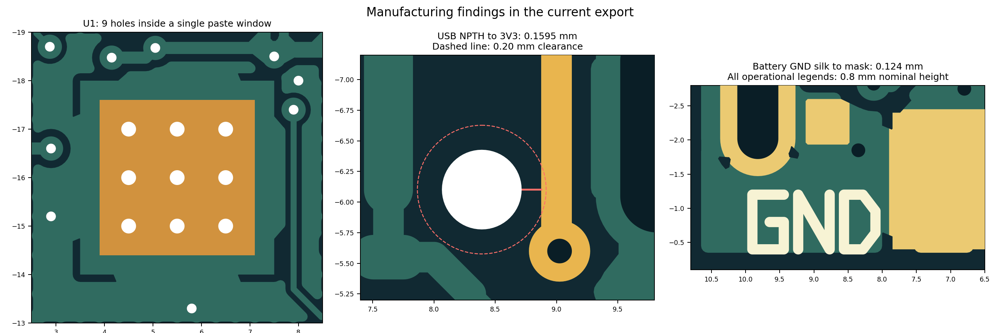
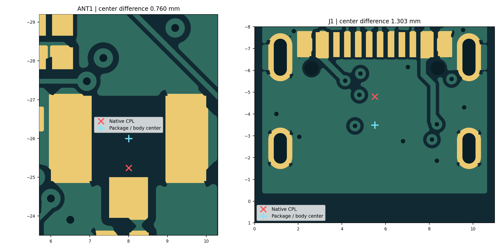
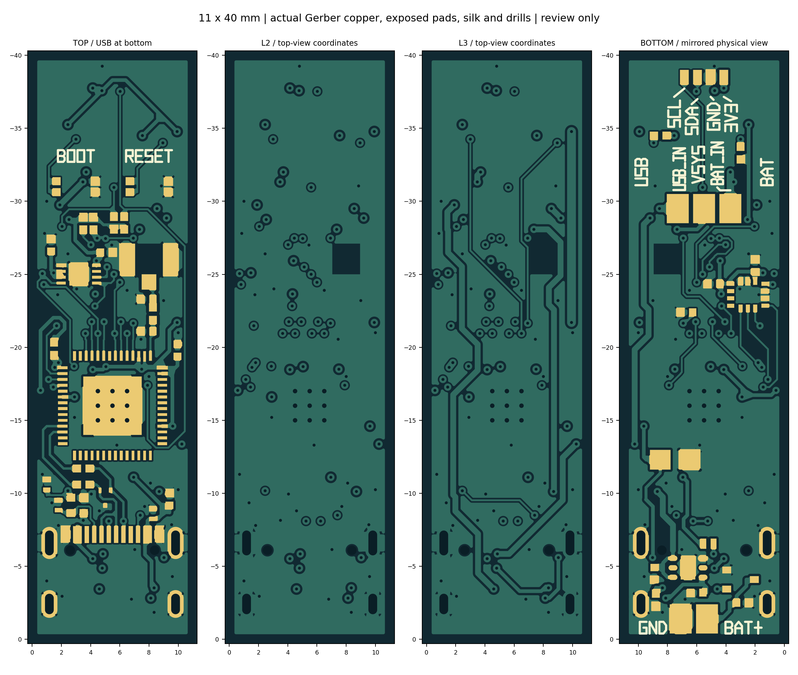

# 11 × 40 mm 四层笔杆板：下单前审查

**后续 VSYS 修改已完成（2026-11-05）：**U5 旁短颈已改为 0.40 mm 并加入相切渐变，邻近地过孔微移；原生重铺、保存重开后 DRC 0、27/27 连通，新 Gerber 检查通过。当前 PCB 及审核包请使用 [2026-11-05 验证记录](verification/20261105_vsys/README.md)和 README 中的新入口。以下为原下单前审查及工厂分工的历史记录，不是对本次 VSYS 微调的重复全流程审厂。

**后续两项微调已完成（2026-11-04）：**用户授权后已在原 PCB 完成 USB 孔旁 3V3 避让和电池 GND 字移动。孔边至走线 **0.2035 mm**，线宽保持 **0.25 mm**；电池 GND 实际 Gerber 露铜间距 **0.196541 mm**。保存重开后原生 DRC 0、27/27 连通，新 Gerber 27 网各一个连通组，无短路、漏盘或悬空铜岛。原理图、网表和器件未改。见 [本轮修改与验证](verification/20261104_usb_gnd/README.md)。下文保留微调前审查证据，P1-02 的功能走线和 P2-01 的电池 GND 字建议已完成；USB 孔周地铜、盘中孔、钢网及其他制造事项仍按工厂分工处理。

审查日期：2026-11-04。范围为当前单页六格原理图、四层 PCB、网页新导出的 Gerber／钻孔／BOM／CPL，以及 TB01 实际下单经验。本轮为只读审查，未更改正式原理图、PCB、规则或网表，未提交订单。

**结论（按嘉立创工艺重新分类）：电气连接和 CAD 一致性检查通过；没有发现必须修改原理图的事项。现有设计可以带着明确问题进入工厂工程审核，不需要先把所有项目都改进 PCB。主控盘中孔工艺、钢网分窗、拼板与贴装库对位可由工厂工程处理并确认；建议本地只做 USB 定位孔旁 3V3 避让及电池 GND 字位置的小调整。当前尚未取得本版生产稿和工艺确认，因此不是生产放行。**

本报告初版将“生产前必须确认”过度归类成“送审前必须修改设计”，现予以更正：0.8 mm 字高可选择高精字符；USB_IN 到实际露铜约 0.196 mm，不能因为到阻焊开窗约 0.145 mm 就判为不符合 0.15 mm 焊盘距离要求。实际 GND 露铜会延伸到开窗边界，其间距约 0.124 mm 的问题仍存在。

用户已明确确认：**TB01 已成功下单、制造并测试成功。** 本报告采用这个最新状态；旧交接材料中“未生产／未测试”是当时记录，不能再作为 TB01 的现状。具体测试覆盖范围和量测值未在本轮提供，因此不把该结论扩展为长条板实测通过。

## 优先处理的实际问题

| 编号 | 本轮证据 | 影响和处理要求 |
|---|---|---|
| P1-01：U1 中央焊盘的制造方式发生变化 | 当前 EP 为 4 × 4 mm，锡膏为单个约 3.2 × 3.2 mm 开口，覆盖率约 64%；9 个约 Ø0.305 mm 过孔均落在开口内，顶面露孔、底面盖油。TB01 原始 CAM 是四个窗口、EP 内无孔；工厂最终预览进一步分成 12 个窗口 | **先交 PCB＋SMT 工程确认工艺，不强制移孔。**嘉立创有四层付费树脂塞孔加电镀盖帽方案，须确认本订单可选及孔位处理；可接受则保留布局，不能接受再改孔位。普通盖油不能等同于填平盖帽。64% 锡膏面积符合其 60～70% 指导范围，大开口需要分窗架桥，可在工厂钢网资料中处理，不必先改铜焊盘 |
| P1-02：USB 定位孔与铜太近 | 两个 NPTH 中心为顶视坐标 (2.61, −6.102)、(8.39, −6.102) mm，孔径 Ø0.651 mm。四层地铜最近约 0.101～0.102 mm；右孔距底层 `3V3` 走线 `gge990001413` 仅 0.1595 mm，该线宽 0.25 mm。TB01 对应孔距顶铜约 0.2097 mm | **建议本地小改，也可明确交 CAM 工程处理。**最终制造资料需满足孔周 0.20 mm 清铜。地铜清除属于常规处理；功能走线可能被削窄，不能仅凭“审核通过”默认影响为零。推荐将 3V3 局部让开并重铺铜；若交厂，须检查最终保留线宽、铜形及连通。当前差额本身不证明必然断线 |
| P1-03：贴装范围和非对称封装原点需对位 | 原生导出包含 43 位号；本板实际 SMT 是 **38 件：顶面 24、底面 14，22 种 MPN**。ANT1 原生 MidY=25.24 mm，连接器几何中心 26.00 mm；J1 原生 MidY=4.80 mm，厂家壳体几何中心约 3.4974 mm | **属于输出与贴装工程核对，不要求改原理图或 PCB。**用 38 件草案明确 C30/C31 不装、J2/J4/SW1 手焊；以厂家机器库取料基准和逐脚叠图为准。几何中心与原点不同不等于必然贴错，中心校正草案也不是已核准的机器坐标。核验底面角度和极性，不能手动重复镜像底面坐标 |
| P2-01：丝印工艺选择及一处距离 | 13 组功能字标称高 0.80 mm、笔画 0.15 mm。实际 Gerber 底面丝印到露铜最近约 0.124 mm，位于电池 GND；USB_IN 到开窗约 0.145 mm，但到露铜约 0.196 mm | **字高可保留，选“高精字符”；无需统一加到 1.0 mm。**GND 距离小于 0.15 mm，建议稍移字以保留完整可读性；也可交厂削字后核对生产稿。USB_IN 不再按开窗距离判为硬性问题。保留 BOOT、RESET、USB/BAT 与各焊盘功能名称，不恢复无关位号 |

上述尺寸来自当前实际导出文件。依据为 [嘉立创无铜孔说明](https://www.jlc.com/portal/q7i4061.html)、[字符设计规范](https://www.jlc.com/portal/t6i10417.html)、[钢网规范](https://www.jlc.com/portal/q6i974.html)、[盘中孔规则](https://www.jlc.com/portal/t7i38630.html)及[下单技术说明](https://www.jlc.com/portal/t7i1325.html)。四层盘中孔方案需按订单选择并核价，不能假定包含六层及以上的免费工艺；无需因此直接改成六层。PCB 工厂审核处理可制造性，SMT 工程处理贴装和钢网，两者都不能代替原理图功能审查。

## 从已成功的 TB01 继承什么

已核对 TB01 的实际工厂 BOM、贴装对位图、钢网图及交付源。长条板与测试板共用的 **35 件 SMT 器件**，准确型号、铜焊盘尺寸及脚距没有检出变化；新增 R12/R13/R14，删除旧 R11 和测试板的 R40～R51 隔离电阻。没有因为改小板而缩小这 35 件的铜焊盘。该比较不表示阻焊、锡膏和热过孔也保持相同，相关差异已单列。

| 项目 | 本次采用的经验 | 本版需要单独落实的差异 |
|---|---|---|
| 核心器件与采购 | 沿用 ESP32-S3-PICO-1-N8R8、MLX90393、LSM6DSOX、TLV75533、USB4105 等准确型号 | TB01 的 U1 曾用客户寄料；新单现货或寄料数量按新单核对，历史库存不代表现在库存 |
| BOOT／RESET 按键 | 官方型号 EVPBB2A9B000 对应商城 EVP-BB2A9B000／**C4365176**；测试板已有成功匹配记录 | 不再把商品编码空白当作型号不明，也不按外形替换 |
| U6 钢网 | TB01 工厂图约为三个 0.30 × 0.30 mm 孔，与 TI 示例吻合 | 本版原生锡膏又是 0.20 × 0.30 mm；应申请复用成功单的工厂修正方案。无需机械地指定“必须 0.08 mm”；实际厚度及开孔以生产稿为准 |
| U1 钢网 | TB01 的最终工厂图采用中央分窗 | 本版新增 9 个盘中孔，必须同时解决孔与锡膏的关系；只复制分窗图不够 |
| BOM／CPL | 过滤不装件、手焊位；校正非对称封装中心；逐脚看贴装预览 | 由 48 件顶面 SMT 变为 38 件双面 SMT，位置和面别全部重新核验 |
| 板厂流程 | 采用标准型 SMT、人工工程审核、锣槽／连接桥与工艺框；细间距器件可沿用沉金经验 | 80 × 60 mm、2 层 1.6 mm 的旧框与叠层不能复制到 11 × 40 mm、4 层 0.8 mm 的新板 |
| 实板功能 | TB01 制造与测试成功作为器件和基础电路的重要实证 | 新板改为两路 I²C＋四线 SPI、SW1 强制选源，且器件布局、回流和散热不同，需要新的首板复测 |

TI 的 DRT 钢网示例为 0.30 mm 方孔、厚度上限 0.1016 mm；这支持测试板工厂扩孔方案，而非要求一律采用 0.08 mm。Panasonic 按键另有 0.08 ± 0.01 mm 推荐钢网条件，需要由工厂结合成功订单及双面回流工艺统一落实。[TI TPD2EUSB30A 图纸](https://www.ti.com/lit/ds/symlink/tpd2eusb30a.pdf)，[Panasonic EVPBB 图纸](https://industrial.panasonic.com/cdbs/www-data/pdf/ATK0000/ATK0000C362.pdf)。

## 原理图审查结果

本轮重新打开网页端六格原理图并下载源文件。与正式版本相比，仅编辑器版本、43 个实例缓存 ID、总图框 BBox 的 y／height 元数据不同；图元、引脚、参数和连线保持一致。随后用新下载的 SCH、PCB 与正式原生网表逐脚比较：**43 位号、190 逻辑脚、193 实际焊盘、27 网络；147 有网脚、43 明确 NC，差异 0。** USB 外壳四个物理焊盘共用 SH 编号是设计定义。

| 模块 | 核验结果 |
|---|---|
| ESP32-S3-PICO-1 最小系统 | 3V3 电源脚及 EP/GND 接法一致；保留 22 µF、100 nF、电源与复位去耦；CHIP_PU 为 10 kΩ／1 µF，GPIO0 上拉和 BOOT／RESET 保留。没有将内部 Flash／PSRAM 占用脚作为新总线脚使用 |
| 笔头 I²C | GPIO1/2 → J4 SDA/SCL，R5/R6 各 4.7 kΩ；J4=3V3、GND、SDA、SCL。该针序是本板焊盘定义，外部模块需按其标注接线 |
| 板载 MLX90393 | GPIO6/7 为独立 I²C，R12/R13 各 4.7 kΩ；CS 接 VDDIO，MISO 未接，INT 接 GPIO4；VDD/VDDIO 去耦与 EP 接地保留。与厂家 I²C 引脚建议相符 |
| LSM6DSOX | GPIO10=CS、11=MOSI、12=SCK、13=MISO，INT1 接 GPIO5；R14 将 CS 上拉至 3V3。SDx/SCx 接地，辅助端口不使用，符合主接口 Mode 1 的四线 SPI 接法；固件需按 SPI 配置，不能继续当作 0x6A 的 I²C 器件 |
| USB-C | D−/D+ 对应 GPIO19/20，经各 22 Ω 串阻；两面 USB2 数据脚合并，CC1/CC2 各有独立 5.1 kΩ 下拉；SBU 未用。U6 为 1=D+、2=D−、3=GND，电源／CC 保护器件保留 |
| 强制选源 | SW1.1=BAT_IN、.2=VSYS、.3=USB_IN；U5 IN、EN 同接 VSYS。USB→D4→USB_IN；BAT_P→Q1→BAT_IN。Q1 专用 CAD 盘号 1=D、2=G、3=S，对应厂家物理 3、1、2，不能用普通 1/2/3 盘序直接替换 |
| RF／其他 | R30=0 Ω 保留；C30/C31 默认不装。U.FL 接外置天线。没有板载充电器，电池仍板外充电；未发现误加充电或自动回退通路 |

芯片依据：[ESP32-S3-PICO-1](https://www.espressif.com/sites/default/files/documentation/esp32-s3-pico-1_datasheet_en.pdf)、[MLX90393](https://www.melexis.com/-/media/files/documents/datasheets/mlx90393-datasheet-melexis.pdf)、[LSM6DSOX](https://www.st.com/resource/en/datasheet/lsm6dsox.pdf)、[TLV755P](https://www.ti.com/lit/ds/symlink/tlv755p.pdf)、[DMP2165UW](https://www.diodes.com/_files/datasheets/DMP2165UW.pdf)。ST 原厂索引中的 Mode 1 引脚说明已核对；本轮完整 PDF 下载超时，没有把下载失败写成已完成全册视觉检查。

**供电边界：**主供电通路满足“所选电源未接就不上电”；没有自动切换到另一电源。SW1 需使用先断后接的外置 SPDT，承载完整输入电流；切换允许复位。电池电压降至 LDO 所需压差以下时，3V3 会下降，不能把电池保护板的深放截止值当作正常工作下限。U5 的 500 mA 是器件额定值，窄板 USB 供电的温升及瞬态仍需复测，不据此要求无依据更换已用过的稳压器。

**VBUS 边界修正：**用户此前已要求取消检测支路，测试板也按此制造并测试成功。本轮不以“缺少比较器”为由强制重做原理图。USB 档下拔除 USB 会失去主供电；但 BAT 档仍供电时，现有硬件没有独立 VBUS／SW1 位置检测，不能据此宣称已实现自供电 USB 的插拔检测与合规断开。协议掉线回调不等于 VBUS 电压检测；若实际用途包含电池供电同时保持 USB 设备连接，此项需单独解决。对于按已定用途打样，它列为明确的功能边界。[Espressif 自供电 USB 要求](https://docs.espressif.com/projects/esp-usb/en/latest/esp32s3/usb_device.html#self-powered-device)。

本项是逐脚和电路人工审查，**不是一次完整电气规则 ERC**；标准版没有在本轮提供可验证的完整 ERC 报告。

## PCB／CAM 审查结果

| 检查项 | 本轮结果与边界 |
|---|---|
| 正式源身份 | 网页新导出 PCB 与当前正式源逐字节相同；PCB SHA256 为 `c55a10de161cae77b013ed8a844aacdf387a702aa9c9ca3cf26327b29e45190b` |
| 原生 DRC／连通 | 本轮重新执行：**DRC 0，27/27 网络连通** |
| 实际 Gerber 铜连通 | 按四层铜与真实镀孔连接复算：27 网均为单一连通组，没有检出的异网短路、缺失焊盘或无焊盘归属的悬空铜岛。43 个 NC 焊盘组有明确归属，不是误留的铜岛 |
| 角度、出线和线宽 | 复查跨图元铜并集及用户此前指出的 12 区；两处 3V3 汇接的大倒角、底面泪滴和 BOOT 背面钝角仍保留。原厂焊盘凸角不作擅自削减；微观角度算法为 0 不等于任何尺度绝无尖口。不同电流／信号的线宽等级有功能依据，USB 四网统一 0.1643 mm、RF 两网统一 0.145 mm；非要求所有网络同宽 |
| 交叉／内层 | 未检出同层异网交叉；异层投影交叉本身不构成短路。L2 无信号 TRACK；两处 IMU_CS_N 小铜区只连接相邻过孔焊环，不是跨板信号线。L3 保留电源和少量信号，其余接地 |
| USB／RF 参考地 | RF 路径位于顶面，L2 参考完整。USB_DP 有约 1 mm 的底面跨线；改用相邻 L3 复核，并扣除自身过孔反焊盘后，没有新增的中心线跨地缝。此项仅为几何投影检查；USB 并非全程严格并行／等长，不能代替 90 Ω 差分、50 Ω RF 阻抗验证 |
| 钻孔／板边 | 实际 110 个镀孔（含 106 个过孔和 4 个 USB 槽）＋2 个 NPTH；Via 文件是 PTH 文件的子集，不能重复加工。最小孔边距约 0.209 mm，余量较小；铜距外形最小 0.3125 mm。USB 槽宽 0.60 mm，长度约 1.40／1.70 mm。另见 P1-02 的 NPTH 问题 |
| 焊线和 DNP | J2/J4/SW1 共 9 个手焊盘开窗且无锡膏；C30/C31 不进入贴装清单。R30 必须装，不能误把两个并联 DNP 补成 0 Ω |
| 器件与结构 | 本体包络检查未发现同面相撞或压住其他器件裸焊盘；这不是笔杆外壳、USB 插头或线材应力的 3D 配合认证。J4 焊盘 0.6 × 1.0 mm、节距 0.9 mm，手焊和固定比测试板更受限 |

USB／RF 布局判断参考 [Espressif PCB 布局指南](https://docs.espressif.com/projects/esp-hardware-design-guidelines/en/latest/esp32s3/pcb-layout-design.html)。测试板的实际通信成功不能证明新四层结构的阻抗或无线性能相同；也不因约毫米级短跨线而武断判定 USB 必然不能工作。

[12 处铜形放大审查图](verification/20261104_preorder/Copper_12_regions.png)。图来自真实源／Gerber 的几何渲染，不是生成式 PCB 示意图。

## 送审与生产稿确认的分工

1. 可用当前资料向工厂工程提出 P1-01～P2-01，无须先完成全部源设计修改。推荐先做 P1-02 的走线避让和 GND 文字微移；若修改源，才需重新铺铜、DRC、逐脚／实际 Gerber 连通、保存重开，并重新导出同版制造文件。若由工厂改制造稿，则取得并复核改后孔处理、钢网、铜形、丝印和对位，不能把旧 Gerber 的检查结果直接用于新生产稿。
2. 锁定本版 **4 层、11 × 40 mm、计划 0.8 mm，JLC04081H-3313，外铜 1 oz／内铜 0.5 oz**；该叠层目前是设计依据，需按国内订单实际可选结构确认。新导出对话框仍默认 1.6 mm／绿色／有铅喷锡，不能直接接受默认值，也不能复制 TB01 的 2 层 1.6 mm 参数。可参照成功订单采用沉金、蓝油白字，但它们尚未成为本版订单承诺。
3. 使用标准型双面 SMT，由工程制定满足设备尺寸的工艺框／拼板、Mark、定位和 USB 避让；本板 11 × 40 mm 单片不能直接当作已准备好的双面贴装工艺板。保留锣槽／连接桥方案，不直接 V 割。底面先回流、顶面按键面后回流的工艺顺序由厂家核实。
4. 按 38 件清单配料。工厂预览逐项核对 U1/U2/U3/U5/U6、Q1、D4、J1、ANT1 方向和底面镜像；将 TB01 已成功的按键匹配、U6 开孔与供料方式作为参考。新单供应情况仍按新单查询。
5. 删除或更新元件属性中的旧坐标备注：ANT1 仍带旧圆板 `MidY 80.67 mm` 指示；Q1 的旧 `spiceSymbolName`、J1 的非对应 3D 模型名称不能作为装配依据。以准确 MPN、厂家焊盘图与引脚定位表为准。

本轮已在本地生成 **38 件 BOM／CPL 校正审核草案和引脚定位表**，尚不作为生产发布包：`reviews/下单前审查_20261104/assembly_draft_38_review_only/`。仅校正输出副本的 J1／ANT1 中心、过滤非 SMT 项、补入已在 TB01 使用的按键编码；未改变设计源或机器库方向。当前 Gerber 明确命名为 `Gerber_preorder_review_only.zip`。

## 新板到手后要验证的变化

测试板成功的烧录、传感器和通信流程可作为回归流程。新板首先复测 USB／电池各档、所选电源缺失、切换复位、3V3 启动／发射纹波及温升；随后迁移两路 I²C 与 IMU SPI 的 GPIO 和驱动，再做 USB 正反插／恢复烧录、BLE 与外置天线、笔头飞线及安装姿态标定。不要直接烧入测试板旧 GPIO／旧 SW1 逻辑的固件并把不工作误判为贴装失败。

以上是新布局和新电源／总线带来的回归要求，不否认 TB01 已制造和测试成功。

## 可追溯证据

- [源文件清单与 SHA256](verification/20261104_preorder/source_manifest.json)
- [本轮原生 DRC 记录](verification/20261104_preorder/native_DRC.txt)
- [新网页 SCH／PCB 与原生网表逐脚比较](verification/20261104_preorder/netlist_fresh_web_audit.json)
- [Gerber、钻孔、钢网、铜连通与 CPL 数值](verification/20261104_preorder/cam_audit.json)
- [定位孔相关铜对象、各文字距离及手焊盘尺寸](verification/20261104_preorder/detail_audit.json)
- [嘉立创工艺分工澄清与实际露铜间距复算](verification/20261104_preorder/jlc_process_clarification.json)
- [USB／RF 参考层投影核验及限制](verification/20261104_preorder/signal_reference_review.json)

本地完整审查目录：`reviews/下单前审查_20261104/`，包括改前备份、新导出的 SCH／PCB／Gerber／BOM／CPL、TB01 比较结果、原厂参考页和只读复算脚本。TB01 工厂资料保持原位，没有改写其历史审核记录。
