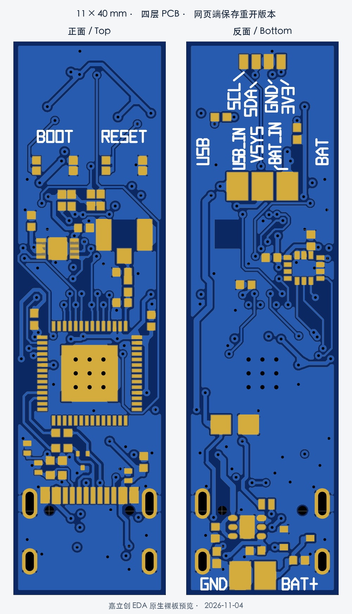
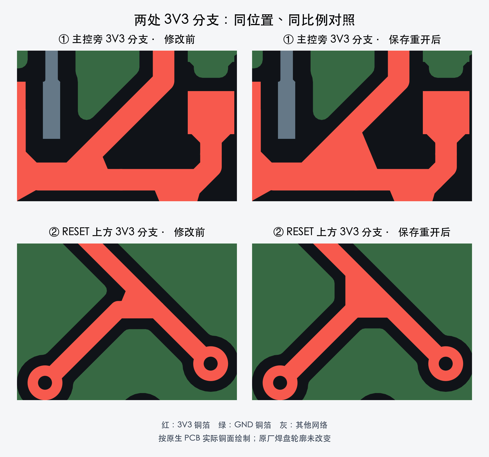

# 11 × 40 mm 四层笔杆传感板：详细信息与操作指南

版本：**2026-11-04，USB/BAT 强制选源、两处 3V3 分支钝角修正版**。

这块板用于安装在笔杆内，采集笔头磁场、板载磁场和笔杆运动数据，由主控完成时间戳处理、数据打包和通信。原理图、PCB 与网表已保存核对；以下上电、下载和传感器步骤是首板调试指南，尚非整板实测结果。

## 1. 当前文件与验证状态

| 内容 | 入口 |
|---|---|
| 正式 PCB | [四层 PCB 保存重开源](easyeda_std/PCB_11x40_四层_3V3两处分支钝角_保存重开_20261104.json) |
| 正式原理图 | [单页六格原理图](easyeda_std/SCH_独立总线六格_USB_BAT强制选择_保存重开_20261104.json) |
| 原生网表 | [原理图网表](easyeda_std/SCH_USB_BAT强制选择_20261104.net) |
| 工程交接 | [CAD_HANDOFF.md](CAD_HANDOFF.md) |
| 检查证据与哈希 | [验证目录](verification/20261104/README.md) |
| 完整审核包 | [下载 ZIP](deliverables/pen_sensor_11x40_4layer_3V3_junction_review_20261104.zip) |

2026-11-04 的检查记录为：原生 **DRC 0、27/27 网络连通**，原理图与 PCB 逐脚一致，完整铜检查未发现异网间距违规、同层异网交叉或电气悬空铜组。网页端重开后的实际铜形与已验证候选一致。

首板上电、USB 枚举/烧录、三传感器联合采样、BLE、温升、射频、装壳和工厂装配条件仍待验证。当前工程包不代表生产放行。

## 2. 机械与 PCB 规格

| 项目 | 当前设计 |
|---|---|
| 板形 | 全长严格 **11 mm 宽、40 mm 长**，长条形 |
| 板厚 | 设计采用 **0.8 mm**；最终以板厂确认的叠层为准 |
| 设计叠层 | JLC04081H-3313；标称 0.8 ± 0.1 mm，外铜 1 oz、内铜 0.5 oz |
| L1 顶层 | 顶面器件、USB/RF、部分信号及 GND 铺铜 |
| L2 内层 | GND 参考平面，无信号走线 |
| L3 内层 | 电源、少量低速信号及 GND 铺铜 |
| L4 底层 | 底面器件、信号、电源及 GND 铺铜 |
| 设计位号 | 43 个：顶面 26、底面 17，含手焊焊盘和不装件 |
| 网络与焊盘 | 27 网、190 个逻辑脚、193 个物理焊盘 |
| USB-C | 原 USB4105-GF-A-060，笔尾轴向插线 |
| 电池焊盘 J2 | 靠近 USB，同在尾端 |
| 笔头接口 J4 | 位于 USB 的另一端 |
| 丝印 | 保留操作、接线和极性文字；位号关联在原理图、网表及装配文档层中保留 |

11 mm 是板宽，不是保证能装入的笔杆内径。壳体需另计双面元件、USB 外壳、焊线和绝缘层的净空。40 mm 是当前可布通并留出标识的长度，尚未证明为全局最短。电池本体的尺寸与安放不在本板外形设计范围内。



## 3. 主要器件与功能

| 位号 | 器件 | 功能 |
|---|---|---|
| U1 | ESP32-S3-PICO-1-N8R8 | 主控、USB、采集处理和无线通信 |
| U2 | MLX90393SLQ-ABA-011-RE | 板载三轴磁场测量 |
| U3 | LSM6DSOXTR | 三轴加速度及三轴角速度 |
| U5 | TLV75533PDRVR | 3.3 V 线性稳压 |
| Q1 | DMP2165UW-7 | 电池反接保护通路 |
| D4 | LMBR4010BST5G | USB 供电防倒灌通路 |
| J1 | USB4105-GF-A-060 | USB-C 数据、下载和 5 V 输入 |
| ANT1 | U.FL-R-SMT-1(80) | 外接 2.4 GHz FPC 天线 |
| SW2 / SW3 | EVPBB2A9B000 | BOOT / RESET 实体按键 |
| J4 外接模块 | MLX90393 笔头模块 | 笔头三轴磁场测量，模块不在本 PCB 上 |

U1 集成 8 MB Flash、8 MB Octal PSRAM，双核处理器最高 240 MHz，具备 2.4 GHz Wi-Fi 和 Bluetooth LE 能力。无线程序应按 BLE 开发，不使用传统蓝牙 SPP 串口方案。[Espressif 数据手册](https://www.espressif.com/sites/default/files/documentation/esp32-s3-pico-1_datasheet_en.pdf)

完整传感系统提供两组三轴磁场、三轴加速度和三轴角速度。磁场需结合磁体、柔性结构及机械标定才能转换为压力或形变指标；IMU 原始数据不能直接当作绝对笔尖 XY 轨迹。安装轴向、零偏和整机标定尚待完成。

USB 保留两路 5.1 kΩ CC 下拉、22 Ω 数据线串联电阻及 CC/VBUS/数据 ESD 器件。接口按 USB 设备使用，无 USB-PD 控制器。板上没有电源或状态指示 LED。

## 4. 独立总线和固件 GPIO

| 功能 | 网络 | GPIO |
|---|---|---:|
| 笔头 I²C0 SDA | PEN_SDA | 1 |
| 笔头 I²C0 SCL | PEN_SCL | 2 |
| 板载 MLX 中断 | MLX_INT | 4 |
| IMU INT1 | IMU_INT | 5 |
| 板载 MLX I²C1 SDA | MLX_SDA | 6 |
| 板载 MLX I²C1 SCL | MLX_SCL | 7 |
| IMU SPI2 CS，低有效 | IMU_CS_N | 10 |
| IMU SPI2 MOSI | IMU_MOSI | 11 |
| IMU SPI2 SCK | IMU_SCK | 12 |
| IMU SPI2 MISO | IMU_MISO | 13 |
| USB D− | USB_DM_SOC | 19 |
| USB D＋ | USB_DP_SOC | 20 |
| BOOT | BOOT_N | 0 |
| RESET | MCU_EN | CHIP_PU / EN，非普通 GPIO |

R5/R6 为笔头总线的 4.7 kΩ 上拉，R12/R13 为板载 MLX 总线的 4.7 kΩ 上拉，均接 3.3 V。R14 为 IMU CS 提供 10 kΩ 上拉。外接模块如有自带上拉，应核对并联后的阻值和上拉电压。

- 笔头 MLX：预期七位地址 `0x0E`，以实际模块配置和扫描为准。
- 板载 MLX：当前 SLQ-ABA-011 型号预期七位地址 `0x10`。
- IMU：四线 SPI，通过 CS 选择；不再使用旧 I²C 地址 `0x6A`。

板载 MLX 地址与厂家的 xLQ-ABA-011 表项一致。初次 I²C 调试可从 100 kHz 开始，确认波形、上拉和线长后再尝试 400 kHz；总线时钟不等于传感器采样率。[MLX90393 数据手册](https://www.melexis.com/-/media/files/documents/datasheets/mlx90393-datasheet-melexis.pdf)

## 5. 焊接与外部接线

以下方向统一为：**底面朝自己，笔头 J4 在上，USB 在下**。接线仍以实物丝印和功能为准。

| 接口 | 脚号定义 | 上述方向下从左到右 |
|---|---|---|
| J4 笔头 | 1=3V3，2=GND，3=PEN_SDA，4=PEN_SCL | SCL、SDA、GND、3V3 |
| SW1 电源选择 | 1=BAT_IN，2=VSYS，3=USB_IN | USB_IN、VSYS、BAT_IN |
| J2 电池 | 1=BAT_P，2=GND | GND、BAT+ |

J4 的 3V3 是给笔头模块供电的输出；SDA/SCL 为 3.3 V 逻辑。不要给 J4 输入 USB 5 V 或电池电压，也不要仅按两个模块焊盘的排列顺序对接。J2/J4/SW1 为手焊焊盘，保留禁开钢网属性；焊线与应力释放需实物确认。

**SW1 是三个外接开关焊盘，PCB 上没有装好的拨动开关。** 外接 SPDT 的公共端接 VSYS，两个选择端分别接 USB_IN 和 BAT_IN。使用先断后接开关，设计选型条件为 DC 至少 1 A / 5 V，并核验浪涌；不可将两个电源选择端同时接通。安装前断电测通断，确认实际拨向与 USB/BAT 标识一致。

电池通过板外可拆连接接到 BAT+、GND；充电时拆开连接，不依赖反复拆焊。所有焊接均在断开 USB 和电池后进行。

## 6. 供电方式

USB 通路：`USB_5V → D4 → USB_IN → SW1 → VSYS → U5 → 3V3`。

电池通路：`BAT_P → Q1 → BAT_IN → SW1 → VSYS → U5 → 3V3`。

U5 的 EN 与输入同接 VSYS。所选电源存在时自动上电；SW1 不再控制原来的 ON/OFF 使能信号。

| 电源连接 | SW1=USB | SW1=BAT |
|---|---|---|
| 只有 USB | 上电 | 不上电 |
| 只有电池 | 不上电 | 上电 |
| 两者都接 | USB 供电 | 电池供电 |
| 两者都不接 | 断电 | 断电 |

这是主供电通路的设计行为；端口反向供电、启动与切换瞬态仍待实测。

- SW1 仅选择供电来源，不选择通信方式。BAT 档不会自动启动 BLE，USB 档不会自动关闭 BLE。
- 切换可能短暂掉电、重启。切换前停止采集并保存数据。
- 两种电源都接着时没有独立 OFF 档；完全关机需断开供电来源。
- 使用带过充、过放及短路保护的 4.2 V 满充单节锂电池，不接两节串联电池。
- 板上没有充电器。插 USB 不给电池充电；电池从板子断开后，用匹配的外部充电器充电。
- U5 不升压；低电池电压无法满足稳压余量时，3.3 V 可能下降并引起复位。

TLV755P 的器件额定输出能力是 500 mA，需供主控、无线和传感器共用，不能作为 J4 可额外输出的电流指标。实际允许负载、温升和续航尚未测定。[TI 数据手册](https://www.ti.com/lit/ds/symlink/tlv755p.pdf)

## 7. 首次上电与 USB 烧录

1. 断电检查焊接、电池极性、SW1 公共端和 J4 四线，确认没有硬短路。
2. 先不接电池，SW1 置 USB 档；在可限流的供电条件下检查 3V3 对 GND 约为 3.3 V，无异常发热。不能靠亮灯判断上电。
3. 使用确认支持数据传输的 USB-C 线连接电脑。
4. 按住 BOOT，按下并释放 RESET，然后松开 BOOT，进入下载模式。
5. 选择新出现的 USB 串口，烧录为本板配置的 ESP32-S3 固件。
6. 必要时按 RESET 运行程序，先检查 USB 日志，再逐项验证传感器。

USB 数据线经串阻和保护器件连接 ESP32-S3 GPIO19/20，无额外 USB 转串口芯片。若使用已配置的 ESP-IDF 工程：

```bash
idf.py set-target esp32s3
idf.py -p PORT flash monitor
```

将 PORT 替换为实际串口；macOS 通常为 `/dev/cu.*`。Flash 配置匹配 8 MB；启用 PSRAM 时匹配本型号的 Octal PSRAM。USB 日志需启用对应控制台配置。若应用重配 USB 引脚导致端口消失，使用 BOOT＋RESET 恢复下载模式。[Espressif USB Serial/JTAG 指南](https://docs.espressif.com/projects/esp-idf/en/stable/esp32s3/api-guides/usb-serial-jtag-console.html)

RESET 只复位主控，不切断整板 3.3 V。正常启动时不要一直按住 BOOT；本板尚未定义短按 BOOT 切换 BLE 的应用行为。

## 8. 传感器、天线与 BLE 调试

按总线逐个验证：笔头 I²C0 扫描实际地址，板载 I²C1 检查 `0x10`；IMU 用四线 SPI 读取地址 `0x0F` 的 WHO_AM_I，预期为 `0x6C`。随后设置采样率、量程、FIFO/中断和联合采样时间戳。[LSM6DSOX 数据手册](https://www.st.com/resource/en/datasheet/lsm6dsox.pdf)

天线使用适配的 2.4 GHz FPC 天线，通过短同轴线接 U.FL，按整机结构放置；当前没有板载 PCB 天线。射频匹配默认 R30=0 Ω，C30/C31 不装，最终需按装壳后的射频结果调谐。磁传感器周围避免铁磁零件和靠近传感器的大电流回路，装壳后重新标定。

电池独立使用流程：接好天线和电池 → SW1 选 BAT → 固件启动 → 客户端连接固件提供的 BLE 服务。只有固件实现广播、连接和数据发送后才会出现可连接设备；广播名、服务 UUID、数据格式、采样率和断线处理尚未定稿。

仓库现有[单 MLX 采集草图](../../firmware/mlx90393_sensor/mlx90393_sensor.ino)是旧硬件参考：只有一颗传感器，使用 D1/D2 引脚别名，不包含本板双 I²C、IMU SPI 和 BLE 完整流程。旧程序的 100 Hz 不代表本板三器件采样已验证。迁移时必须使用本指南的明确 GPIO。

USB 会话掉线停止采集、不自动转 BLE，以及电池/BLE 模式的启动方式，仍需在新固件中落实。供电切换、电源存在检测和通信任务管理需要分别处理。

## 9. 常见问题

| 现象 | 优先检查 |
|---|---|
| USB 接上没有反应 | SW1 是否选 USB、外接开关是否接好、3V3 电压 |
| 电池接上不上电 | SW1 是否选 BAT、电池极性/电压、开关公共端 |
| 没有 USB 串口 | 数据线、3V3、BOOT＋RESET、USB 引脚和控制台配置 |
| 找不到板载 MLX | 是否在 GPIO6/7 总线上扫描 0x10 |
| I²C 扫描找不到 IMU | IMU 已改 SPI，应通过 CS 读取身份寄存器 |
| 电池模式反复复位 | 电池电压、供电压降、开关接触及启动/无线峰值电流 |
| 搜不到蓝牙 | 固件是否广播、供电是否正常、天线是否连接 |
| 装壳后磁场零点变化 | 磁体位置、铁磁件、电池导线和电流回路 |

## 10. 本轮布线修改

主控旁 3V3 汇接改为更明显的大倒角，夹角约 112.5°；RESET 上方分支直接垂直汇入斜主干，两侧倒角约 135°。相关支路线宽保持 0.25 mm，删除一段冗余微段。检查同时包含实际铜轮廓与同比例视觉对照，不能仅以 DRC 0 或微小倒角后的顶点计数代替视觉判断。



更早的圆板、双层、ON/OFF 和 USB 优先供电说明均为历史版本；接线和使用以本指南及当前原生源为准。
