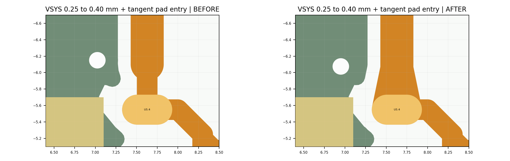
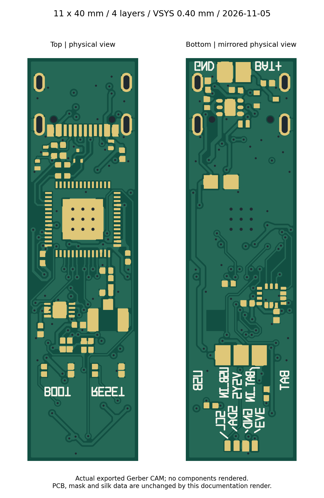

# VSYS 短颈改为 0.40 mm，并平滑接入焊盘

2026-11-05。按用户“直接改”的授权完成，已保存回网页端原 PCB 并关闭重开核验。

- 从网页端重新导出当前正式 PCB，备份源、原理图、网表和交接文件。当前网页 J1 一个多边形焊盘的宽高元数据与前次导出不同，实际多边形铜不变；本次从当前网页源修改，完整保留该元数据，没有覆盖用户当前状态。
- `gge998500100` 原约 0.55 mm 长、0.25 mm 宽的短颈改为 **0.40 mm**；末端缩入原 U5.4 焊盘，避免圆端略凸出焊盘。新增相切渐变铜形，将主干平滑接入原圆角焊盘；原厂焊盘和阻焊/锡膏开窗均未改。
- GND 过孔 `gge990001131` 从约 (7.024878, −6.150102) mm 移至 (6.950005, −6.075000) mm，位移约 **0.106 mm**。其原 45° 地引线同步缩短；孔径 0.20 mm、铜环外径 0.50 mm 保持不变。VSYS 到此过孔铜环间距约 **0.2196 mm**，新增过渡距右侧 USB 定位孔约 0.2308 mm。
- 邻近旧 GND 补铜 `gge998700354` 内缩 0.005 mm，消除重铺铜后一个细小凸点。该处原 U5.4 焊盘至补铜间距约 0.1596 mm，满足原 0.15 mm 电源间距；**0.2196 mm 特指到所移动过孔，不能作为全板或整个 VSYS 到地铜的最小间距**。自动铺铜仍按原设计规则避让。
- 原生候选与正式保存重开后的 **DRC 均为 0，网络均为 27/27**。本地实际铜检查无异网间距违规、同层异网交叉或电气悬空铜组；轮廓检查无新增未处理锐角/直角，并结合放大图核对平滑过渡。
- 保存重开源与已验证候选的四层实际铜并集差异为 **0.0 mm²**。相对修改前仅底层 VSYS/GND 铜面变化，顶层和两个内层铜并集不变；上述 GND 钻孔位置改变已反映在新钻孔文件中。
- 新导出 Gerber：27 网各一个连通组，无短路组、漏焊盘或无焊盘铜岛。原理图/网表字节、全部器件实例和 DRC 规则未改，USB/RF 走线与其他信号、电源保持不变。BOM/CPL 沿用前次器件审核草案，本次未重新生成贴装文件。

当前正式 PCB：[保存重开源](../../easyeda_std/PCB_11x40_四层_VSYS加宽平滑_保存重开_20261105.json)。

当前制造审核文件：[Gerber／钻孔 ZIP](../../manufacturing/Gerber_11x40_4layer_VSYS_20261105.zip)。

当前审核包：[VSYS 修改工程与 Gerber](../../deliverables/pen_sensor_11x40_4layer_VSYS_review_20261105.zip)。

GitHub 发布时核对源与 Gerber 字节、验证报告和下载包，未再次执行 EDA。当前 PCB／Gerber 的公开文件身份见 `source_manifest.json`，当前审核包身份见 `package_manifest.json`。旧 PCB／旧审核包由当前下载入口替换，可从 Git 历史恢复；前次证据仍按各自日期阅读。

本轮没有改变原理图功能，也未进行实物或工厂生产验证。前次明确的盘中孔、钢网、拼板、孔周地铜清除及生产稿确认仍按原工厂分工处理。Gerber 导出对话框的默认板厚等参数不代表订单选择，设计计划仍为四层 0.8 mm。
