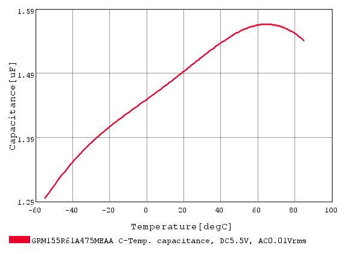

> 2026-10-05后续状态：C9规格/国内准确条目核实及SCH/PCB/BOM替料已完成，见 `../C9替料_20261005/本轮交接_仅审核.md`。下文保留提出候选时的历史状态；当前源以CAD_HANDOFF顶部为准。

# C9与USB供电收尾建议｜仅审核

**当前状态补充（板外充电实施后）**：下文是同日实施前的专题依据，43元件及U4充电路径描述均属历史。本轮已删除U4/R10并保存重开，现41元件/20网；C9替料仍未实施，系统USB总流与暂停/自供电条件仍未闭合。准确当前入口见[板外充电交接](../板外充电_20261005/本轮交接_仅审核.md)；不恢复下文充电管理候选。

日期：2026-10-05。基于当前PCB `2e0d9293…`；本轮没有改原理图、PCB、采购BOM或Gerber，没有运行新的原生DRC。保留丝印终检版为唯一当前工程。

## 1. C9：已找到有容量余量的同封装替料

建议将C9的采购候选从 `GRM155R61A105KE15D`（1µF/10V）改为 **`GRM155R61A475MEAAD`（4.7µF/10V、X5R、±20%、0402）**。这是待实施变更，当前工程仍为1µF/10V。

本轮通过[村田SimSurfing](https://ds.murata.com/simsurfing/mlcc.html)的可见操作界面选择准确系列，导出 **DC 5.5V、AC 0.01Vrms、C-Temp. / Capacitance** 联合曲线，各281点；页面数据库更新日期2026/10/02。原始CSV、曲线图及[计算记录](组合曲线审核_仅审核.json)已保存在本目录。

| 料号系列 | 名义容量 | 全模型温区−55～85℃典型最小值 | 再计负容差的筛查值 | −40～85℃再计负容差 | 选择 |
|---|---:|---:|---:|---:|---|
| GRM155R61A105KE15 | 1µF | 0.516µF | 0.465µF | 0.486µF | 不选作有充分余量的新C9；旧料不因此判定必然失效 |
| GRM155R61A225KE01 | 2.2µF | 0.443µF | 0.399µF | 0.418µF | 排除；更大标称值没有改善实际偏压容量 |
| GRM155R61A475MEAA | 4.7µF | 1.295µF | **1.036µF** | **1.081µF** | 推荐候选 |

比较门槛采用[TLV755P手册](https://www.ti.com/lit/ds/symlink/tlv755p.pdf)输入/输出有效电容>0.47µF。4.7µF候选全模型温区筛查值约为门槛2.20倍；相对该筛查值还可下降约54.6%才到门槛。这不是原厂允许的老化保证或寿命承诺。原1µF在0～60℃的同条件筛查约0.522µF；不能把低温上限筛查推断为室内研究样板必定失效。

**证据边界：**组合曲线已经包含AC/DC与温度，不能再重复乘0.85温度或0.9小信号因子；仅额外做容差筛查。模型是典型值，容差与偏压响应组合不是制造商最小值保证，未包括老化。5.5V是现LDO输入上限的保守筛查，不是声称USB电脑通常输出5.5V；−55/−40℃也不是给本项目新增的使用要求。上一轮独立降额乘法仅保留为历史敏感度分析，本轮组合数据优先。

### 具体改法、收益与代价

- **改法：**C9仍接VSYS—GND，使用现0402位置、焊盘和连接；同步更新原理图值/完整MPN、PCB属性和审核BOM。C10仍保留1µF/10V。没有新增器件、网络或功能。
- **收益：**以准确料号的组合偏压数据获得明显容量余量；原料在当前原厂列表标记“计划停产”，新候选为“生产中”。这些生命周期状态不能替代国内库存/接贴确认。
- **机械代价：**原厂当前列表中最大高度由0.55升至0.65mm，增加0.10mm；同为0402不等于最大实体尺寸完全相同。当前C9模型名为H0.5；实施时需检查替料最大实体包络及周边、板底装配空间，不把旧模型当新料最大高度。候选尺寸规格PDF旧索引返回404，尚未归档新完整规格；当前最大高度证据来自原厂可见列表。
- **电气代价：**名义容量增加3.7µF，会增加插入/上电充电量。以5.5V和恒定名义容量估算差额约20.35µC，仅为量级估算；实际非线性C(V)、线阻、D4、全部输入/输出电容决定浪涌。不能用C9单体通过宣称整个USB浪涌通过。
- **实施验收：**回读同一在线工作板并核对最新差异；校验替料实体/焊盘适配；同步SCH、PCB、BOM和模型说明；保存重开并核对本次差异。若仅属性/模型变化，铜几何应完全不变。真实上电瞬态继续列入首板测试。

## 2. USB：充电开关不能单独完成供电整改

当前USB_5V有两条主要负载路径：一条到U4给电池充电，另一条经D4到VSYS/U5给主控和传感器供电。R10=220k使恒流阶段名义充电约109mA，MCU目前不能禁充。即使给U4加禁止控制，第二条供电路径仍然存在。

| 场景 | 现板/仅加禁充开关的行为 | 完整方案还必须解决的内容 |
|---|---|---|
| 插USB、复位、固件未运行 | 现板可能开始充电；系统同时取电。新增禁充开关可让充电默认关，但不能限定系统启动取电 | 对实际端口授权、冷启动和枚举前总电流作完整处理 |
| 已配置、电脑允许相应电流 | 可并行运行和充电，但总流为系统＋充电＋辅助；不能把500mA全留给主控 | 按实际授权和总预算使能充电；需读到有效USB状态 |
| 主机暂停但VBUS仍存在 | 禁充后系统仍通过D4从USB取电；VBUS高也不能证明主机允许活动电流 | 如需继续蓝牙采集，应切到电池或实现相应低功耗模式 |
| 电池独立运行、主机断电/拔线 | 主控可继续运行；USB Serial/JTAG默认D+上拉不是物理VBUS检测 | 自供电连接/断开行为，含复位和ROM阶段 |
| 无电池或电池电量极低 | 不能假设MCU先靠电池运行再授权USB供电 | 在限定输入电流下的启动/恢复，不形成启动循环 |
| SW1关机、USB仍插着 | MCU不能执行控制；现充电器仍可工作 | 明确关机充电规则，控制脚不得向已断电3V3反灌 |

依据：[Espressif自供电说明](https://docs.espressif.com/projects/esp-iot-solution/en/latest/usb/usb_overview/usb_device_self_power.html)、[Serial/JTAG说明](https://docs.espressif.com/projects/esp-idf/en/stable/esp32s3/api-guides/usb-serial-jtag-console.html)、[ESP32-S3 TRM第33章](https://documentation.espressif.com/esp32-s3_technical_reference_manual_en.pdf)、本地 `references/sgm40567.pdf`。Serial/JTAG的SOF连接指示不能替代VBUS电压检测、SET_CONFIGURATION确认或端口电流授权。本轮未取得其精确bMaxPower证据，不假定可更改其固定硬件描述符来解决电源问题。

### 已排除的不完整改法

1. **只换R10、降低固定充电电流：**不能让暂停电流接近零，也不能解决系统支路取电。
2. **直接用GPIO短接IREF：**会改变设定电阻关系，复位/断电状态也未满足禁充要求，不采用。
3. **IREF加一个受控开关即宣称完整USB通过：**错误。曾筛查TMUX1219这类带失电安全逻辑输入的SPDT，使IREF在禁充电平与原R10设定之间切换；即使解决控制脚反灌和默认状态，也仍不处理D4系统支路、冷启动及VBUS行为，因此没有生成或实施该局部网表。

### 曾讨论的两条路线（非当前强制二选一）

**A．受限研究样板：**保留当前精简供电，继续完成C9换料和既定制造确认。博后须看到并接受：USB数据功能设计成立但未经实物验证；通用端口的枚举前/暂停取电条件未闭合；不能声称符合全部USB供电行为。首板用受控、限流且可监测的供电/数据测试条件验证总流、下载和采集，再验证目标电脑端口；暂停、关机及低电量作为明确测试场景。仅关闭电脑睡眠或选外供电Hub，均不自动证明USB协议符合。该路线不等于本报告批准下单。

**B．先做完整电脑USB供电管理：**保留PICO、USB和三传感器功能，但同时设计充电禁止、系统电源路径、VBUS/USB状态控制以及默认/失电状态。收益是能按统一状态表收尾；代价是新增器件、固件配合和局部重布线，并需重新核算18mm可放置性。当前没有验证过的新增器件数量、坐标或布线，因此不能说“肯定放得下”或承诺仅增加一个开关。先确定范围，再做一份完整候选，避免反复加入不完整小修补。

用户随后澄清：“插usb的时候就是电脑供电啊”。这正是现设计的正常供电目标：插USB由电脑供电，拔USB由电池供电。上面的A/B选择不再作为继续收尾的前置阻塞；该澄清不等于用户选择A、豁免USB约束或授权B。继续现架构下的必要核查，保留未验证条件；如发现阻碍目标使用的具体问题，再提出有依据的局部改法。项目AGENTS.md的架构变更约束继续有效。

## 3. 本轮收尾状态

- 已完成：三款准确系列的同条件电容组合数据、C9明确替料建议、USB状态表及局部禁充方案不足的核查。
- 未实施：C9工程/BOM替换、任何USB新增器件或供电改动。当前PCB仍43元件/21网络，原生DRC结果沿用丝印终检记录，不是本轮新运行。
- 下单前工厂事项仍为Q1原0.14mm焊盘工艺、盘中孔/钢网/双面装配、0.8mm层叠与阻抗、准确供料和J1机器基准。没有新增无限复审任务。
- 样板后再做实际USB、三传感器、蓝牙、低电量、热与装配测试；不要求下单前凭空完成实测。
