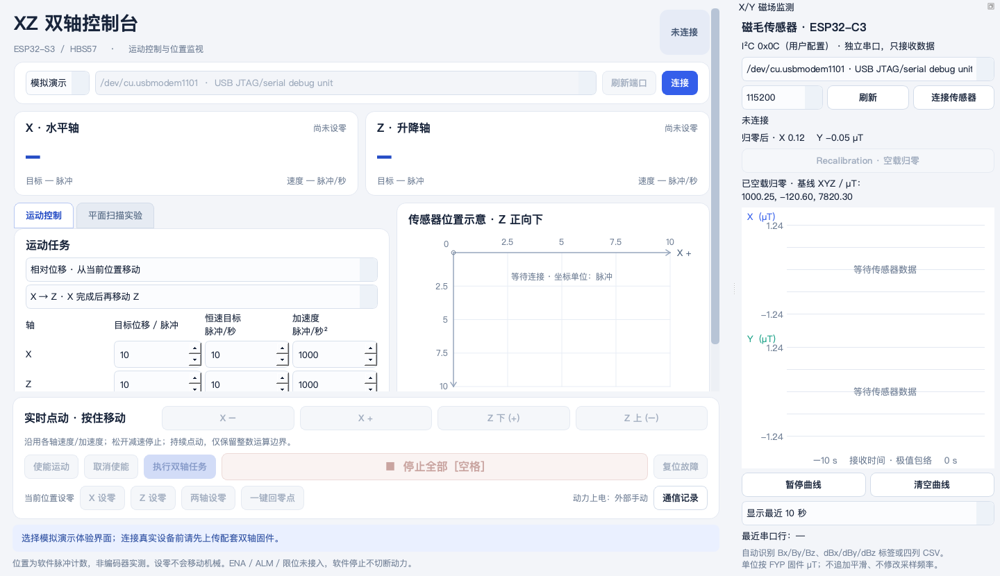

# XZ 双轴控制与磁传感实验平台

基于 Python / PySide6 的桌面控制台，配套 ESP32-S3 双轴固件。支持 X/Z 运动控制、独立串口磁传感器监测、基线校准和实验记录。

## 项目结构

```text
.
├── xz_control/                 # 桌面程序 Python 包
│   ├── __main__.py            # python -m xz_control 入口
│   ├── app.py                 # 界面、设备连接与操作协调
│   ├── protocol.py            # XZ1 协议、运动参数校验与模拟器
│   ├── sensor.py              # 传感器串口、数据解析、校准与曲线
│   └── experiment.py          # 实验流程与 CSV / JSON 记录
├── windows_acquire.py         # Windows 无 GUI 运动与磁场采集脚本
├── start_windows_acquire.bat  # 双击启动并交互选择 COM 口
├── firmware/
│   ├── XZ_Controller/         # 当前 ESP32-S3 双轴固件
│   └── examples/              # 单轴与 GPIO 独立测试草图
├── tests/                     # Python 测试与固件主机测试
├── docs/
│   ├── user-guide.md          # 完整操作说明与协议
│   ├── architecture.md        # 模块关系与开发入口
│   ├── hardware/             # 平台构建、驱动库与单轴测试说明
│   ├── archive/              # 历史交付文档
│   └── images/               # 界面预览图
├── data/
│   ├── recordings/           # 整理前已有的实验记录
│   └── experiments/          # 新实验默认输出，运行时创建，Git 忽略
├── requirements.txt          # Python 依赖
└── 启动双轴控制台.command     # macOS 双击启动入口
```

## 启动

macOS 可双击根目录的 `启动双轴控制台.command`，首次启动会创建虚拟环境并安装依赖。也可以在项目根目录执行：

```sh
python3 -m venv .venv
.venv/bin/python -m pip install -r requirements.txt
.venv/bin/python -m xz_control
```

默认处于断开状态。选择“模拟演示”并点击“连接”可体验界面；模拟模式不连接硬件。真实设备接线、固件上传和操作步骤见[用户指南](docs/user-guide.md)。

Windows 下的无 GUI 采集使用 [`windows_acquire.py`](windows_acquire.py)，运行时会搜索并选择 COM 口、询问 X/Z 距离和速度，在运动前取 `Bx0` 基线，并在 Enter 后开始；运动顺序和参数见[Windows 脚本采集说明](WINDOWS_ACQUIRE.md)。也可以直接双击 `start_windows_acquire.bat`。

## 验证

在项目根目录执行：

```sh
.venv/bin/python -m unittest discover -s tests -v
sh tests/run_firmware_tests.sh
```

固件主机测试需要 C++ 编译器和 AccelStepper 1.64.0 源码，默认读取 `~/Documents/Arduino/libraries/AccelStepper/src`。其他位置可通过 `ACCELSTEPPER_SRC` 环境变量指定。

本地自动测试验证软件逻辑，不能代替机械、电气和实物停止时序验证。界面位置来自发脉冲计数，不是编码器实测；软件停止不是硬件急停。

## 文档与数据

- [完整用户指南](docs/user-guide.md)：启动、双轴操作、协议、传感器与实验模式。
- [软件结构](docs/architecture.md)：模块职责、数据流和修改入口。
- [硬件平台构建](docs/hardware/platform-setup.md)与[单轴测试步骤](docs/hardware/single-axis-test.md)。
- [AccelStepper 说明](docs/hardware/accelstepper-notes.md)与[历史交付文档](docs/archive/project-handover-v1.0.md)。
- 已有实验文件保存在 `data/recordings/`，保持原始内容；新实验默认写入 `data/experiments/`。是否将新记录纳入版本管理，由实验整理时决定。



预览图用于说明界面，不作为硬件验证或测量结果的证据。

## 在 FYP 仓库内启动 Linux 工作台

```bash
cd hardware/xz-control
python3 -m venv .venv
.venv/bin/python -m pip install -r requirements.txt
.venv/bin/python linux_workbench.py
```

[Linux 工作台完整说明](LINUX_WORKBENCH.md)。本次仅上传程序、固件、测试与使用文档，采集数据和分析结果保留在本地；运行时仍会保存至本机 `data/experiments_linux/`。
