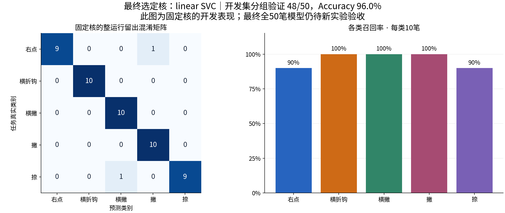
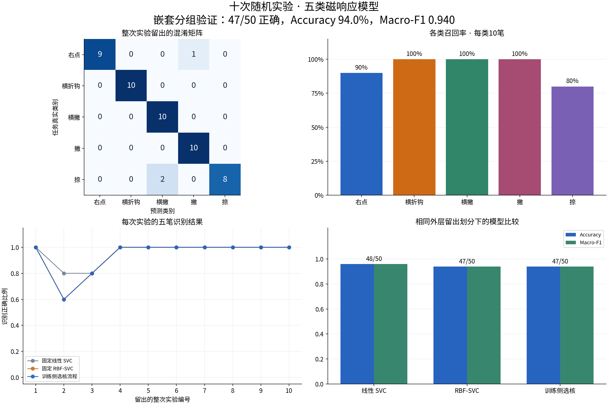

# 十次随机实验五类笔画模型：训练报告

主验证流程：外层10次整运行留出，内层只在9次训练运行中选核。50笔中识别正确 **47笔**，Accuracy **94.0%**，Macro-F1 **0.940**，Balanced Accuracy **94.0%**。

最终保存模型：**linear SVC**，StandardScaler＋SVC，使用全部50个合格样本训练。最终核根据两个固定核的开发CV按预登记规则选择；最终模型还没有全新独立测试实验。





## 数据与处理

使用随机测试1（xy，磁）_001～_010的真实sensor.csv，共10次运行、50笔，每类10笔。未加入10月31日标准数据，没有生成合成训练样本。采集身份用于任务标签，不代表额外做过墨迹人工裁定。所有50个窗口有效，无窗口内采样缺口。

输入：sqrt(dBx²+dBy²) → 连续记录标量EMA(alpha=0.3) → measure完整书写段 → 按实际时间前10%区间中位数扣基线 → 归一化时间128点。此基线是方案允许的回退参考，不是空载零力。原始幅值和基线均保留。

每折缩放器只拟合训练侧。模型没有读取笔序、实验编号、时间长度、坐标或磁目标；phase只用于切段。每笔独立预测，不强制每次五笔各占一类。

## 固定核与选核流程的留出表现

| 模型／流程 | 正确数 | Accuracy | Macro-F1 | Balanced Accuracy |
|---|---:|---:|---:|---:|
| 固定线性 SVC | 48/50 | 96.0% | 0.960 | 96.0% |
| 固定 RBF-SVC | 47/50 | 94.0% | 0.940 | 94.0% |
| 训练侧选核流程 | 47/50 | 94.0% | 0.940 | 94.0% |

两个固定核的CV用于最终选核开发；主成绩使用内层选核后的外层预测，避免读取外层测试标签选择核。固定参数C=1，RBF gamma=scale；RBF的内层Macro-F1比线性高超过0.02才选RBF，否则选线性。

## 每类结果

| 类别 | precision | recall | F1 | 支持数 |
|---|---:|---:|---:|---:|
| 右点 | 1.000 | 0.900 | 0.947 | 10 |
| 横折钩 | 1.000 | 1.000 | 1.000 | 10 |
| 横撇 | 0.833 | 1.000 | 0.909 | 10 |
| 撇 | 0.909 | 1.000 | 0.952 | 10 |
| 捺 | 1.000 | 0.800 | 0.889 | 10 |

## 每次实验

| 留出实验 | 内层选核 | 该次正确数 |
|---|---|---:|
| 001 | linear | 5/5 |
| 002 | rbf | 3/5 |
| 003 | rbf | 4/5 |
| 004 | linear | 5/5 |
| 005 | linear | 5/5 |
| 006 | rbf | 5/5 |
| 007 | linear | 5/5 |
| 008 | linear | 5/5 |
| 009 | linear | 5/5 |
| 010 | linear | 5/5 |

## 误分类

全部误分类均列出，图中仅用外层训练侧类别曲线计算均值及±1个标准差阴影；阴影不是置信区间。

- 实验002，右点 → 撇：[曲线对照](figures/误分类/run02_stroke01.png)
- 实验002，捺 → 横撇：[曲线对照](figures/误分类/run02_stroke05.png)
- 实验003，捺 → 横撇：[曲线对照](figures/误分类/run03_stroke05.png)

## 识别接口

model.joblib是标准sklearn Pipeline，输入形状(n,128)，各列必须是同一处理定义下的Δr，不是原始dBx/dBy，也不是图片。模型输出0～4，映射见model_metadata.json。

附带predict_stroke.py可从单笔原始CSV、或完整.brushrun中指定一笔完成处理并识别。原始CSV需有seq、sensor_t_us、dBx_uT、dBy_uT及至少100个连续有效写前采样；valid和baseline_id可用现有采集字段。写前数据只用于连续滤波，不进入分类向量。单笔接口不需要真实标签或笔顺特征。若只剩已经裁切且无EMA状态的原始曲线，不能静默按每笔重置EMA冒充同一输入。

```bash
python predict_stroke.py --sensor-csv example_single_stroke.csv --seq-start 5689 --seq-end 6942
python predict_stroke.py --archive /绝对路径/新实验.brushrun --stroke 3
```

第二种调用的stroke仅用于选择边界，不参与分类。example_single_stroke.csv来自本次训练样本，只验证模型加载和输入接口，不能用其预测成绩证明泛化。HTML中的单笔示例使用外层留出模型，和最终全量模型的接口演示分开。

## 可视化与文件

- [交互报告](训练成果可视化.html)：选择50个样本查看留出曲线、预测及各类判别分数。
- [全部实测曲线和模型输入](figures/五类全部曲线与模型输入.png)。
- [单笔留出示例](figures/单笔识别留出示例.png)。
- predictions.csv：两个固定核及主流程的全部150行逐笔留出预测。
- sample_audit.csv / data_manifest.json：样本边界、参考基线、原始来源与随机设置。
- cv_folds.json / fold_models/：完整外层与内层划分、缩放器统计和每折模型，便于重放留出预测。
- features_128.npz / .csv / curves_native.csv：模型输入和原生实测曲线。
- model.joblib / model_metadata.json / requirements.txt：最终离线模型、预处理定义、标签、环境版本。

## 解释边界

十次运行来自同一套机器人采集协议，随机参数中途发生过变化，不能当成十位独立书写者。50笔属于10个运行组。CV是这批数据上的建模流程估计，不是跨批次或自由手写准确率。训练侧按类重复采集有固定笔顺／目标协议混杂，排除笔序特征并不能完全消除这些物理混杂。

多数类基线Accuracy为20%；仅按笔序直接映射可得100%，后者不是磁响应分类成绩。

五类模型对任何合格输入都会输出一个已知类别，尚无横／竖／未知类别拒识；不包含实时起止检测、图片识别、概率校准或控制界面改动。各类OVR判别分数不能解释为概率。建议下一批完整实验在模型冻结后做独立验收。
