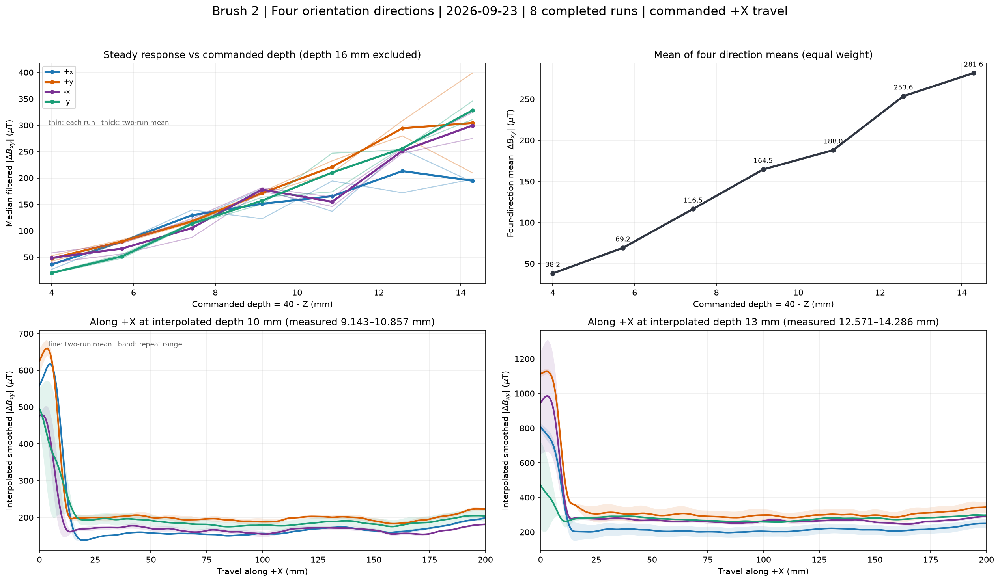

# 2026-09-23 Brush 2 四方向实验对比

**图表更新（2026-09-25）：**操作者认为 Z=24 mm（命令压深 16 mm）这档数据可能有问题，因此上方两图排除该档；底部改画 d=10 mm 与 d=13 mm 的**线性插值曲线**，它们不是在这两个压深直接测得的结果。原始记录及下表的 16 mm 行仍保留供复核。

## 数据范围与方法

| 方向标签 | 记录的 TCP RPY（约） | 完整 run |
| --- | --- | --- |
| +x | Ry+15° / Rz0° | `df7649`、`c575e5` |
| +y | Rx+15° / Rz90° | `7d1a59`、`486bc3` |
| -x | Ry−15° / Rz180° | `9666d5`、`2f3488` |
| -y | Rx−15° / Rz270° | `43a39c`、`3b670b` |

方向标签表示笔刷/传感器姿态类别；四组机器人测量轨迹均为命令沿 +X 行进，并未分别沿世界坐标的 ±X/±Y 运动。

八次 run 的 manifest 均为 `completed`，且每次都有 8 条完整的 +X 200 mm 测量路径。共同配置为：接触 Z=40 mm、命令 Z=36→24 mm（8 档）、测量速度 10 mm/s、实验原点 X=−200/Y=500 mm。两次较早的 +x（Ry+15°/Rz0°）故障 run `901492` 和 `4c8ffa` 仅完成前六档，本报告完全排除。

- **稳态值**：每条路径在命令行程 X=30–170 mm 内，取 `control.jsonl` 的 `a_control_uT` 中位数。每条路径都有 700 个样本。图左上粗线为同方向两个 run 中位数的平均，细线为各 run；右上是四个方向均值的等权平均。两图都只显示压深 4–14.286 mm。
- **沿程曲线**：将 `sensor.csv` 的有效 `dBx_uT`、`dBy_uT` 与控制样本按 `sample_seq` 匹配，计算 `√(dBx²+dBy²)`；在 0.5 mm 网格上插值后用 21 点 Hann 窗平滑（窗口约 10.5 mm）。图下方 d=10 mm 由实测 9.143/10.857 mm 档等权插值，d=13 mm 由 12.571/14.286 mm 档按 0.75/0.25 插值；先逐笔插值，再画两笔均值与范围。它们只供看趋势，不能当作这两个压深的实测证据。
- 各路径匹配到 1002–1003 个原始样本。所有位置来自**命令 TCP 轨迹**；日志没有同步的实测 TCP 位姿。

## 各档稳态响应

下表单位为 µT，数值是同方向**两个 run 各自稳态中位数的平均**；它不是把 1400 个样本直接合并后求得的中位数。

| Z (mm) | 命令压深 (mm) | +x | +y | -x | -y |
| ---: | ---: | ---: | ---: | ---: | ---: |
| 36.000 | 4.000 | 36.2 | 47.6 | 48.8 | 20.2 |
| 34.286 | 5.714 | 79.4 | 79.8 | 66.1 | 51.4 |
| 32.571 | 7.429 | 129.5 | 117.6 | 105.2 | 113.5 |
| 30.857 | 9.143 | 151.2 | 171.5 | 178.2 | 157.0 |
| 29.143 | 10.857 | 165.5 | 221.2 | 154.9 | 210.3 |
| 27.429 | 12.571 | 213.1 | 294.1 | 251.3 | 255.9 |
| 25.714 | 14.286 | 194.9 | 304.3 | 299.3 | 328.1 |
| 24.000 | 16.000 | 327.5 | 516.5 | 849.3 | 372.6 |

## 主要观察

1. **方向排序随压深改变。** 在 4 mm 压深，四方向约为 20–49 µT；10.857 mm 时 +y 最高（221.2 µT），14.286 mm 时 -y 最高（328.1 µT）。不存在可用于全部档位的固定方向排序。
2. **四方向均值随压深上升。** 排除 16 mm 后，四方向等权均值从 4 mm 的 38.2 µT 上升到 14.286 mm 的 281.6 µT。它只是这四个姿态的描述性平均，不能代表任一姿态的单独标定曲线。
3. **沿程形状也不同。** 底部插值图的起笔段约 0–10 mm 有明显瞬态，故上方稳态值只取命令 X=30–170 mm；插值未消除两次重复的差异。
4. **重复性存在局部弱点。** 在保留的七档里，+x 于 12.571 mm 两次稳态中位数差 82.1 µT；+y 于 14.286 mm 差 **189.0 µT**（两次为 209.8/398.7 µT）；-y 于 10.857 mm 差 73.0 µT。+y 的 14.286 mm 档尤其不适合只用两次实验给出稳定的单一标定值。16 mm 的历史指标仍在下表与 CSV，但暂不用于这张图的结论。

## 解释边界与下一步

这些差异是逐路径重取基线后的水平磁场变化 `|ΔBxy|`，不能直接换算为法向力、实际笔尖压深或笔画质量。四种姿态的笔刷接触几何、传感器相对磁场方向都可能改变；而 Ry 正负比较同时改变了 Rz（0° 对 180°），Rx 正负比较也同时改变了 Rz（90° 对 270°），因此当前数据不能把差异单独归因于 Rx/Ry 的符号。四个方向又按时间顺序采集，沾水、笔毫状态和时间漂移也可能参与。

若用于各方向前馈标定，先独立核查并复测受质疑的 Z=24 mm 档，暂不把它纳入拟合；其余优先补采重复差值较大的 +y Z=25.714 mm、+x Z=27.429 mm、-y Z=29.143 mm。只有每方向两次完整重复，目前无法给出可靠的总体不确定度或因果结论。

## 可复核文件

- [绘图与分析所用的逐路径汇总](./four_directions_pass_summary.csv)
- [各方向沿程平滑均值与重复范围](./four_directions_spatial_curves.csv)
- [来源 run、方法与完整精度统计](./four_directions_metadata.json)
- 生成脚本：`/home/ethan/FYP/scripts/compare_brush2_orientations.py`
