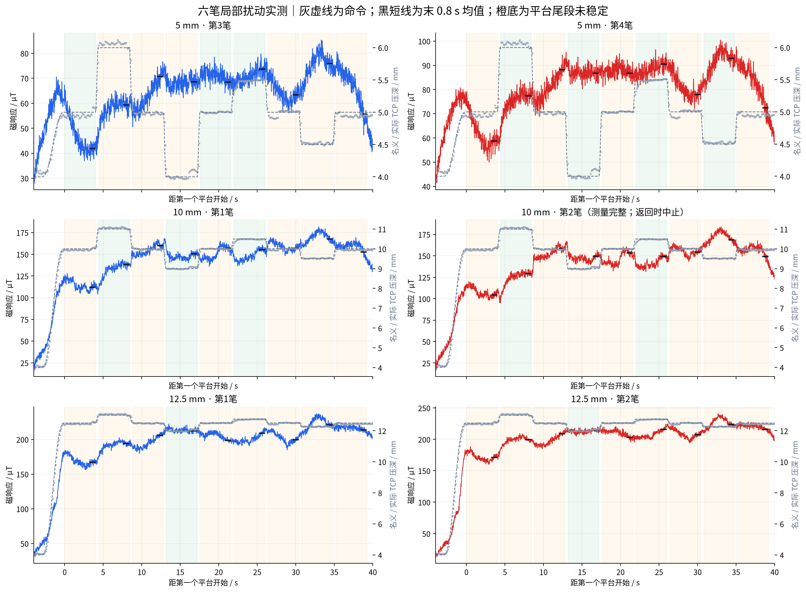
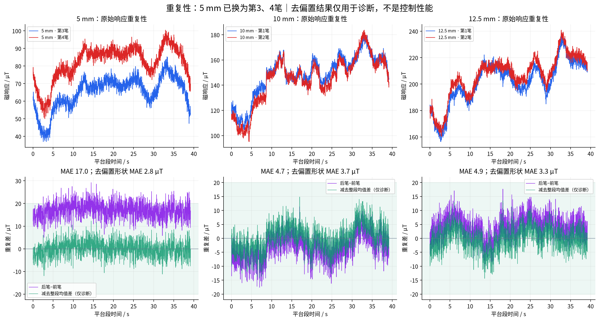
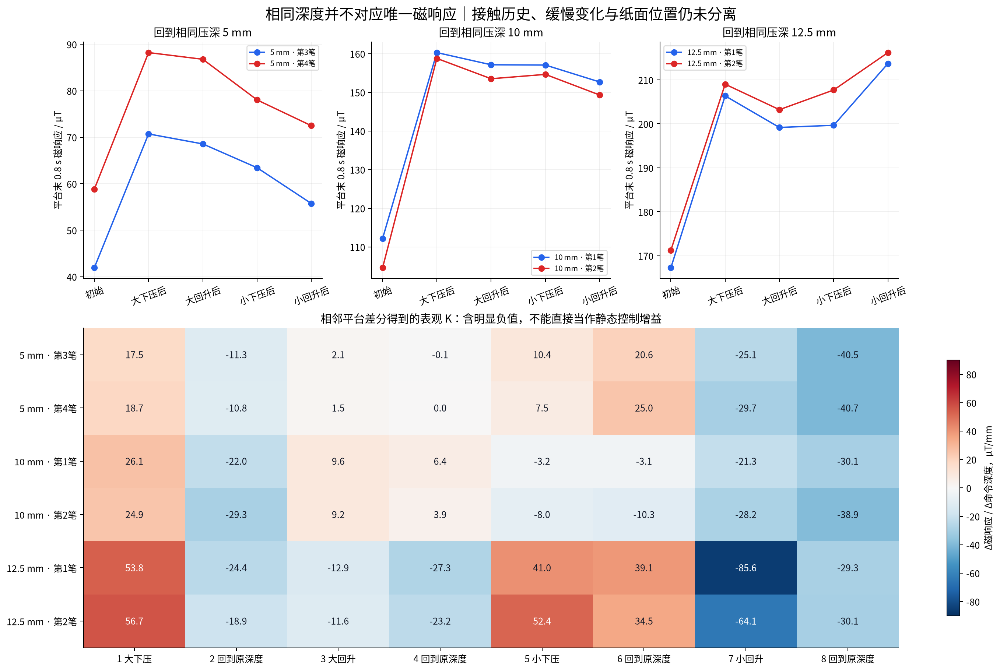
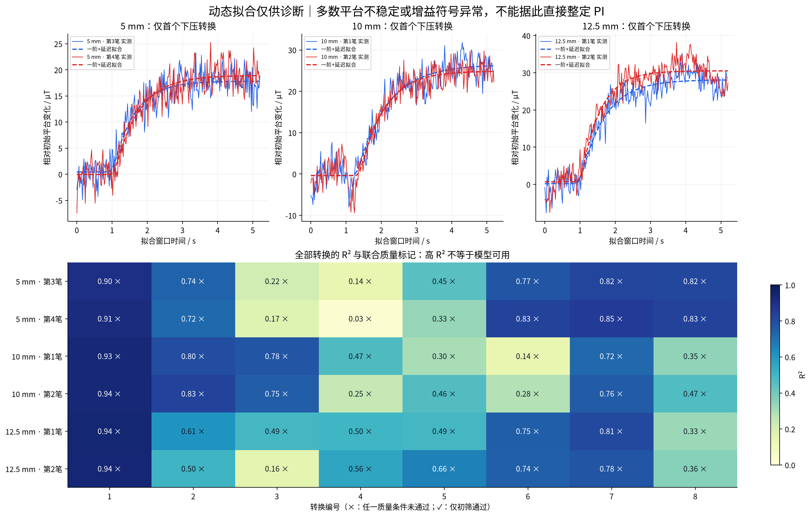
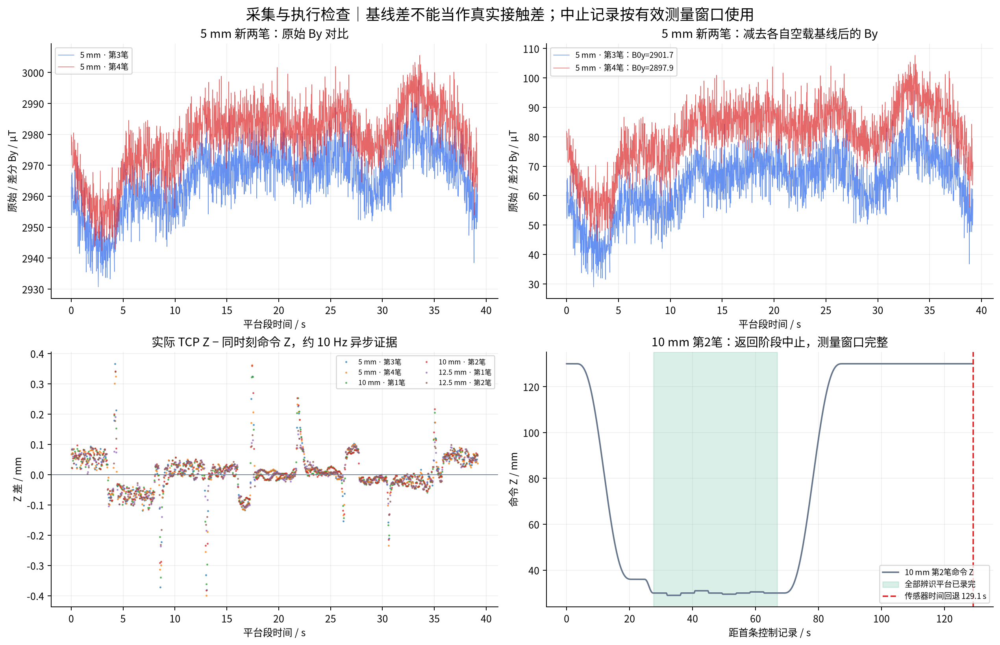

# 六笔局部辨识实测分析｜2026-09-25｜5 mm 重录替换版

## 本次替换

按用户要求，用 **16:09:01 第3次、16:12:58 第4次**替换原 **15:25:02 第1次、15:29:34 第2次**的 5 mm 实验。10 mm、12.5 mm 的四笔数据保持不变。图中保留原始实验编号，因此 5 mm 标为第3、4笔；差值均为组内后笔减前笔。

本报告及同目录五组 PNG/PDF、四份 CSV 和 JSON 均为替换后的六笔结果。旧两笔不参与当前汇总；旧分析保存在相邻 `六笔局部辨识_20260925_旧5mm` 目录，原始记录全部保留。

## 结论

- 六笔辨识窗口完整，共 **54 个平台、48 次转换**。新两笔均 completed；10 mm 第2笔仍保留返回阶段 aborted 状态，仅使用核验通过的完整辨识窗口。
- 新 5 mm 两笔曲线 MAE 为 **16.97 µT**，比旧组 29.59 µT 小；去固定均值差后的形状 MAE 为 **2.78 µT**。波形接近，但绝对响应仍有约 17 µT 的偏置。
- 首次下压表观增益：**5 mm 17.52–18.65，10 mm 24.86–26.15，12.5 mm 53.79–56.66 µT/mm**。支持较深工作点更敏感，但不能代表所有回程与小扰动。
- 新 5 mm 同深度平台跨度为 **28.80 / 29.40 µT**，回到相同深度仍未回到原响应。
- 当前 **0/48** 次转换通过联合质量初筛，**27/48** 次差分增益非正，**40/54** 个平台尾段未稳定。不能据此直接给出已验证的 K、延迟或 PI 参数。

## 1. 替换前后的 5 mm 指标

| 指标 | 旧第1、2笔（仅历史对照） | 新第3、4笔（当前使用） |
|---|---:|---:|
| 两笔曲线 MAE / µT | 29.59 | 16.97 |
| 两笔绝对差 P95 / µT | 35.25 | 22.62 |
| 后笔−前笔均值 / µT | -29.59 | 16.97 |
| 去偏置形状 MAE / µT | 2.74 | 2.78 |
| 空载 B0y 后笔−前笔 / µT | 32.82 | -3.87 |
| 测量段原始 By 均值后笔−前笔 / µT | 1.85 | 12.71 |

新两笔原始 By 均值变化 **+12.71 µT**，空载 B0y 变化 **-3.87 µT**，因此 ΔBy 均值变化约 **+16.58 µT**。EMA 磁响应范数的均值变化为 **+16.97 µT**。

**修正原结论：**旧组约 30 µT 差异与基线选择直接相关的证据，不能直接套到新组。新组原始 By 本身也发生变化；目前不能将约 17 µT 偏置全部归因于基线，也不能区分真实接触变化和磁背景变化。去偏置结果仅用于描述波形相似性，不代表在线补偿或目标跟踪已达标。

## 2. 数据完整性与执行检查

| 数据 | 原始文件夹 | 状态 | 测量行数 | 有效 TCP/总数 | 进笔峰值 / µT |
|---|---|---|---:|---:|---:|
| 5 mm · 第3笔 | 16-09-01_压深5mm_扰动1mm_先下压_第3次 | completed | 1960 | 1307/1307 | 47.1 |
| 5 mm · 第4笔 | 16-12-58_压深5mm_扰动1mm_先下压_第4次 | completed | 1960 | 1308/1308 | 60.5 |
| 10 mm · 第1笔 | 15-35-27_压深10mm_扰动1mm_先下压_第1次 | completed | 1960 | 1317/1317 | 37.5 |
| 10 mm · 第2笔 | 15-37-57_压深10mm_扰动1mm_先下压_第2次 | aborted | 1960 | 1288/1288 | 41.4 |
| 12.5 mm · 第1笔 | 15-41-18_压深12p5mm_扰动0p5mm_先下压_第1次 | completed | 1960 | 1322/1322 | 51.1 |
| 12.5 mm · 第2笔 | 15-52-04_压深12p5mm_扰动0p5mm_先下压_第2次 | completed | 1960 | 1322/1322 | 32.2 |

全部采用 Z36 旋转接触、Ry15、+X10 mm/s、450 mm 行程；5/10 mm 大扰动 ±1 mm，12.5 mm 大扰动 ±0.5 mm，小扰动为各自一半。每笔 9 个 4 s 平台、8 次 0.4 s 平滑转换，均为 press-first。配对 profile 与 settings 哈希一致，新旧 5 mm 的配置也相同。每笔 1960 条 id_* 记录与计划 tick 完全匹配，无缺失或重复，辨识窗口内无 invalid 传感记录。

**10 mm 第2笔：**辨识结束约为首条控制记录后 66.84 s；传感器在 129.08 s 的高位返回阶段报告 `sensor_time_rollback` / `sensor_time_faulted`。只纳入此前完整辨识窗口，保留 aborted 状态，不声称完成最终等待或取得末端基线。常规 `summarize_run` 拒绝 aborted；本次独立脚本使用同一拟合函数，并额外核验了测量窗口。

六笔主循环周期 P99 为 **20.11–20.14 ms**，辨识窗口传感年龄 P99 最大 **0.293 ms**。新两笔进笔峰值为 47.1 / 60.5 µT，未见此前上千 µT 异常；不能仅凭本轮记录断言 Z36 是改善原因。

黑短线为平台末 0.8 s 均值；橙底表示尾段线性趋势绝对值超过 3 µT/s。灰虚线是命令深度，灰点为约 10 Hz 异步实际 TCP。

| 数据 | 稳定平台 / 9 | 通过初筛转换 / 8 | TCP Z 平均绝对差 / mm | Z 差 P95 / mm | 同深度响应跨度 / µT |
|---|---:|---:|---:|---:|---:|
| 5 mm · 第3笔 | 3 | 0 | 0.046 | 0.120 | 28.80 |
| 5 mm · 第4笔 | 4 | 0 | 0.046 | 0.116 | 29.40 |
| 10 mm · 第1笔 | 3 | 0 | 0.045 | 0.124 | 48.14 |
| 10 mm · 第2笔 | 2 | 0 | 0.045 | 0.118 | 54.20 |
| 12.5 mm · 第1笔 | 1 | 0 | 0.040 | 0.100 | 46.47 |
| 12.5 mm · 第2笔 | 1 | 0 | 0.041 | 0.097 | 44.97 |

实际 TCP 读取中点与同主机时刻命令比较，未补偿延迟。未见平台执行方向反转；约 10 Hz 的记录不能单独辨识高频伺服延迟，也不能证明笔毫实际压缩量或纸面接触状态相同。

## 3. 重复性

| 工作点 | 配对实验编号 | 曲线 MAE / µT | 绝对差 P95 / µT | 后笔−前笔均值 / µT | 去偏置形状 MAE / µT |
|---|---|---:|---:|---:|---:|
| 5 mm | 第3、4笔 | 16.97 | 22.62 | 16.97 | 2.78 |
| 10 mm | 第1、2笔 | 4.71 | 11.21 | -3.50 | 3.70 |
| 12.5 mm | 第1、2笔 | 4.86 | 10.65 | 4.13 | 3.33 |

按相同计划 tick 对齐全部 1960 条记录，不使用动态时间规整。这里的 MAE 是两次实验响应的差，**不是目标跟踪误差**。形状 MAE 仅减去整段均值差，没有完成在线基线修正。

## 4. 局部增益与回程偏差

表观 K = 相邻平台末 0.8 s 磁响应均值差 / 给定名义深度差。相邻平台可能处于不同位置或接触状态，不能直接视为稳态增益。

| 工作点 | 首次下压前笔 K | 首次下压后笔 K |
|---|---:|---:|
| 5 mm | 17.52 | 18.65 |
| 10 mm | 26.15 | 24.86 |
| 12.5 mm | 53.79 | 56.66 |

单位 µT/mm。首次下压显示较深工作点更敏感，但后续回程出现非正差分；不能据此反转控制方向。

新 5 mm 的具体例子：
- **5 mm · 第3笔**：初始 5 mm 为 41.91 µT；下压到 6 mm 为 59.43 µT；回到 5 mm 后升至 **70.71 µT**。
- **5 mm · 第4笔**：初始 5 mm 为 58.81 µT；下压到 6 mm 为 77.46 µT；回到 5 mm 后升至 **88.21 µT**。

10 mm 第1笔也仍为 112.15 → 138.30 → 160.28 µT（对应 10 → 11 → 10 mm）。同深度不对应唯一响应的问题在新数据中继续存在。

保持 Z 时仍沿 X 以 10 mm/s 行走，每个 4 s 平台覆盖约 40 mm 纸面。平台趋势可能含接触松弛、位置变化和历史效应，单纯延长保持时间不一定消除它们。

## 5. 动态拟合与可信度

拟合既有平滑命令到 EMA 磁响应的一阶加纯延迟模型，包含伺服、采集、滤波和接触影响。L 搜索范围 0–1 s，网格 0.02 s；τ 为 0.001 s 加 0.02–3 s 的对数网格。下表仅为首次下压的描述性拟合，全部 48 次转换保留在图和 CSV 中。

| 工作点 | 前/后笔 L / s | 前/后笔 τ / s | 前/后笔 R² |
|---|---|---|---|
| 5 mm | 0.00 / 0.06 | 0.61 / 0.68 | 0.903 / 0.914 |
| 10 mm | 0.30 / 0.36 | 0.86 / 0.68 | 0.934 / 0.937 |
| 12.5 mm | 0.00 / 0.00 | 0.68 / 0.54 | 0.944 / 0.941 |

**新 5 mm 两笔首次下压拟合 R² 较高，但相邻平台未全部稳定，仍未通过联合质量初筛。**L=0 表示网格选到下界，不证明物理上没有延迟；10 mm 的 0.30–0.36 s 也不是已验证的全局延迟。

沿用原阈值：相邻平台尾段 |斜率|≤3 µT/s；响应幅度至少为相邻尾段标准差的三倍（标准差下限 1 µT）；差分及拟合 K 均为正；R²≥0.8；未触及 L 上界或 τ 边界；时序正常。这是启发式工程诊断，不是统计置信保证。

| 质量标记 | 次数（可重叠） |
|---|---:|
| 相邻平台至少一个未稳定 | 47 / 48 |
| 响应相对波动偏小 | 23 / 48 |
| 差分增益非正 | 27 / 48 |
| 模型搜索触边 | 24 / 48 |
| R²不足或拟合增益非正 | 41 / 48 |

本版 **0/48** 转换通过全部初筛。旧版 2/48 的两次通过均来自已替换的旧 5 mm，因此该结论已更新。不能把阈值未通过等同于整笔数据无效：这些记录仍明确展示了可重复波形、偏置和回程效应。

## 6. 基线与返回中止诊断

左上为新 5 mm 原始 By，右上为减去各自基线后的 By；下方为六笔实际 TCP Z 差及 10 mm 第2笔中止时间。原始 By 在新两笔间存在变化，因此本版不沿用“原始 By 两笔接近、偏置主要来自基线”的旧标题。

## 7. 对后续实验的影响

当前仍不足以确认前馈表＋PI 能否满足大部分误差 ≤20 µT，也没有证据要求直接采用更复杂控制器。首段 K 的深度依赖值得保留，但需要进一步分离接触历史和 X 位置影响。

下一步仍优先做 **10 mm 固定 Z 行笔对照两次**：保持同一进笔、加载、X 路径和速度，进入工作点后不叠加 Z 扰动，记录约 39 s。再用相同等待位的前后空载观测检查基线恢复。对照后再决定改变扰动顺序、起始位置或增加方向/历史状态补偿；本次仅更新分析，没有创建或执行新实验。

## 方法与复现

- 名义深度 d=40−Z；信号为控制日志 EMA |ΔBxy|，不是实际笔毫压缩量。
- 每个平台保留末 0.8 s 均值、标准差、趋势以及异步实际 TCP。
- 当前六笔来源和排除的旧两笔名称在 `six_local_metrics.json` 中显式记录；源文件哈希保留，raw 未修改。
- `quality.csv`、`repeatability.csv`、`plateaus.csv`、`transitions.csv` 为指标表。重复差 CSV 的历史字段 `mean_offset_2_minus_1_uT` 表示组内后笔减前笔，5 mm 本次实际为第4减第3笔。
- `reproduce_six_local.py` 显式列出六个输入目录，不会把目录内所有实验自动混入。重跑时需将 OUT 改为新目录，默认不覆盖已有结果。
- 五幅图各输出 PNG/PDF。仅两次重复，无独立验证集；固定顺序和持续 +X 行走造成深度、历史、位置效应混淆。
