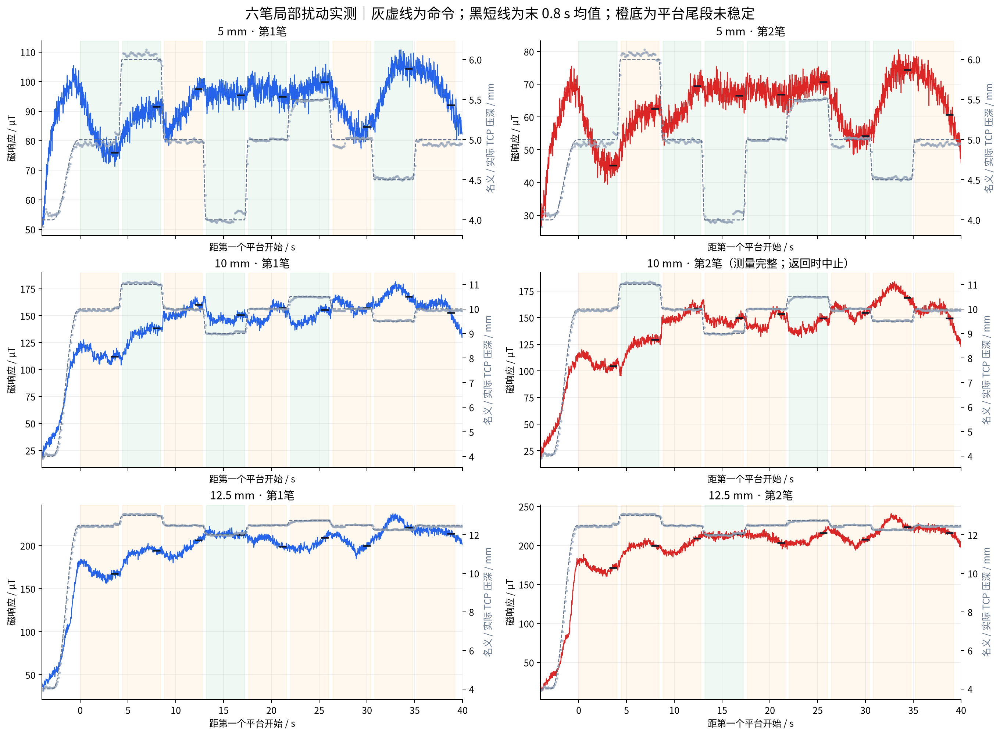
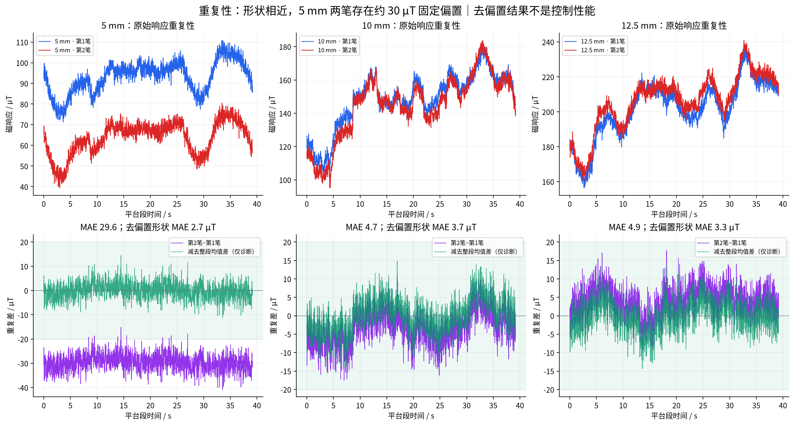
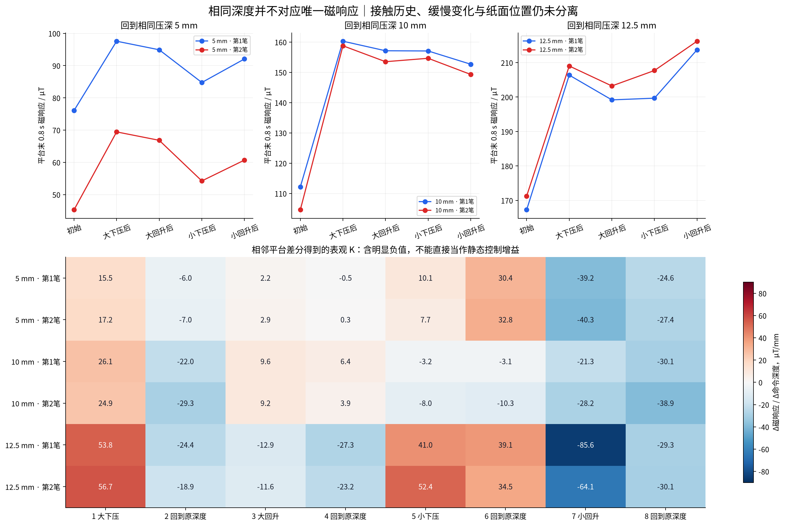
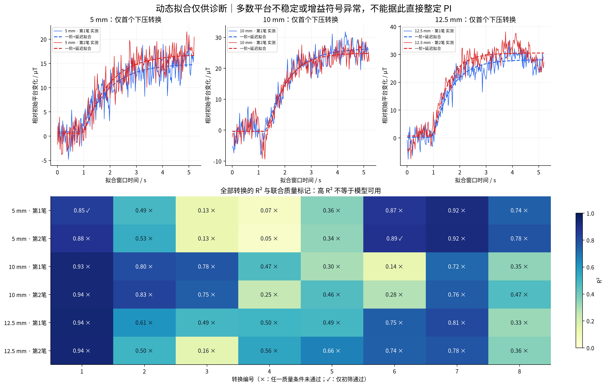
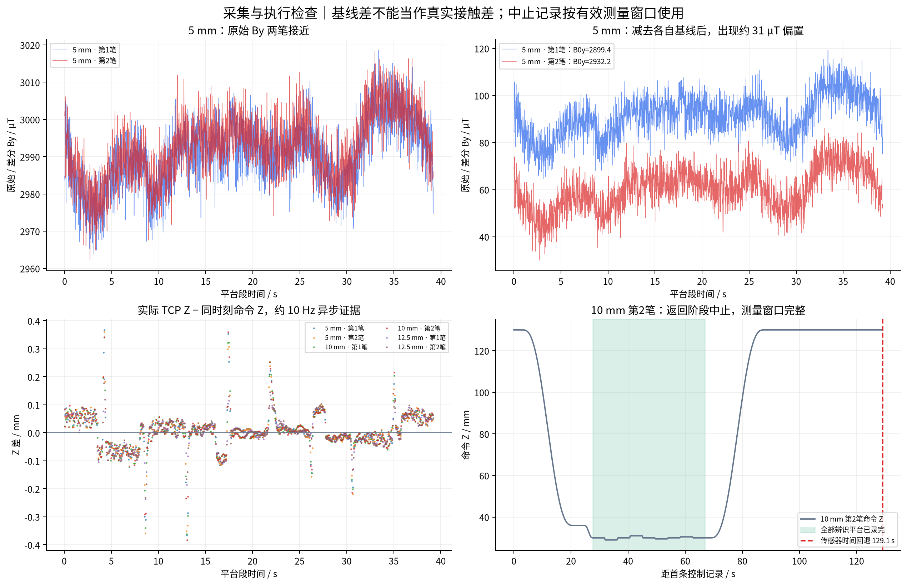

# 六笔局部辨识实测分析｜2026-09-25

## 结论

- 六笔的辨识测量窗口完整：每笔 9 个平台、8 次转换，共 54 个平台、48 次转换。10 mm 第2笔在后续高位返回时因传感器时间回退中止，整体状态仍标记 aborted；仅使用已核验的完整测量窗口。
- 10 mm 和 12.5 mm 两次实测曲线的平均绝对差分别为 **4.71、4.86 µT**。5 mm 原始磁响应相差 **29.59 µT**，减去整段固定均值差后形状差约 **2.74 µT**；这一诊断不等于已经完成在线基线补偿。
- 首个下压段的表观增益约为 **5 mm：15.5–17.2；10 mm：24.9–26.1；12.5 mm：53.8–56.7 µT/mm**。它提供了非线性敏感度的初步证据，但不能代表所有回程和小扰动转换。
- 多次回到同一深度后，磁响应仍比初始平台高；同深度平台的磁响应跨度约 **5 mm：21–24；10 mm：48–54；12.5 mm：45–46 µT**。
- 按既有启发式质量阈值，仅 **2/48** 次转换通过初筛，**27/48** 次平台差分增益为负，**34/54** 个平台尾段斜率超过 3 µT/s。当前不足以给出可推广的单一 K、延迟 L、时间常数 τ，或据此直接设定 PI。

## 1. 数据完整性与纳入规则

| 深度/重复 | 开始时间 | 全程状态 | 测量行数 | 有效 TCP/总数 | 进笔阶段峰值 / µT |
|---|---|---|---:|---:|---:|
| 5 mm · 第1笔 | 15-25-02 | completed | 1960 | 1307/1307 | 83.7 |
| 5 mm · 第2笔 | 15-29-34 | completed | 1960 | 1309/1309 | 51.1 |
| 10 mm · 第1笔 | 15-35-27 | completed | 1960 | 1317/1317 | 37.5 |
| 10 mm · 第2笔 | 15-37-57 | aborted | 1960 | 1288/1288 | 41.4 |
| 12.5 mm · 第1笔 | 15-41-18 | completed | 1960 | 1322/1322 | 51.1 |
| 12.5 mm · 第2笔 | 15-52-04 | completed | 1960 | 1322/1322 | 32.2 |

六笔全部使用 Z36 旋转接触、Ry15、+X10 mm/s、450 mm 行程。5/10 mm 的大扰动为 ±1 mm，12.5 mm 为 ±0.5 mm，小扰动为各自一半；所有重复均为 press-first。相同深度两笔 profile 和 settings 哈希一致，全部原始快照哈希核验通过。

**10 mm 第2笔中止的处理：**所有测量阶段结束于首条控制记录后约 **66.84 s**；两条 invalid 传感记录发生在 **129.08 s**，原因分别为 `sensor_time_rollback` 和 `sensor_time_faulted`，最后控制阶段为 `return_high`。每个测量计划 tick 均存在且顺序正确，测量时间窗内无 invalid 传感记录，因此纳入辨识窗口对比；未修改 manifest，未将该笔全程状态改为 completed。不能对这笔声称已完成最终等待或取得末端基线。

这是本批次的按测量窗口纳入规则。常规 `analyze_z_identification.py` 会拒绝 aborted 的整笔输入；本报告使用同一动态拟合函数，并在独立脚本中核验测量窗口完整性后处理该笔。

六笔主循环周期 P99 为约 **20.11–20.14 ms**，测量窗口内传感样本年龄 P99 小于 **0.30 ms**。本轮未见之前上千 µT 的进笔异常；但没有 Z38/Z36 的随机配对对照，不能因此断言高度修改就是改善原因。

## 2. 六笔时序与平台稳定性

图中灰虚线为命令深度，灰点为约 10 Hz 的异步实际 TCP，黑短线为平台最后 0.8 s 的磁响应均值；橙色底表示末尾 0.8 s 拟合趋势绝对值超过 3 µT/s。

| 深度/重复 | 尾段稳定的平台 / 9 | 通过全部初筛的转换 / 8 |
|---|---:|---:|
| 5 mm · 第1笔 | 6 | 1 |
| 5 mm · 第2笔 | 7 | 1 |
| 10 mm · 第1笔 | 3 | 0 |
| 10 mm · 第2笔 | 2 | 0 |
| 12.5 mm · 第1笔 | 1 | 0 |
| 12.5 mm · 第2笔 | 1 | 0 |

平台未稳定可能包含接触松弛、X 位置变化、笔毫状态和磁背景变化。本实验在保持 Z 时仍以 10 mm/s 行走，每个 4 s 平台覆盖约 40 mm 纸面，因此“平台末尾仍变化”不能自动全部解释为等待时间不够。单纯延长等待也会扩大纸面位置变化，需加入对照。

## 3. 重复性：固定偏置与波形形状分开看

按相同计划 tick 对齐全部 1960 条 id_* 控制记录，不使用动态时间规整。MAE 表示两次响应的差，不是跟踪目标误差。去偏置列仅减去这两笔的整段均值差，属于事后诊断。

| 压深 / mm | 原始曲线 MAE / µT | P95 绝对差 / µT | 第2笔−第1笔均值 / µT | 去偏置形状 MAE / µT |
|---:|---:|---:|---:|---:|
| 5 | 29.59 | 35.25 | -29.59 | 2.74 |
| 10 | 4.71 | 11.21 | -3.50 | 3.70 |
| 12.5 | 4.86 | 10.65 | 4.13 | 3.33 |

5 mm 两笔的原始 By 在测量段平均仅变化 **+1.85 µT**，但用于扣除的空载基线 B0y 增加 **32.82 µT**，因此 ΔBy 的两笔均值差约 **−30.97 µT**；最终 EMA 磁响应范数的差为 **−29.59 µT**。这给出了固定偏置与基线选择直接相关的证据。

这不能证明哪一笔基线才是“正确零点”，也不能直接把第二笔数据加上 30 µT 后当成真值。应在相同名义等待位增加回程后的空载稳定观测，确认基线是否恢复、是否受接触历史影响。

## 4. 局部增益与同深度回程偏差

差分口径：K_app =（后平台末 0.8 s 均值 − 前平台末 0.8 s 均值）/ 实际给定名义深度变化。因前后平台可能处于不同接触状态且未稳定，统一称为**表观增益**。

| 工作点 / mm | 首次下压第1笔 K_app | 首次下压第2笔 K_app |
|---:|---:|---:|
| 5 | 15.52 | 17.22 |
| 10 | 26.15 | 24.86 |
| 12.5 | 53.79 | 56.66 |

单位为 µT/mm。首个下压转换两次较一致，并随工作点压深增大。后续正/负与大/小扰动不能用同一个比例解释：48 次转换中有 27 次得到负差分增益。这些负值不应直接用于反转控制方向；需要先判断初始松弛、位置变化及历史状态的贡献。

同深度平台的具体例子：

- **10 mm 第1笔**：初始平台 112.15 µT；下压到 11 mm 后 138.30 µT；回到 10 mm 后反而为 160.28 µT。
- **10 mm 第2笔**：初始 104.58 µT，回到 10 mm 后 158.77 µT。
- **12.5 mm** 两笔的初始平台分别约 167.25、171.23 µT，后来同深度平台可达 213.72、216.21 µT。

因此，初始正向响应可重复，不代表整个实验符合“磁响应只由当前 Z 决定”的静态映射。也不能仅凭重复的负差分就断言机械臂执行方向错误。

## 5. 延迟与时间常数：只报告候选，不当作已辨识参数

拟合使用实际记录的平滑命令波形及主机时间，模型为一阶响应加纯延迟，估计偏置、增益、L、τ。延迟网格 0–1 s、步长 20 ms；τ 候选为 0.001 s 与 0.02–3 s 对数网格。模型包含机械臂跟随、采集、滤波和接触效应，不等于纯材料延迟。

下表**仅为第一个下压段的描述性拟合**，其余 42 次转换均保留在图和 CSV 中；不能用首段的较高 R² 掩盖其余模型失配。

| 工作点 / mm | 两笔拟合 L / s | 两笔拟合 τ / s | 两笔 R² |
|---:|---|---|---|
| 5 | 0.00 / 0.00 | 0.96 / 0.96 | 0.846 / 0.881 |
| 10 | 0.30 / 0.36 | 0.86 / 0.68 | 0.934 / 0.937 |
| 12.5 | 0.00 / 0.00 | 0.68 / 0.54 | 0.944 / 0.941 |

**0 s 是网格搜索选到下界，不能解释为物理上没有延迟。**10 mm 首段的 0.30–0.36 s 也不能直接推广到所有方向和幅度，因为前平台有趋势，其他转换明显不满足同一模型。

沿用既有初筛阈值：相邻平台尾段趋势均不超过 3 µT/s；响应幅度至少为相邻尾段标准差的三倍（标准差下限 1 µT）；差分与拟合增益均为正；R²≥0.8；不触及现有模型上边界或 τ 边界；时序正常。阈值是工程诊断，非统计置信保证。

| 标记 | 转换数（可重叠） |
|---|---:|
| 相邻平台至少一个不稳定 | 40 / 48 |
| 响应相对波动偏小 | 24 / 48 |
| 差分增益非正 | 27 / 48 |
| 模型搜索触边 | 26 / 48 |
| R²不足或拟合增益非正 | 40 / 48 |

仅 5 mm 第1笔的转换 1、5 mm 第2笔的转换 6 通过全部初筛，它们并非同一转换的两次独立复现，不能据此组成一组已验证 PI 参数。

## 6. 实际执行、基线与中止检查

| 深度/重复 | 实际 TCP Z 平均绝对差 / mm | P95 / mm | 同深度磁响应跨度 / µT |
|---|---:|---:|---:|
| 5 mm · 第1笔 | 0.046 | 0.117 | 21.50 |
| 5 mm · 第2笔 | 0.046 | 0.131 | 24.17 |
| 10 mm · 第1笔 | 0.045 | 0.124 | 48.14 |
| 10 mm · 第2笔 | 0.045 | 0.118 | 54.20 |
| 12.5 mm · 第1笔 | 0.040 | 0.100 | 46.47 |
| 12.5 mm · 第2笔 | 0.041 | 0.097 | 44.97 |

实际 TCP 的读取中点与同主机时刻命令比较，未做延迟补偿。平台尾段的实际深度顺序与指令一致：例如 10 mm 两笔依次约为 10.02→11.03→9.98→9.08→10.00→10.49→10.01→9.53→9.95 mm。没有看到命令正负方向被反向执行。

上述测量不能证明笔毫实际压缩量、纸面高度或接触点状态相同；约 10 Hz 的 TCP 也不能单独提供高频机械臂纯延迟。

## 7. 下一步建议

本轮结果不支持继续仅用“当前深度对应唯一磁响应”的模型直接整定固定 PI。PI 是否能满足 ±20 µT 仍未验证，数据也没有证明必须使用复杂控制器。

优先补能区分原因的对照，而不是原样再重复全部六笔：

1. **先选 10 mm 做固定 Z 行笔对照两笔**：保持同一 X 路径、速度、进笔和加载过程，进入工作点后不加 Z 扰动，记录约 39 s。用于判断在没有 Z 激励时，是否也会出现几十 µT 的变化。此为后续实验建议，本次未创建或执行该模式。
2. **在相同等待位加足够的前后空载观测**，分析基线恢复与笔间偏置；先解决类似 5 mm 两笔的固定差，避免把零点差作为真实接触误差补偿。
3. 有了固定 Z 对照后，再改变扰动顺序或开始位置，检查同一 Z 转换能否在不同 X 位置复现，减少输入与纸面位置的混淆。根据结果决定是否延长平台、增加方向/历史状态补偿或进行局部增益调度。

当前较深工作点首段 K 较大，任何后续反馈增益都应考虑这一差别；本报告不修改控制参数，也不从负差分直接推导负反馈增益。

## 方法、输出与复现

- 信号：既有控制日志中的 EMA 磁响应，单位 µT；深度 d=40−Z 是名义命令压深。
- 每个平台取末 0.8 s 均值/标准差/线性趋势；所有样本保持原始时间与阶段归属。
- 六笔 raw 均未修改；原始流 SHA256 保存于 `six_local_metrics.json`。
- `01_六笔轨迹与磁响应`、`02_重复性与固定偏置`、`03_回程偏差与表观增益`、`04_动态拟合与可信度`、`05_基线执行器与中止诊断` 均输出 PNG/PDF。
- `quality.csv`、`repeatability.csv`、`plateaus.csv`、`transitions.csv` 为指标表；`six_local_metrics.json` 保留全部细节和质量标记。
- `reproduce_six_local.py` 为本批次生成代码（需将 OUT 改为新目录后重跑，默认不覆盖已有结果）。

两次重复仅提供初步重复性证据，无独立验证集。固定顺序与持续 +X 行走使深度、历史和位置效应仍有混淆。
