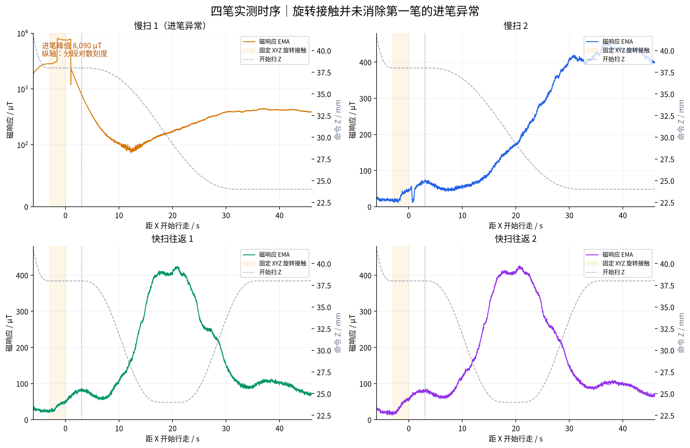
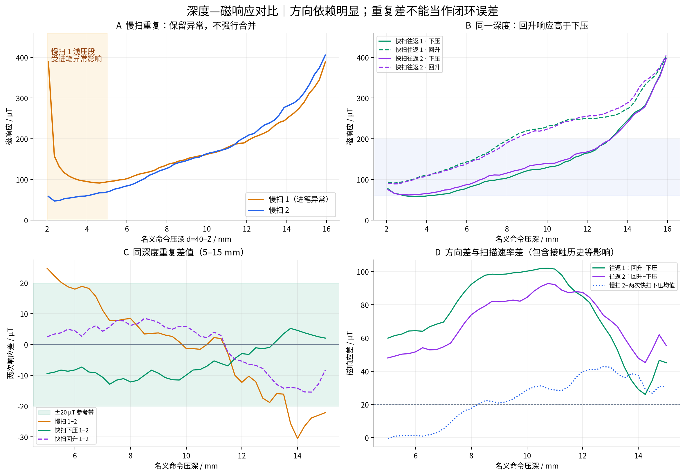
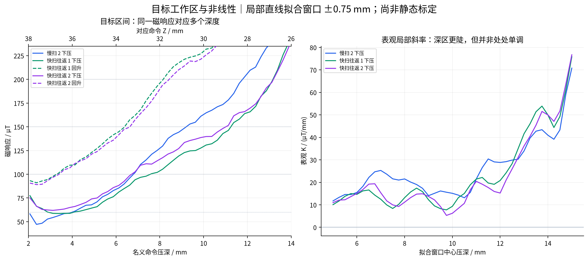
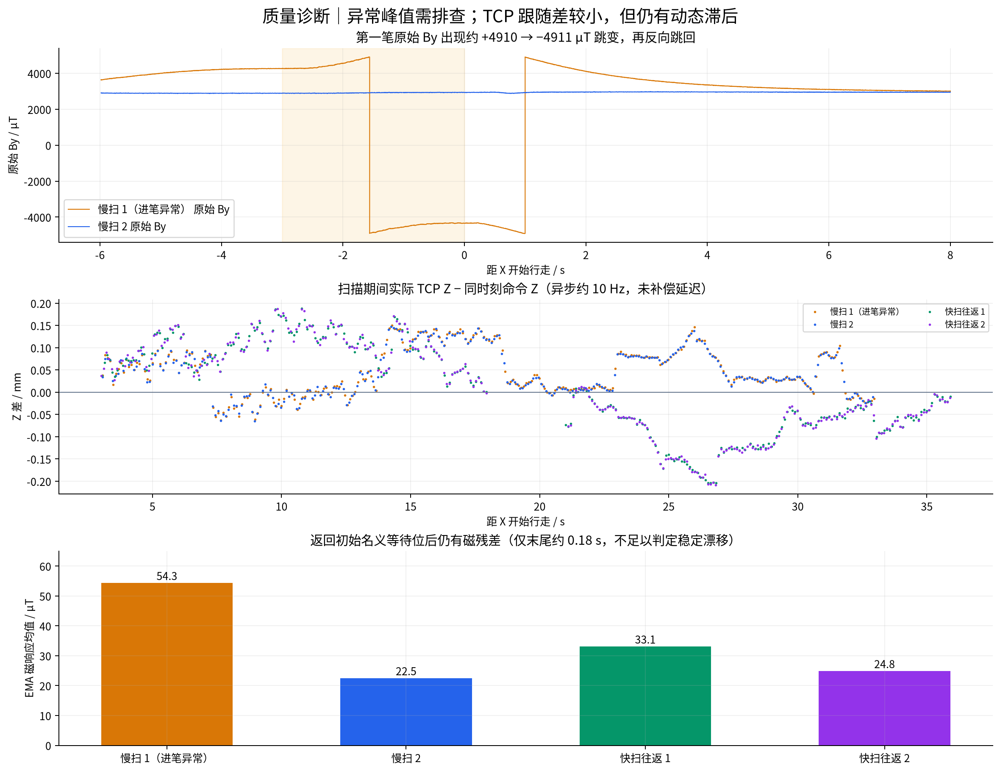

# 2026-09-25 四笔 Z 扫描实测分析

## 结论

1. 两笔快扫的同方向曲线有初步重复性，但下压与回升的分支差远大于重复差。当前数据不支持用单一静态深度—磁响应表准确描述整个往返过程。
2. 第一笔慢扫出现异常进笔及原始 By 突跳，暂不用于反查前馈深度；原始记录与异常曲线均保留。
3. 深区表观斜率显著增大，支持按工作点选择控制增益；斜率并非处处单调，扫描斜率仍混有动态效应。
4. 实际 TCP 记录显示扫描 Z 差较小；这四笔的主循环未见持续降频。没有关 TCP 的配对对照，不能据此证明读取完全没有代价。
5. 这批扫描不足以唯一确定磁响应的局部延迟/时间常数，也尚未验证前馈+PI 能否达到 ±20 µT。

## 输入与完整性

| 记录 | 时间 | 状态 | 控制行 | 有效 TCP / 总数 |
|---|---|---|---:|---:|
| 慢扫 1（进笔异常） | 14-25-49 | hardware / completed | 6638 | 1323 / 1323 |
| 慢扫 2 | 14-28-57 | hardware / completed | 6638 | 1324 / 1324 |
| 快扫往返 1 | 14-32-02 | hardware / completed | 6507 | 1299 / 1299 |
| 快扫往返 2 | 14-35-25 | hardware / completed | 6507 | 1298 / 1298 |

四笔的 settings 快照相同，同模式的轨迹/配置哈希一致。全部 manifest 快照哈希已核验，磁传感记录无被采集器标记为 invalid 的行。`valid` 仅表示通过现有采集校验，不能证明不存在物理量程或数值异常。原始数据未修改。

主循环周期中位数均约 20.00 ms，P99 为 20.10–20.13 ms；慢扫 1、往返 1、往返 2 各在最后抬笔阶段出现一次遗漏计划 tick 和一次重复 tick，扫描段未发生这类异常。独立 TCP 全部有效，读取最大耗时 16.65–22.40 ms；由于在后台独立连接读取，不等于主线程增加同等阻塞。

## 1. 第一笔进笔异常

- 慢扫 1 在旋转接触阶段的 EMA 磁响应峰值为 **8089.9 µT**；后三笔的旋转接触加初始滑动阶段峰值约 **72.4、85.1、83.8 µT**。
- 第一次 By 跳变为 **+4910.40 → −4911.45 µT**，发生在旋转接触阶段，命令 Z38、Ry 约 23.06°；第二次为 **−4914.30 → +4910.40 µT**，发生在初始行走阶段。
- 数值形态疑似存在量程边界/数值回绕问题，但当前文件不足以确认机制，也不能将 8090 µT 当作可信的正常受压峰值。应结合现场操作和传感器原始协议核查。
- 慢扫 1 的浅压曲线持续下降，进入后续压深区域才接近其他曲线。因此保留其深区对比，但不用于目标反查或静态标定。5 mm 是本报告统一比较窗口的下界，不表示已证明从该点起异常完全消失。

### 针对“前 3 秒后能否使用”的补充核查

操作者说明未留意第一笔现场细节，认为峰值可能来自挤压，并希望重点使用恢复后的下压数据。本报告保留该解释作为现场假设；挤压和原始 By 的数值突跳也可能同时发生，不能仅凭日志确认全部峰值的物理意义。

第一笔 **3 秒后尚未恢复**。下面时间均从 X 开始行走计起；磁响应取以该时刻为中心的 1 秒均值，用于避免单样本噪声影响比较：

| 行走时间 / s | 名义压深 / mm | 慢扫 1 / µT | 慢扫 2 / µT | 差值 / µT |
|---:|---:|---:|---:|---:|
| 3 | 2.00 | 809.7 | 68.9 | 740.8 |
| 5 | 2.04 | 334.8 | 57.0 | 277.8 |
| 8 | 2.50 | 139.1 | 47.6 | 91.5 |
| 10 | 3.22 | 105.1 | 55.2 | 49.9 |
| 12 | 4.30 | 92.5 | 63.3 | 29.2 |
| 14 | 5.68 | 98.7 | 80.1 | 18.6 |
| 16 | 7.29 | 121.9 | 113.1 | 8.8 |

以“两笔同时间曲线差的 1 秒滑动均值进入 ±20 µT，且持续至少 2 秒”为探索判据，首次约发生在行走 **13.8 秒、压深 5.53 mm（Z≈34.47 mm）**。该时刻不是材料恢复时间常数，也不证明后面所有数据无偏差；深区约 14 mm 时两笔仍有约 30 µT 差值。

处理方式：前段标记为进笔异常影响；后段继续保留用于深度响应和重复差分析。用于建立前馈曲线时需独立重复确认，不能简单删除最初 3 秒就把整条扫描视为正常标定。

## 2. 重复性与上下行分支差

统计方法：按 0.25 mm 名义命令压深分箱，取 EMA 磁响应均值，每箱至少 5 个样本；插值至 **5–15 mm、间隔 0.25 mm** 的共同深度网格。每个深度等权，不按时间采样密度加权。下表是曲线差，**不是目标跟踪误差**。

| 对比 | 平均绝对差 / µT | P95 绝对差 / µT | 最大绝对差 / µT |
|---|---:|---:|---:|
| 两次慢扫下压（含异常笔深区） | 12.2 | 25.7 | 30.5 |
| 两次快扫下压 | 7.1 | 11.7 | 12.9 |
| 两次快扫回升 | 6.9 | 14.2 | 15.5 |
| 往返 1：回升−下压 | 74.9 | 101.5 | 102.0 |
| 往返 2：回升−下压 | 69.4 | 91.0 | 92.8 |
| 慢扫 2−两次快扫下压均值 | 23.1 | 41.0 | 42.8 |

两次快扫的下压差、回升差在上述网格上均不超过 20 µT；但同一笔的上下行分支差平均约 **69–75 µT**，最大约 **93–102 µT**。分支形状在两笔中相似，是值得进一步辨识的系统性现象。

**因果限制：**X 始终向前，同一深度的下压和回升发生在不同纸面位置、不同接触历史和不同时间；慢扫与快扫的同深度位置也不同。因此不能把所有分支差直接称为材料迟滞，也不能把慢快差全部称为纯速率效应。

## 3. 目标 60–200 µT 与工作深度

名义压深定义为 d=40−Z，不是实际笔毫变形量。下表来自扫描曲线反查，仅用于选择后续实验工作点，不能直接替换前馈表。第一笔慢扫因进笔异常排除；对每条曲线采用最低点之后的首次向上穿越，不外推。

| 目标 / µT | 慢扫 2 下压 d / mm | 快扫下压 d / mm（两笔） | 快扫回升 d / mm（两笔） |
|---:|---:|---|---|
| 60 | 3.99 | 4.08 / 未覆盖 | 未覆盖 / 未覆盖 |
| 100 | 6.79 | 7.57 / 6.71 | 3.29 / 3.39 |
| 150 | 9.20 | 11.24 / 11.01 | 6.39 / 6.63 |
| 200 | 11.78 | 13.17 / 13.19 | 8.15 / 8.42 |

例如 **150 µT**：两笔快扫下压约需 **11.01–11.24 mm**，回升约为 **6.39–6.63 mm**。这个约 4.4–4.9 mm 的表观映射差进一步说明，不能只用一个深度查表值代表全部历史状态。

60 µT 接近浅压区响应下限：慢扫 2 和快扫往返 1 的下压曲线可穿越 60，但快扫往返 2 的分箱曲线未覆盖；两笔回升曲线在本次 2–16 mm 范围内也未覆盖 60。不能通过外推声称该目标在所有阶段均可稳定达到。

## 4. K 随深度变化

以下为下压分支在工作点 ±0.75 mm 内作局部直线拟合的**表观斜率**，不等于固定深度充分稳定后的静态 K。

| 压深 / mm | 慢扫 2 | 快扫 1 | 快扫 2 |
|---:|---:|---:|---:|
| 5 | 11.7 | 10.1 | 11.0 |
| 7.5 | 21.6 | 8.4 | 10.0 |
| 10 | 15.1 | 9.3 | 6.2 |
| 12.5 | 29.9 | 28.3 | 26.0 |
| 15 | 70.8 | 75.9 | 76.7 |

单位均为 µT/mm。5 mm 附近约 10–12，12.5 mm 约 26–30，15 mm 约 71–77；深区更敏感。中间区域有平台和斜率起伏，数据不支持“每增加一点压深，K 必然严格增大”的强假设。

## 5. 执行器、基线与延迟

异步实际 TCP 使用读取请求的中点时间，与同主机时刻插值的命令比较；没有将 10 Hz 位姿插成伪实测高频证据，也没有补偿延迟。

| 记录 | 扫描 Z 平均绝对差 / mm | P95 / mm | 最大 / mm | 返回等待位后的磁残差 / µT |
|---|---:|---:|---:|---:|
| 慢扫 1（进笔异常） | 0.055 | 0.136 | 0.150 | 54.3 |
| 慢扫 2 | 0.055 | 0.133 | 0.148 | 22.5 |
| 快扫往返 1 | 0.089 | 0.170 | 0.204 | 33.1 |
| 快扫往返 2 | 0.090 | 0.174 | 0.209 | 24.8 |

Z 差平均约 0.055 mm（慢扫）和 0.090 mm（快扫），最大不超过 0.209 mm；快扫下压/回升误差符号相反，符合存在跟随滞后的表现。以这一级命令—位姿差，不能直接解释全部 69–75 µT 的分支差；同时，本数据也不能将伺服滞后、材料动态、滤波及空间效应完全分离。

返回初始名义等待位后仍有 22–54 µT 的磁响应。当前终点观察仅约 0.18 s，不能确认是稳定基线漂移还是尚未恢复。末端位置不同的 post_lift_hold 不可直接作为同位置基线对照。

**延迟结论：**本报告不从单调扫描强行输出唯一磁延迟 L 或时间常数 τ。它们仍需局部正负扰动、充分平台和独立验证；实际 TCP 采样约 10 Hz，也限制了快速位姿动态的分辨率。

## 6. 下一步实验与控制方案判断

1. **补一笔正常慢扫**，得到至少两笔没有异常进笔的慢扫记录。先核对第一笔现场情况及 By 突跳来源；保留原始异常笔。
2. **局部工作点优先选 5、10、12.5 mm，各做两次**，覆盖浅、中、较深的目标工作区；当前 15–16 mm 响应已显著超过 200 µT，优先级较低。若需要更贴近快扫的 200 µT 点，再补约 13 mm 工作点。
3. 局部扰动幅度需结合本次斜率检查：原 10 mm 工作点 ±0.4 mm 预计变化仅约 2.5–6 µT，可能不足以清晰辨识。宜先确定磁噪声与响应幅度，再决定是否增大；本报告没有修改执行参数。
4. 接触初始化应结合磁信号是否恢复稳定来评价；固定 3 s 初始滑动对异常第一笔明显不够。后续可增加同位置悬空恢复观测，区分基线变化与接触残留。

**对前馈+PI的判断：**PI 仍可作为候选反馈结构，但这一批数据不能证明单一静态前馈表加固定 PI 已足够。应先测小扰动下分支差是否仍显著；若显著，再比较按方向/历史状态选择前馈、按局部 K 调整反馈增益与抗饱和的方案。不能把一次 2→16→2 mm 大回线直接当作日后 ±0.3 mm 小修正的迟滞幅度。

## 文件与复现

- `01_四笔时序与进笔.png/.pdf`
- `02_深度响应与重复性.png/.pdf`
- `03_目标区间与表观增益.png/.pdf`
- `04_异常与执行器诊断.png/.pdf`
- `four_sweep_metrics.json`：全部指标、口径和原始流 SHA256。
- `quality_metrics.csv`、`target_crossings.csv`、`apparent_gains.csv`：机器可读表。
- `comparison.json`、`sweep_curves.csv` 与逐笔图：既有分析工具输出。
- `reproduce_comparison.py`：本批次对比图和指标生成代码；仅读取 raw。

目前每种模式只有两笔，全部用于探索，未设置独立验证集。所有判断限于本次装配、纸面和操作条件。
