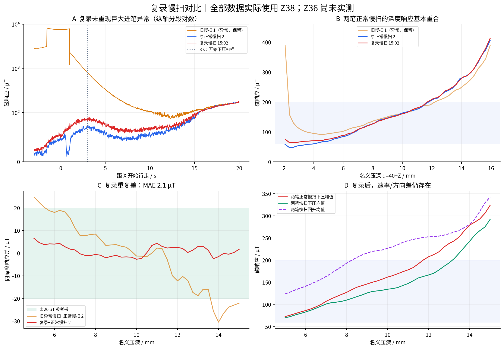

# 复录慢扫更新分析

## 数据与结论

复录记录：`15-02-32_连续下压_Z38到24mm_单程30s_第3次`，状态 hardware/completed。配置与原正常慢扫 2 相同，**实际接触高度仍为 Z38**。

- 进笔阶段峰值 **88.6 µT**，开始下压时 **88.7 µT**；没有重现旧慢扫 1 的 8089.9 µT 峰值。
- 原始 By 范围为 **2874.3–3357.4 µT**，无超过 1000 µT 的相邻样本突跳。
- 复录浅区仍有先回落再随深度上升的过程；“没有巨大异常”不表示 3 秒时已完全达到静态平衡。

## 同深度重复性（5–15 mm）

| 指标 | 复录 vs 正常慢扫 2 | 旧异常慢扫 1 vs 正常慢扫 2 |
|---|---:|---:|
| 平均绝对差 / µT | 2.14 | 12.17 |
| P95 绝对差 / µT | 4.33 | 25.66 |
| 最大绝对差 / µT | 6.50 | 30.51 |

每条曲线先按 0.25 mm 命令深度分箱，至少 5 个样本/箱，再插值到 5–15 mm、间隔 0.25 mm 的共同网格，等深度加权。这是两条实测响应曲线的差，不是闭环跟踪误差，也不是统计置信区间。

两笔正常慢扫下压均值相对两笔快扫下压均值，平均差 **23.6 µT**。原先观察到的上下行分支差仍存在；复录提高了慢扫重复性证据，没有消除速率/历史/纸面位置混合影响。

## 目标反查（仅用于选择工作点）

| 目标 / µT | 正常慢扫 2 压深 / mm | 复录慢扫压深 / mm |
|---:|---:|---:|
| 60 | 3.99 | 未覆盖 |
| 100 | 6.79 | 6.72 |
| 150 | 9.20 | 9.32 |
| 200 | 11.78 | 11.69 |

反查使用分箱曲线最低点之后的首次向上穿越，不外推。低端目标接近浅压响应下限，不能以完整目标范围均可达来解释这张表。

## 后续 Z36 配置

按操作者要求，后续默认旋转接触/起扫高度改为 Z36；高位 Ry30 下降至 Z36，固定 TCP XYZ 转到 Ry15，再向 +X 行走。慢扫 Z36→24；往返 Z36→24→36。名义压深参考仍为 40 mm，因此扫描范围改为 4–16 mm。

**36 比 38 更低 2 mm**，本次复录数据不能证明这一改动降低挤压或异常；是否有效需新高度实测。旧 Z38 与新 Z36 的接触历史、覆盖深度及同一扫描时长下的 Z 速度均不同，应分条件比较。

既有 Z38 原始记录和先前报告保留，旧异常笔仍可用于异常诊断。更新后的慢扫重复性以“原正常慢扫 2 + 复录慢扫”为主。

原始流 SHA256 保存于 `复录对比指标.json`，未修改原始数据。

## 软件验证记录

Z36 配置的两种扫描、五档局部扰动共七种离线预检通过；辨识相关测试 36 项通过。全套结果为 731 通过、7 跳过、3 失败。失败均来自任务开始前已有修改的 `scripts/return_to_origin.py`：回原点 X 已为 −370 mm，而测试仍期望 −200 mm；本次未修改该脚本或其测试。失败项：

- `tests/test_return_to_origin.py::test_confirmed_return_sends_one_direct_move_to_code_defined_origin`
- `tests/test_return_to_origin.py::test_main_uses_hardcoded_connection_defaults_without_cli_arguments`
- `tests/test_return_to_origin.py::test_main_allows_return_from_140_mm_high_position`

文档布局检查通过。本次未连接机械臂，Z36 的实际进笔效果尚未验证。
