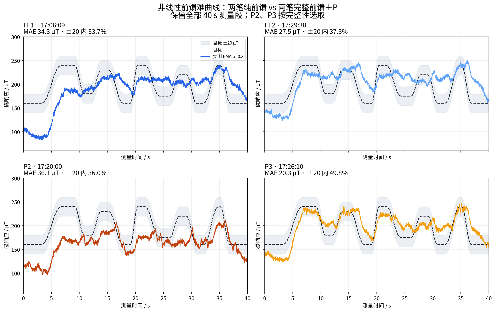
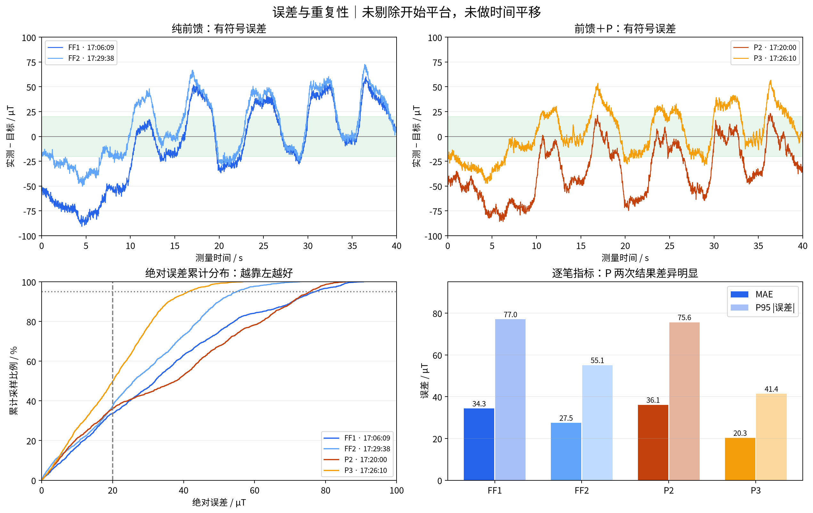
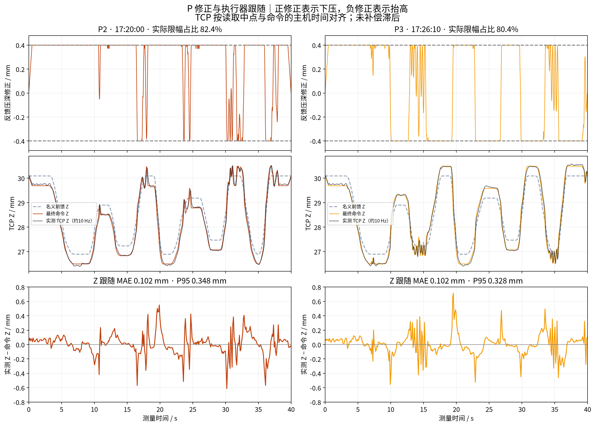

# 非线性前馈难曲线：四笔完整记录分析

## 选取与计算口径

使用 FF 17:06:09、17:29:38，以及 P 17:20:00、17:26:10（目录第2、3次）。这四笔均 completed、hardware，2001 个连续测量点、完整 40 s，目标及 XY 与快照一致，所有 manifest 输入哈希验证通过。目标、前馈表、现场设置、旋转进笔配置哈希一致；两笔 P 参数完全一致：Kp=2、Ki=0、±0.4 mm。

P 17:11:37 因 acceleration_limit 中止，仅 38.20 s、1911 点，保留为部分记录，不纳入主比较。筛选只按完整性、配置、记录质量，未按误差挑选。部分笔自身 MAE 24.37 µT 也没有用于替换较差的完整 P2。

全部指标使用 measure_00 的原始记录 a_control_uT（EMA α=0.3），误差=实测−目标；未去掉前3秒、未重新滤波、未平移曲线、未重拟合基线。±20 为采样点比例；严重偏离描述阈值定义为 |误差|>50 µT，持续时间按左端采样对应区间求和，总计40 s。完整2001点均参与点统计。

## 四笔结果

| 笔次 | MAE / µT | P95绝对误差 / µT | ±20内 | 平均有符号误差 / µT | >50总时长 / s | 实际±0.4 mm限幅占比 |
|---|---:|---:|---:|---:|---:|---:|
| FF1 · 17:06:09 | 34.32 | 77.02 | 33.68% | -8.10 | 10.08 | 0.00% |
| FF2 · 17:29:38 | 27.46 | 55.07 | 37.33% | +9.68 | 3.98 | 0.00% |
| P2 · 17:20:00 | 36.09 | 75.62 | 35.98% | -34.07 | 12.96 | 82.36% |
| P3 · 17:26:10 | 20.26 | 41.37 | 49.78% | +2.62 | 0.34 | 80.36% |

## 模式汇总与重复性

- 两笔等权平均 MAE：FF **30.89** → P **28.17 µT**，描述性下降 **8.8%**。
- ±20内：FF **35.51%** → P **42.88%**。尚未达到“大部分误差≤20 µT”。
- 合并各模式4002点得到的 P95：FF 71.07、P 70.69 µT；这是合并分位数，不是两笔 P95 的平均。
- 同一时刻两次实测曲线之间的 MAE：FF **18.03 µT**，P **36.69 µT**。两次重复不足以估计稳定的总体方差；不能给出因果改善或统计显著性结论。
- FF1 采用修复前调度，其测量实际记录仍为完整连续2001点；其余三笔采用 sequential_20ms。记录完整性通过，但版本差异保留在 summary.json，不能称所有软件条件完全相同。

## 为什么 P 改善不稳定

1. **修正范围经常耗尽。** P2/P3 实际 |depth_fb|达到0.4 mm的比例分别 82.4%/80.4%。P2下压上限占比 77.1%，整体仍偏低 34.1 µT。limit_reasons 中 acceleration、z_speed 等表示原始请求落在约束外，并不等于最终已发送指令违规。
2. **按本表预测，±0.4 mm只对应约6–15 µT调整量。** 这是同一静态表的插值估算，不是这四笔新测出的局部增益；实际接触和动态下可能不同。Kp=2时原始请求约在5 µT误差处即触幅值限幅，继续增大Kp对已到幅值上限的部分无法增加修正行程。
3. **同样目标、同样高度，笔内及笔间信号变化大。** 两笔FF首次160 µT平台的平均误差分别 -64.7/-23.2 µT；末次160 µT平台为 +29.2/+33.1 µT。仅以Z为输入的静态表在这组轨迹中无法同时解释两端；加载历史、X位置、含水量、纸面和基线均可能参与，现有数据不能拆分因果。
4. **升降方向存在误差差异。** 目标导数>1 µT/s为上升、<-1为下降，其他为近平台（阈值仅用于分组）。P2上升/下降平均误差 -46.2/-20.7 µT；P3为 -9.1/+16.2 µT。方向相关误差与动态滞后相容，但本实验不能单独辨识纯延迟或回滞。

## 实际 TCP 与采集质量

四笔实际TCP均无无效记录；磁测量最大样本年龄均≤1.21 ms，控制记录最大相邻主机时间间隔均≤21.03 ms；修复后的两笔P均完成抬笔回程。未发现这几笔因姿态读取导致的中止或明显控制掉拍。

TCP采用读取开始/结束中点时间，在共享host_monotonic时钟上对已发送Z命令线性插值。约10 Hz只能诊断较慢跟随，不能排除高频误差，也不把其偏差直接解释成纯伺服延迟。

- FF1/FF2 Z跟随MAE：0.078/0.077 mm。
- P2/P3 Z跟随MAE：0.102/0.102 mm；P95：0.348/0.328 mm，转换段的实际跟随仍有偏差。
- P2/P3空载B0y分别 2955.09/2929.50 µT。这是不同基线快照，不能把差值直接当作磁幅值跟踪误差，更不能据此认定应手工改基线。

## 下一步优先级

1. 先复核160/200/240 µT短平台在同一进笔、固定沾水流程下的笔间偏差，并记录首次与经历深压后的返回平台；用实测判断是否需每笔工作点校正或区分加载/回升。
2. 再依据新实测局部增益评估所需修正行程，并设置有依据的深度、速度和加速度限制；当前数据不能直接证明更大的修正范围可用。
3. 在修正行程和重复性得到支持后，再测试局部增益调度P或带抗饱和的慢积分。现有结果不足以判定“前馈＋PI一定足够”，也不支持仅增大Kp就能达标。

本次只读取原始记录并生成分析文件，没有修改表、控制器参数、实验脚本或raw数据。

完整审计与分段指标见 [summary.json](summary.json)，四笔指标见 [metrics.csv](metrics.csv)。所有PNG另附同名PDF。重现：在任意目录运行 `python /home/ethan/FYP/runs/brush2/2026-09-25/06_非线性前馈难曲线对比/analysis/nonlinear_ff_p_selected_20260925/analyze.py`。
