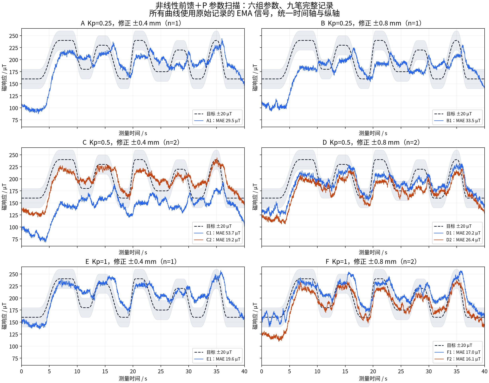
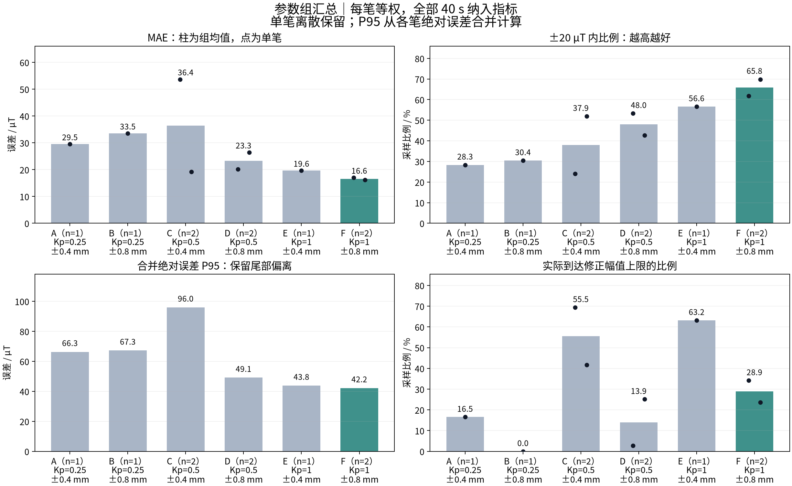
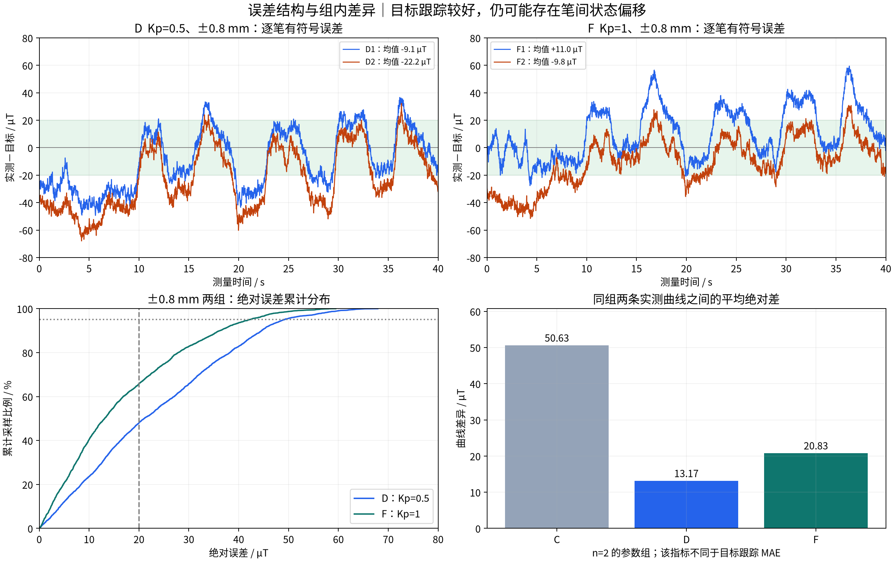
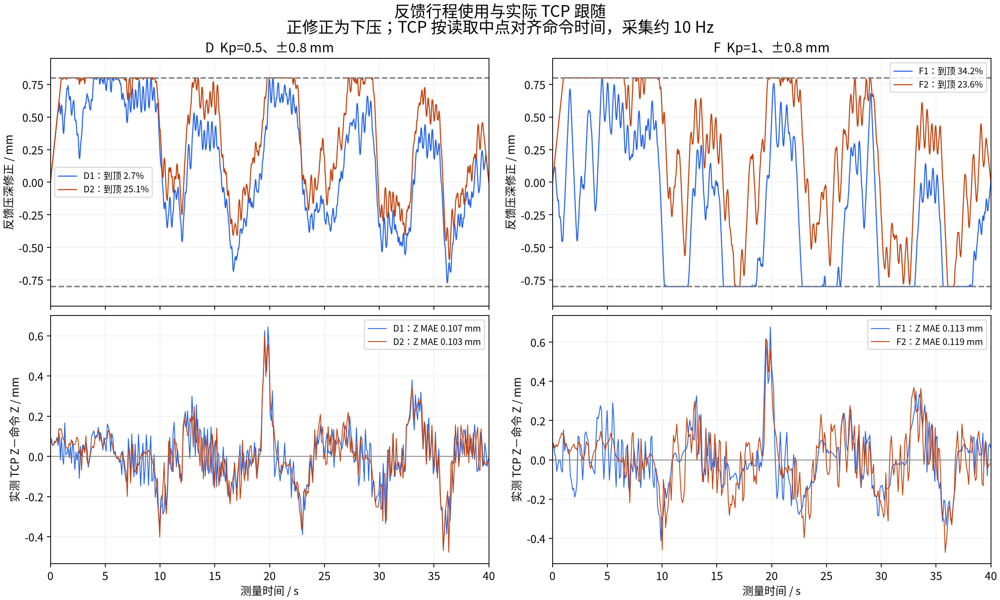

# 非线性前馈＋P 参数扫描综合分析

## 1. 实验范围与结论

本实验采用同一条 160–240 µT 难目标曲线，比较 Kp=0.25、0.5、1 与修正行程 ±0.4、±0.8 mm 的六种组合。共纳入 **9 笔真机记录、6 组参数**，统一按参数归组分析。

在现有数据中，**F 组（Kp=1、Ki=0、修正 ±0.8 mm）适合作为后续控制实验的基准**：平均 MAE 为 **16.58 µT**，±20 µT 内比例为 **65.84%**，两笔 MAE 为 16.13–17.02 µT。该组的跟踪误差在本批参数中较低，但仍存在初始平台偏差、尾部偏离和笔间状态差异，尚不能认为已经稳定达到全程贴合目标的要求。

## 2. 共同条件与计算口径

- 同一前馈表、目标 StrokePlan、现场设置及旋转进笔配置，四项输入文件哈希一致；Ki 均为 0。
- X 速度 10 mm/s，测量段长 400 mm、时长 40 s；Z36、Ry30°→15°旋转接触后滑动加载。
- 修正速度 2 mm/s、加速度 30 mm/s²、首尾渐变 1 s；控制指令间隔 20 ms，实际 TCP 采用独立连接约 10 Hz 记录。
- 九笔均 completed、hardware，每笔有 2001 个连续测量点，时间、目标及 XY 与输入快照一致；快照哈希及测量引用的传感器有效性校验通过。
- 误差统一定义为 **记录的实测 EMA 信号－目标**，正值偏高，负值偏低。所有主指标保留完整 0–40 s；不裁剪首段、不重新滤波、不平移信号、不调整基线。
- 组 MAE 为单笔 MAE 的等权平均；±20 比例合并该组全部采样点；P95 从各笔的绝对误差合并计算，未对平均曲线评分。各笔点数相同，因此组 MAE 也等于合并绝对误差均值。
- “严重偏离”用于描述 |误差|>50 µT；按每个 20 ms 区间左端点判定累计时长，不把末尾采样点算成额外区间。到顶比例按实际 `depth_fb_m` 达到该组 ±行程上限计算。

## 3. 六组参数的总体比较

| 组 | Kp | 修正/mm | 笔数 n | 平均 MAE/µT | 单笔 MAE 范围/µT | ±20 内 | 合并 P95/µT | 平均 >50 时长/s | 平均到顶比例 |
|---|---:|---:|---:|---:|---:|---:|---:|---:|---:|
| A | 0.25 | ±0.4 | 1 | 29.50 | 29.50–29.50 | 28.29% | 66.32 | 6.08 | 16.54% |
| B | 0.25 | ±0.8 | 1 | 33.51 | 33.51–33.51 | 30.38% | 67.25 | 10.08 | 0.00% |
| C | 0.5 | ±0.4 | 2 | 36.43 | 19.16–53.69 | 37.93% | 95.97 | 11.09 | 55.52% |
| D | 0.5 | ±0.8 | 2 | 23.30 | 20.17–26.43 | 48.00% | 49.13 | 1.77 | 13.92% |
| E | 1 | ±0.4 | 1 | 19.64 | 19.64–19.64 | 56.57% | 43.81 | 1.06 | 63.22% |
| F | 1 | ±0.8 | 2 | 16.58 | 16.13–17.02 | 65.84% | 42.20 | 0.52 | 28.89% |

n=1 的组仅反映一笔观测，不具备组内离散估计。单笔范围表示实测最小值至最大值，不是置信区间。





### 3.1 Kp 与行程需要联合考虑

在 ±0.8 mm 条件下，D 组 Kp=0.5 的平均 MAE 为 23.30 µT，F 组 Kp=1 为 16.58 µT，描述性降低 **28.9%**；±20 内比例由 48.00% 提高到 65.84%，每笔平均严重偏离时长由 1.77 s 降至 0.52 s。F 的两笔 MAE 均低于 D 的两笔。

Kp=1 时，±0.4 mm 的 E 组平均到顶比例为 63.22%，±0.8 mm 的 F 组为 28.89%，同时 F 的平均跟踪指标较好。这支持继续使用 ±0.8 mm 作为当前实验范围；E 仅一笔，不能把两组差异完全归因于行程。

Kp=0.25 时，B 组 ±0.8 mm 的 MAE 高于 A 组 ±0.4 mm，且 B 的实际修正没有到达 ±0.8 mm 上限。因此本批结果不支持“单独增加行程就一定改善”，也不支持把六组观测解释为严格单调的增益规律。

### 3.2 组内差异仍会影响判断

C 组两笔 MAE 为 53.69 和 19.16 µT，平均为 36.43 µT；两条实测曲线之间平均绝对差为 50.63 µT。较大的偏差记录完整纳入该组，组均值与单笔范围共同体现其表现。

F 组两笔目标跟踪 MAE 接近，但有符号平均误差分别为 +11.01 和 −9.81 µT，偏差方向改变；两条实测曲线之间平均绝对差为 20.83 µT。不能用正负误差相互抵消后的组均值判断“无偏”，也不能把较小的跟踪 MAE 等同于接触状态一致。



## 4. 平台、过渡和限幅的具体表现

- F1 在目标下降段的平均实测偏高约 25.18 µT；F2 对应约 1.71 µT。方向相关的偏差程度并不固定，现有数据不足以确定统一的回升补偿量。这里按目标导数 >1 / <−1 µT/s 区分上升/下降，其余为近平台。
- F2 的首次 0–3 s 平台平均偏低约 38.48 µT，该首段仍包含在正式评分中。完整 40 s 的 MAE 为 16.13 µT、±20 内为 69.87%，全程平均指标不能替代局部平台检查。
- F1 到顶主要在抬高方向，F2 主要在下压方向。相同参数需要相反修正，提示前馈偏差及笔间状态具有变化；暂不由单笔现象决定整体下移前馈表或继续扩大行程。
- `limit_reasons` 记录原始请求受到哪些约束；出现 acceleration 等名称不等于最终发送指令违规。图中的到顶比例按实际修正量计算，和原始请求受限比例分开。



## 5. 逐笔指标

记录编号在同一参数组内按采集时间分配，用于连接曲线、指标与原始数据。

| 记录 | MAE/µT | ±20 内 | P95/µT | 实测－目标均值/µT | >50 总时长/s | 实际到顶比例 |
|---|---:|---:|---:|---:|---:|---:|
| A1 | 29.50 | 28.29% | 66.32 | -9.13 | 6.08 | 16.54% |
| B1 | 33.51 | 30.38% | 67.25 | -19.00 | 10.08 | 0.00% |
| C1 | 53.69 | 23.99% | 102.98 | -53.58 | 22.14 | 69.42% |
| C2 | 19.16 | 51.87% | 37.09 | -2.95 | 0.04 | 41.63% |
| D1 | 20.17 | 53.27% | 39.25 | -9.06 | 0.00 | 2.70% |
| D2 | 26.43 | 42.73% | 55.55 | -22.22 | 3.54 | 25.14% |
| E1 | 19.64 | 56.57% | 43.81 | +9.22 | 1.06 | 63.22% |
| F1 | 17.02 | 61.82% | 41.13 | +11.01 | 0.96 | 34.18% |
| F2 | 16.13 | 69.87% | 42.40 | -9.81 | 0.08 | 23.59% |

## 6. 执行器与采集质量

九笔实际 TCP 均无无效读取，全部完成记录。测量控制记录最大相邻间隔为 23.84 ms；独立 TCP 最大单次读取耗时为 25.80 ms。该读取耗时与控制记录间隔不是同一个量，不能直接用前者判断主控制循环超时。

| 记录 | Z 跟随 MAE/mm | Z 跟随 P95/mm | 最大 TCP 读取/ms | 最大控制间隔/ms |
|---|---:|---:|---:|---:|
| A1 | 0.095 | 0.263 | 16.05 | 20.86 |
| B1 | 0.094 | 0.261 | 17.00 | 20.95 |
| C1 | 0.085 | 0.259 | 17.75 | 23.84 |
| C2 | 0.100 | 0.287 | 16.64 | 20.91 |
| D1 | 0.107 | 0.289 | 17.60 | 21.05 |
| D2 | 0.103 | 0.287 | 25.80 | 21.04 |
| E1 | 0.099 | 0.275 | 15.98 | 20.90 |
| F1 | 0.113 | 0.287 | 21.83 | 21.05 |
| F2 | 0.119 | 0.313 | 18.45 | 20.96 |

Z 跟随误差使用共享主机时钟：以实际 TCP 读取开始/结束中点，对已发送命令做线性插值后相减。约 10 Hz 采样可反映较慢的位姿跟随差异，不能排除高频误差，也不能直接等同于纯伺服延迟。

基线、沾水、纸面位置、接触历史及时间漂移尚未被独立控制。不同记录的空载磁分量有变化，但不能把某一轴基线差直接当作磁幅值误差，更不能据此修改基线以贴合曲线。

## 7. 参数选择与后续验证

建议采用 **非线性前馈＋P，Kp=1、Ki=0、总修正 ±0.8 mm、修正速度 2 mm/s、加速度 30 mm/s²、渐变 1 s** 作为基准。该选择依据本批六组九笔的描述性结果，不声称全局最优或统计显著优势。每组仅 1–2 笔，采集顺序未随机化；同一笔的 2001 个时间点不能当成 2001 个独立实验。

下一步已选用 **160→240→160 µT 短平台路径，对比现有 P 与带抗饱和的慢 PI**：同时观察首次平台、深压平台和返回平台，检查积分是否降低持续偏差，以及是否增加返回过程的超调。当前数据支持开展该比较，尚不能保证 PI 足以消除所有偏差。短平台试验方案另见 [实验说明](../../../plans/08_短平台160到240回160_P与PI/README.md)。

## 附录：数据来源与重现

| 记录编号 | 原始记录 |
|---|---|
| A1 | [17-55-48_难曲线160到240_前馈加P0p25_修正0p4mm_平滑_渐变1s_速度2_加速度30_第1次](../raw/17-55-48_难曲线160到240_前馈加P0p25_修正0p4mm_平滑_渐变1s_速度2_加速度30_第1次/) |
| B1 | [17-58-54_难曲线160到240_前馈加P0p25_修正0p8mm_平滑_渐变1s_速度2_加速度30_第1次](../raw/17-58-54_难曲线160到240_前馈加P0p25_修正0p8mm_平滑_渐变1s_速度2_加速度30_第1次/) |
| C1 | [18-04-04_难曲线160到240_前馈加P0p5_修正0p4mm_平滑_渐变1s_速度2_加速度30_第1次](../raw/18-04-04_难曲线160到240_前馈加P0p5_修正0p4mm_平滑_渐变1s_速度2_加速度30_第1次/) |
| C2 | [18-06-53_难曲线160到240_前馈加P0p5_修正0p4mm_平滑_渐变1s_速度2_加速度30_第2次](../raw/18-06-53_难曲线160到240_前馈加P0p5_修正0p4mm_平滑_渐变1s_速度2_加速度30_第2次/) |
| D1 | [18-09-15_难曲线160到240_前馈加P0p5_修正0p8mm_平滑_渐变1s_速度2_加速度30_第1次](../raw/18-09-15_难曲线160到240_前馈加P0p5_修正0p8mm_平滑_渐变1s_速度2_加速度30_第1次/) |
| D2 | [18-25-53_难曲线160到240_前馈加P0p5_修正0p8mm_平滑_渐变1s_速度2_加速度30_第2次](../raw/18-25-53_难曲线160到240_前馈加P0p5_修正0p8mm_平滑_渐变1s_速度2_加速度30_第2次/) |
| E1 | [18-11-48_难曲线160到240_前馈加P1_修正0p4mm_平滑_渐变1s_速度2_加速度30_第1次](../raw/18-11-48_难曲线160到240_前馈加P1_修正0p4mm_平滑_渐变1s_速度2_加速度30_第1次/) |
| F1 | [18-14-14_难曲线160到240_前馈加P1_修正0p8mm_平滑_渐变1s_速度2_加速度30_第1次](../raw/18-14-14_难曲线160到240_前馈加P1_修正0p8mm_平滑_渐变1s_速度2_加速度30_第1次/) |
| F2 | [18-28-26_难曲线160到240_前馈加P1_修正0p8mm_平滑_渐变1s_速度2_加速度30_第2次](../raw/18-28-26_难曲线160到240_前馈加P1_修正0p8mm_平滑_渐变1s_速度2_加速度30_第2次/) |

机器可读结果：[参数组指标](参数组指标.csv)、[逐笔指标](逐笔指标.csv)、[完整指标与来源哈希](summary.json)。图表同时提供同名 SVG。重现命令：

```bash
python runs/brush2/2026-09-25/07_非线性前馈P参数扫描/analysis/analyze.py
```

本报告只整理分析产物；原始执行记录、前馈表及控制参数保持原样。
