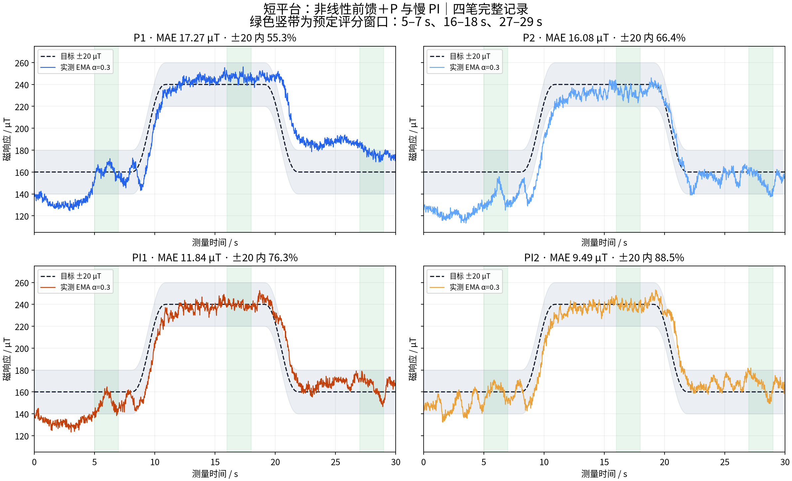
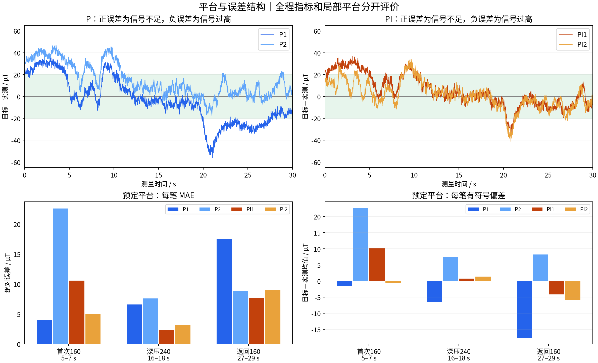
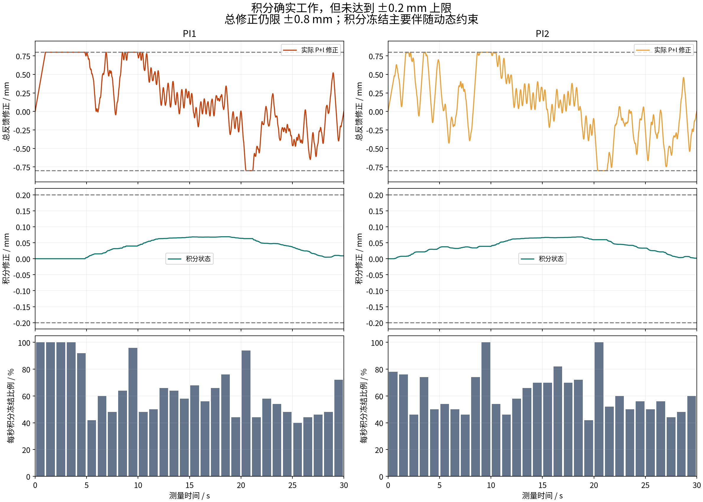
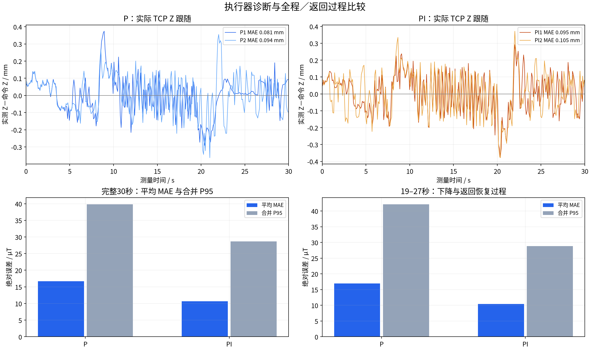

# 短平台：非线性前馈＋P 与慢 PI 对比分析

## 1. 结论

**当前慢 PI 在这四笔短平台实验中表现更好，可以保留为下一步难曲线验证的候选；暂不扩大积分上限或继续增加 Kp。** 两笔 PI 的全程 MAE 均低于两笔 P，预定深压与返回平台的组平均误差也更小。

- 全程平均 MAE：P **16.68** → PI **10.67 µT**，描述性降低 **36.0%**。
- 全程 ±20 µT 内比例：**60.86% → 82.41%**；合并 P95：**39.85 → 28.69 µT**。
- PI 积分确实生效，最大约 **0.069 mm**，未达到 ±0.2 mm 上限；返回平台时积分逐渐释放，未观察到持续积累到上限。
- 本批实际顺序为 **P1→P2→PI1→PI2**，与原方案 P→PI→PI→P 不同。模式与采集先后重合，笔间状态变化尚未隔离，不能将全部改善解释为 I 的独立因果效果。

## 2. 数据与评分口径

四笔均为 completed / hardware，每笔 **1501 个连续测量点、完整 30 s**。目标为 160 保持 8 s、3 s 升至 240、保持 8 s、3 s 返回 160、保持 8 s，X 始终以 10 mm/s 前行。

目标、前馈、现场设置、旋转进笔配置及执行时间线的文件哈希在四笔间一致；manifest 输入哈希校验通过，测量所引用的传感器记录全部有效。共同参数 Kp=1、总修正 ±0.8 mm、修正速度 2 mm/s、加速度 30 mm/s²、首尾渐变 1 s；PI 额外使用 Ki=0.05、积分限幅 ±0.2 mm、条件积分抗饱和。

本报告沿用短平台方案的符号：**误差=目标－实测**。正值表示磁响应偏低、需要增加压深；负值表示磁响应偏高。指标使用日志中的 EMA α=0.3 信号，不重滤波、不平移、不修改基线；首段及末段都计入完整 30 s 评分。

预先约定的三个平台窗口为 **5–7 s、16–18 s、27–29 s**，均包含端点，各 101 点。首次和返回平台均取进入平台后第 5–7 秒。组 MAE 为两笔等权平均；P95 合并两笔绝对误差计算，未对平均曲线评分。±20 表示采样点比例。|误差|>50 µT 的时长按采样区间左端点累积。

## 3. 完整 30 s 跟踪

| 记录 | MAE/µT | ±20 内 | P95/µT | 最大绝对误差/µT | 有符号均值/µT | 总修正到顶比例 |
|---|---:|---:|---:|---:|---:|---:|
| P1 | 17.27 | 55.30% | 34.88 | 56.06 | -4.18 | 39.51% |
| P2 | 16.08 | 66.42% | 40.99 | 46.70 | +14.82 | 27.85% |
| PI1 | 11.84 | 76.35% | 29.91 | 36.74 | +4.85 | 18.79% |
| PI2 | 9.49 | 88.47% | 25.82 | 41.03 | +1.06 | 8.33% |

P1 的 |误差|>50 µT 共 0.22 s；P2 与两笔 PI 均为 0 s。PI 两笔仍有超过 20 µT 的偏离，不能据此称全程误差已控制在 ±20 µT 内。



## 4. 首次平台、深压与返回平台

| 预定窗口 | P 平均 MAE/µT | PI 平均 MAE/µT | P ±20 内 | PI ±20 内 |
|---|---:|---:|---:|---:|
| 首次160：5–7 s | 13.30 | 7.77 | 65.35% | 97.03% |
| 深压240：16–18 s | 7.09 | 2.74 | 100.00% | 100.00% |
| 返回160：27–29 s | 13.18 | 8.36 | 81.19% | 99.50% |

逐笔数值（每格为 **MAE / 有符号平均误差**，单位 µT）：

| 记录 | 首次160 | 深压240 | 返回160 |
|---|---:|---:|---:|
| P1 | 4.01 / -1.41 | 6.59 / -6.56 | 17.52 / -17.52 |
| P2 | 22.59 / +22.59 | 7.58 / +7.53 | 8.83 / +8.21 |
| PI1 | 10.59 / +10.27 | 2.30 / +0.76 | 7.67 / -4.17 |
| PI2 | 4.95 / -0.59 | 3.17 / +1.40 | 9.05 / -5.81 |

### 首次160平台

P 的两笔差异明显：P1 已接近目标，P2 仍平均偏低 22.59 µT。PI 的两笔分别平均偏低 10.27 µT、偏高 0.59 µT。PI 组平均指标较好，但 PI1 没有优于 P1，因此首次平台改善并非逐笔一致。

### 深压240平台

两笔 PI 的 MAE 为 2.30 和 3.17 µT，均低于两笔 P 的 6.59 和 7.58 µT；PI 平均有符号偏差只有 +0.76/+1.40 µT。这是本批最一致的有利观察。四笔该窗口都没有达到总行程上限，±20 内比例均为 100%。

### 深压后返回160平台

PI 的组平均 MAE 为 8.36 µT、±20 内 99.50%，相较 P 组更好；两笔 PI 仍分别平均偏高约 4.17 和 5.81 µT。PI2 的 MAE 9.05 µT 与 P2 的 8.83 µT 接近，没有实现逐笔全面改善。

首次和返回平台位于不同 X、不同时间，且闭环命令 Z 会变化，因此本实验不是固定 Z 的独立滞回辨识。不能将两端信号差直接等同于材料滞回。



## 5. 返回过程中有没有因积分变差

按预定 **19–27 s** 窗口（下降过渡加返回恢复），P 的平均 MAE 为 16.91 µT，PI 为 10.38 µT，±20 内比例为 55.36% 和 87.91%。但 P1/P2 分别为 28.21/5.62 µT，PI1/PI2 为 9.80/10.96 µT：PI 没有优于返回表现最好的 P2。

下降过程仍有短时信号偏高，P1/P2 最大偏高分别 **56.06/17.28 µT**，PI1/PI2 为 **33.94/41.03 µT**。因此可表述为“本批 PI 的平均返回表现较好，未见持续积分累积导致的失控”，不能写成“PI 消除了返回超调”。

## 6. I 是否真正起作用，抗饱和是否过于频繁

已逐拍重算两笔 PI 的 P 请求、积分候选、冻结判断、接受的积分和最终限幅输出，均与日志一致；非测量阶段积分清零符合实现。

| 记录 | 最大积分/mm | 积分冻结比例 | 积分达到 ±0.2 mm | 冻结拍中未到总幅值上限的比例 |
|---|---:|---:|---:|---:|
| PI1 | 0.0688 | 64.89% | 0.00% | 71.15% |
| PI2 | 0.0682 | 61.83% | 0.00% | 86.64% |

两笔积分在深压平台都积累到约 0.067 mm，随后在返回过程中减小：到返回评分窗口平均约 0.008 mm；测量结束时分别约 0.0090/0.0017 mm，离开测量阶段归零。I 的方向与增减逻辑正常，未出现积到 ±0.2 mm 后无法释放的现象。

**冻结频繁主要伴随动态约束。** PI1 的 974 个冻结拍中，965 拍同时记录修正加速度限制；PI2 为 928 拍中的 911 拍。71.15%/86.64% 的冻结拍中，实际修正尚未达到 ±0.8 mm。限制原因可重叠，这些计数描述请求受约束，不代表最终命令超限。P 请求随误差快速变化，而允许发送的修正有速度、加速度及提前制动约束，积分只能在允许方向上缓慢更新。

积分上限两笔均未触发，因此增加 ±0.2 mm 上限对这两条已记录的状态轨迹没有直接作用。当前不因冻结比例高就解除抗饱和或放宽动态限制。

此外，按同一静态前馈表估算，深压平台约 0.067 mm 的积分只对应约 **1.6 µT** 的静态磁响应变化。这只是表内局部估算，不是真实动态贡献。它不足以把全程约 6.01 µT 的组平均 MAE 差完全解释为积分作用；接触状态、初始偏差、动态耦合与先后顺序仍可能参与。



## 7. 执行器跟随、采集与组内差异

| 记录 | TCP Z MAE/mm | TCP Z P95/mm | 最大单次读取/ms | 最大控制记录间隔/ms |
|---|---:|---:|---:|---:|
| P1 | 0.081 | 0.210 | 17.74 | 21.69 |
| P2 | 0.094 | 0.220 | 16.64 | 20.92 |
| PI1 | 0.095 | 0.208 | 20.64 | 20.99 |
| PI2 | 0.105 | 0.214 | 16.32 | 20.96 |

四笔 TCP 均无无效读取、采集线程正常停止。记录中的反馈修正量、速度、加速度均通过 ±0.8 mm、2 mm/s、30 mm/s² 校验，包含收尾边界。离散运动校验依据计划 20 ms 周期；实际控制记录间隔另列于表中。

TCP 在读取开始/结束的中点时间，与共享主机时钟上的已发送 Z 命令插值比较。采集约 10 Hz，属于较慢位姿跟随诊断，不能排除高频误差。PI 的 Z 跟随 MAE 没有同步改善，因此磁信号指标的改善不能表述为机械臂位置跟随也变好了。

同模式两条实测曲线之间平均绝对差为 P **19.00 µT**、PI **6.26 µT**。本批 PI 两笔更接近，但每种仅两笔，实际顺序又按模式分块，不足以证明更广泛条件下的稳定性。P1/P2 空载 B0y 相差约 46.59 µT，PI 两笔相差约 6.02 µT；这是状态变化的线索，不能将轴向基线差直接当作标量幅值误差。



## 8. 下一步建议

1. **保留当前 PI 配置进入原难曲线验证**：Kp=1、Ki=0.05、总修正 ±0.8 mm、积分 ±0.2 mm、修正速度 2 mm/s、加速度 30 mm/s²、渐变 1 s。当前结果支持继续验证这组参数，尚不支持称“前馈＋PI 已足够”。
2. 继续比较同路径、同期 P 与 PI，交错安排模式并保持进笔、沾水与纸面条件一致。短平台与原 40 s 难曲线不能直接拿总 MAE 作控制器优劣比较。
3. 若难曲线仍有明显偏离，优先区分：过渡段动态滞后、P 修正频繁触动态限制、平台持续偏差。只有确认未饱和平台仍存在可累积的稳定偏差，再判断是否需要小幅调整 Ki；本批没有证据要求扩大积分上限。

本次仅分析与生成图表，没有修改控制器、前馈表、实验参数或原始数据。

## 附录：来源与重现

| 编号 | 原始记录 |
|---|---|
| P1 | [18-54-20_平台160到240回160_P_Kp1_Ki0_总修正0p8mm_第1次](../raw/18-54-20_平台160到240回160_P_Kp1_Ki0_总修正0p8mm_第1次/) |
| P2 | [18-56-22_平台160到240回160_P_Kp1_Ki0_总修正0p8mm_第2次](../raw/18-56-22_平台160到240回160_P_Kp1_Ki0_总修正0p8mm_第2次/) |
| PI1 | [18-59-14_平台160到240回160_PI_Kp1_Ki0p05_总修正0p8mm_积分0p2mm_抗饱和_第1次](../raw/18-59-14_平台160到240回160_PI_Kp1_Ki0p05_总修正0p8mm_积分0p2mm_抗饱和_第1次/) |
| PI2 | [19-02-51_平台160到240回160_PI_Kp1_Ki0p05_总修正0p8mm_积分0p2mm_抗饱和_第2次](../raw/19-02-51_平台160到240回160_PI_Kp1_Ki0p05_总修正0p8mm_积分0p2mm_抗饱和_第2次/) |

数据：[逐笔与分段指标](指标.csv)、[完整统计与来源哈希](summary.json)、[预定方案快照](protocol.json)。图片均有同名 SVG。

```bash
python runs/brush2/2026-09-25/08_短平台P与PI对比/analysis/analyze.py
```
