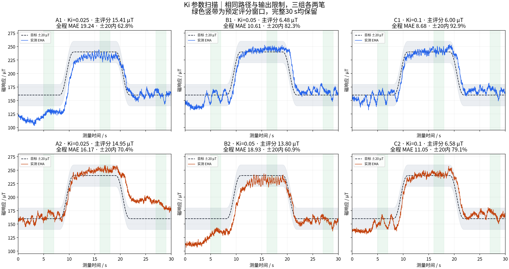
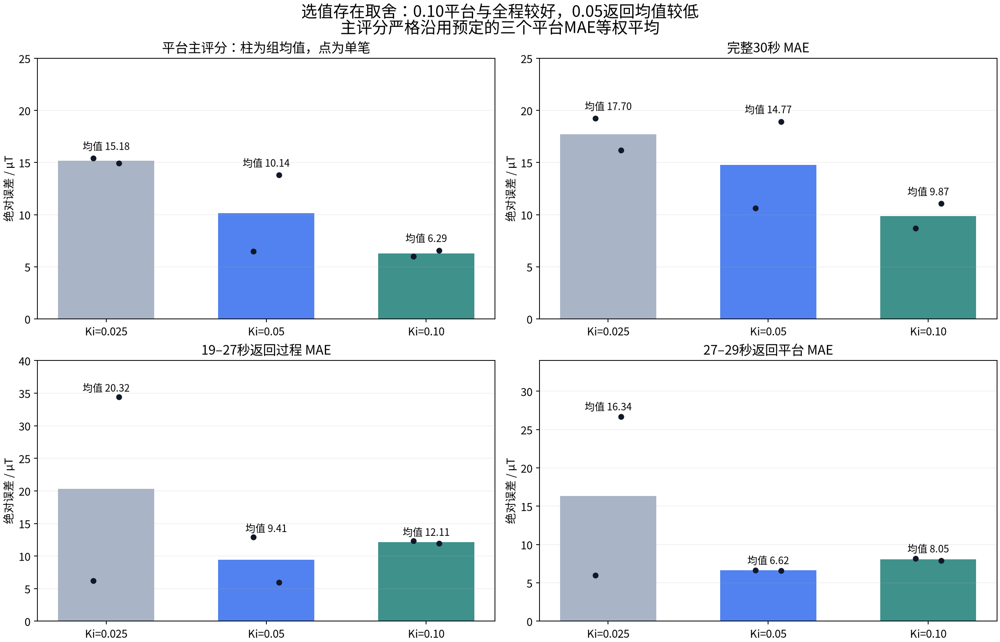
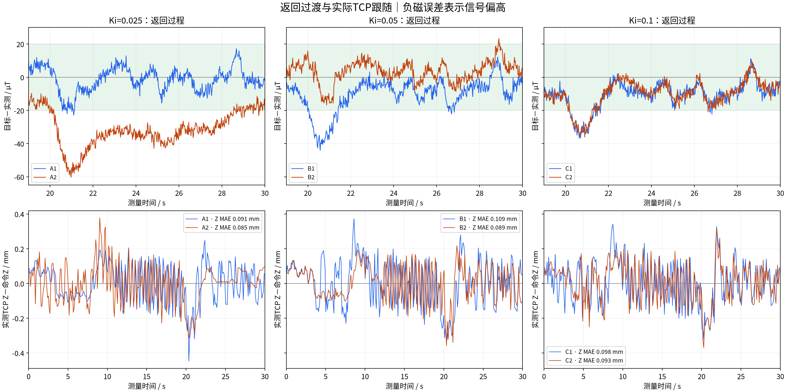
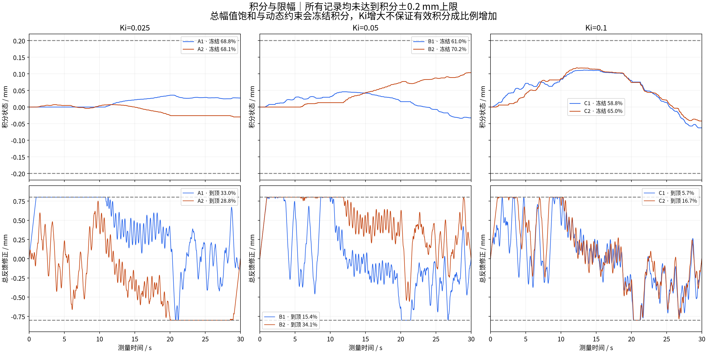

# 短平台 Ki 参数扫描：六笔综合分析

## 1. 选值结论

**Ki=0.10 是下一阶段优先候选，Ki=0.05 保留作对照，Ki=0.025 暂不优先。当前还不能最终锁定 Ki。**

0.10 的平台主评分为 **6.29 µT**，优于 0.05 的 **10.14 µT** 和 0.025 的 **15.18 µT**；两笔平台评分都较低，完整30 s的跟踪指标也最好。

但0.10的 **19–27 s返回过程平均MAE为 12.11 µT，0.05为 9.41 µT**，增加 2.70 µT；返回平台MAE也稍大。按预先约定的“指标冲突时不强行选最优”规则，这一轮可确定优先验证方向，不能宣称0.10已经通过最终选值条件。若下一笔需要一个试用值，采用0.10，继续保留相同限制，不继续向上增加Ki。

## 2. 记录质量与预定规则

六笔全部 completed / hardware，每笔1501个连续测量点、完整30 s；实际顺序 **0.05→0.025→0.10→0.10→0.025→0.05** 与方案一致。三组各两笔，全部纳入，旧批次不混入本次评分。

目标、前馈、现场设置、旋转进笔配置及执行时间线哈希在本批一致；除Ki外的控制参数完全一致：Kp=1、总修正±0.8 mm、积分±0.2 mm、修正速度2 mm/s、加速度30 mm/s²、首尾渐变1 s。各输入快照哈希、传感器引用、目标与XY时间线均通过核对。

误差定义为 **目标－实测**，正值为信号偏低，负值为偏高；使用原记录EMA α=0.3，不裁剪、平移、重滤波或重拟合基线。

主评分严格沿用方案：每笔取首次平台 **5–7 s**、深压平台 **16–18 s**、返回平台 **27–29 s** 的三个MAE等权平均，再对同一Ki的两笔等权平均。每个窗口含端点、101点。完整30 s、19–27 s返回过程、严重偏离和执行器指标作为共同检查项。

预设2 µT阈值仅用于工程上将接近的主评分视作难以区分，并在其他表现相近时倾向较小Ki；不是统计显著性阈值。0.10与0.05主评分相差 3.85 µT，超过该阈值，但返回指标仍需单独评估。

## 3. 三组总览

| Ki | 平台主评分/µT | 单笔评分范围/µT | 全程MAE/µT | 全程±20内 | 合并P95/µT | 返回过程MAE/µT |
|---|---:|---:|---:|---:|---:|---:|
| 0.025 | 15.18 | 14.95–15.41 | 17.70 | 66.62% | 47.20 | 20.32 |
| 0.05 | 10.14 | 6.48–13.80 | 14.77 | 71.59% | 45.27 | 9.41 |
| 0.1 | 6.29 | 6.00–6.58 | 9.87 | 85.98% | 25.82 | 12.11 |

所有MAE均按笔等权；P95合并该组全部绝对误差，未对平均曲线评分。单笔范围不是置信区间。



0.10相对0.05的主评分描述性下降 **38.0%**。两笔0.10的主评分分别5.996和6.578 µT；0.05为6.482和13.798 µT。这表明0.10两笔都保持较好的平台表现，但并非每笔都优于表现最好的0.05。



## 4. 哪个平台改善、哪里有代价

| Ki | 首次160 MAE/µT | 深压240 MAE/µT | 返回160 MAE/µT |
|---|---:|---:|---:|
| 0.025 | 19.76 | 9.44 | 16.34 |
| 0.05 | 15.83 | 7.97 | 6.62 |
| 0.1 | 7.62 | 3.19 | 8.05 |

### 首次平台

0.10的两笔MAE为6.58/8.66 µT，较稳定。0.025的A1平均偏低31.78 µT，整个评分窗口总修正都处于下压0.8 mm上限，积分为0且100%冻结；0.05的B2平均偏低24.61 µT，到顶74.26%、积分冻结86.14%。

这两笔的明显初始偏差不能仅解释为Ki太小：在总行程已经用尽且抗饱和冻结的时段，更大的Ki也无法立即增加允许下压量。该现象提示同时存在工作点／接触状态差异。评分仍完整保留这些笔次，不因饱和而剔除。

### 深压平台

0.10两笔MAE为3.24/3.15 µT，均低于0.05的5.74/10.20 µT以及0.025的8.47/10.41 µT。六笔深压评分窗口均未达到总幅值上限，这是0.10最一致的优势。

### 返回平台与返回过程

0.10返回平台平均MAE为 8.05 µT，0.05为 6.62 µT；两笔0.10均平均偏高约6 µT，虽然对应评分窗口均在±20 µT内，仍存在小偏差。

19–27 s返回过程：0.10两笔MAE为12.30/11.93 µT，0.05为12.89/5.94 µT。0.10的均值较差，但最差单笔略低于0.05最差笔，其最大短时偏高约36–37 µT，也低于0.05最差笔约44 µT。因此结果属于平台、平均返回表现与最差偏离之间的取舍，不能概括为“更大的Ki所有方面都更好”或“确定造成更大峰值超调”。



## 5. 积分确实增大，但尚未达到单独上限

| 记录 | 最大绝对积分/mm | 积分冻结 | 总幅值到顶 | TCP Z MAE/mm | TCP Z P95/mm |
|---|---:|---:|---:|---:|---:|
| A1 | 0.0358 | 68.82% | 32.98% | 0.091 | 0.194 |
| A2 | 0.0298 | 68.09% | 28.78% | 0.085 | 0.222 |
| B1 | 0.0460 | 61.03% | 15.39% | 0.109 | 0.239 |
| B2 | 0.1035 | 70.15% | 34.11% | 0.089 | 0.188 |
| C1 | 0.1113 | 58.83% | 5.66% | 0.098 | 0.233 |
| C2 | 0.1180 | 65.02% | 16.66% | 0.093 | 0.213 |

全部积分状态、候选增量、冻结判定及最终输出逐拍重算通过；六笔都没有达到±0.2 mm积分上限。0.10最大积分约0.111/0.118 mm，深压平台约+0.103/+0.105 mm，返回平台已释放并转为约−0.048/−0.034 mm。可确认积分能在深压后释放并反向，没有积到上限后一直卡住。

0.10在下降初期仍带有正积分，直至返回过程中逐步释放；这可能参与返回滞后，但日志无法单独拆出它的因果贡献。冻结比例仍较高，动态限制与总幅值限制同时参与。增加Ki不会让有效积分严格按比例增长，当前数据也没有要求扩大±0.2 mm积分上限。



## 6. 逐笔指标

编号A为Ki=0.025、B为0.05、C为0.10；组内按采集时间编号，步骤为实际六笔顺序。

| 记录 | 步骤 | Ki | 平台评分/µT | 全程MAE/µT | 返回过程MAE/µT | 返回最大偏高/µT | 全程>50时长/s |
|---|---:|---:|---:|---:|---:|---:|---:|
| A1 | 2 | 0.025 | 15.41 | 19.24 | 6.21 | 22.88 | 0.74 |
| A2 | 5 | 0.025 | 14.95 | 16.17 | 34.43 | 60.20 | 0.76 |
| B1 | 1 | 0.05 | 6.48 | 10.61 | 12.89 | 43.98 | 0.00 |
| B2 | 6 | 0.05 | 13.80 | 18.93 | 5.94 | 16.79 | 0.46 |
| C1 | 3 | 0.1 | 6.00 | 8.68 | 12.30 | 36.72 | 0.00 |
| C2 | 4 | 0.1 | 6.58 | 11.05 | 11.93 | 36.05 | 0.00 |

0.10两笔都没有|误差|>50 µT区间。0.025两笔分别约0.74/0.76 s，0.05一笔为0、一笔约0.46 s。这一指标支持0.10减少本批严重偏离，但仍不足以替代返回过程的单独检查。

## 7. 可以相信到什么程度

- 指令修正量、修正速度与加速度在完整记录中均守住现有限制，含收尾边界。六笔TCP记录均有效、采集线程正常停止；最大控制记录间隔22.96 ms，最大单次TCP读取19.57 ms。实际TCP约10 Hz，只用于较慢位姿跟随诊断，不能排除高频误差；完整状态见summary.json。
- 参数顺序遵守了前后对称设计，但实际间隔并不相等。两笔0.10相隔6分14秒；0.025相隔16分17秒；0.05相隔25分47秒。每组两笔无法充分隔离时间、沾水和接触条件变化。
- 两笔同组实测曲线之间平均绝对差为：0.025 **29.66 µT**、0.05 **18.16 µT**、0.10 **5.58 µT**。0.10两笔更接近，但也处于更接近的采集时段。
- 对应空载B0y差分别约 **53.03、24.55、1.09 µT**。这是状态差异线索，不能直接当成幅值跟踪误差或拿来修正基线。
- 六笔都保留；未按效果挑选数据。1501个时间点不等于1501次独立实验，本批每组只有两笔。

## 8. 下一步范围

**优先用Ki=0.10作为试用候选，同时保留0.05作对照；Kp=1、总修正±0.8 mm、积分±0.2 mm及现有动态限制保持一致。** 不继续扩展完整Ki网格，也不依据平台成绩单独加到0.2或扩大积分行程。

接下来应在原难曲线上比较0.05与0.10，重点检查反复升降时的返回滞后、全程±20比例和严重偏离，同时保留逐笔差异。如果0.10的平台优势能延续且返回过程没有反复变差，才能更有依据地作为工作值；否则保留0.05。现阶段没有准确动态模型，因此本结论是实验筛选，不是理想Ki的理论解。

本次只读取原始记录并生成分析产物，没有修改实验配置、控制器或原始数据。

## 附录：来源和重现

| 记录 | 原始目录 |
|---|---|
| A1 | [19-29-23_平台160到240回160_PI_Kp1_Ki0p025_总修正0p8mm_积分0p2mm_第1次](../raw/19-29-23_平台160到240回160_PI_Kp1_Ki0p025_总修正0p8mm_积分0p2mm_第1次/) |
| A2 | [19-45-40_平台160到240回160_PI_Kp1_Ki0p025_总修正0p8mm_积分0p2mm_第2次](../raw/19-45-40_平台160到240回160_PI_Kp1_Ki0p025_总修正0p8mm_积分0p2mm_第2次/) |
| B1 | [19-22-05_平台160到240回160_PI_Kp1_Ki0p05_总修正0p8mm_积分0p2mm_第1次](../raw/19-22-05_平台160到240回160_PI_Kp1_Ki0p05_总修正0p8mm_积分0p2mm_第1次/) |
| B2 | [19-47-52_平台160到240回160_PI_Kp1_Ki0p05_总修正0p8mm_积分0p2mm_第2次](../raw/19-47-52_平台160到240回160_PI_Kp1_Ki0p05_总修正0p8mm_积分0p2mm_第2次/) |
| C1 | [19-31-38_平台160到240回160_PI_Kp1_Ki0p1_总修正0p8mm_积分0p2mm_第1次](../raw/19-31-38_平台160到240回160_PI_Kp1_Ki0p1_总修正0p8mm_积分0p2mm_第1次/) |
| C2 | [19-37-52_平台160到240回160_PI_Kp1_Ki0p1_总修正0p8mm_积分0p2mm_第2次](../raw/19-37-52_平台160到240回160_PI_Kp1_Ki0p1_总修正0p8mm_积分0p2mm_第2次/) |

[逐笔指标](逐笔指标.csv)、[参数组指标](参数组指标.csv)、[完整统计及哈希](summary.json)、[预定方案](protocol.json)。图片另有同名SVG。

```bash
python runs/brush2/2026-09-25/09_短平台Ki参数扫描/analysis/analyze.py
```
