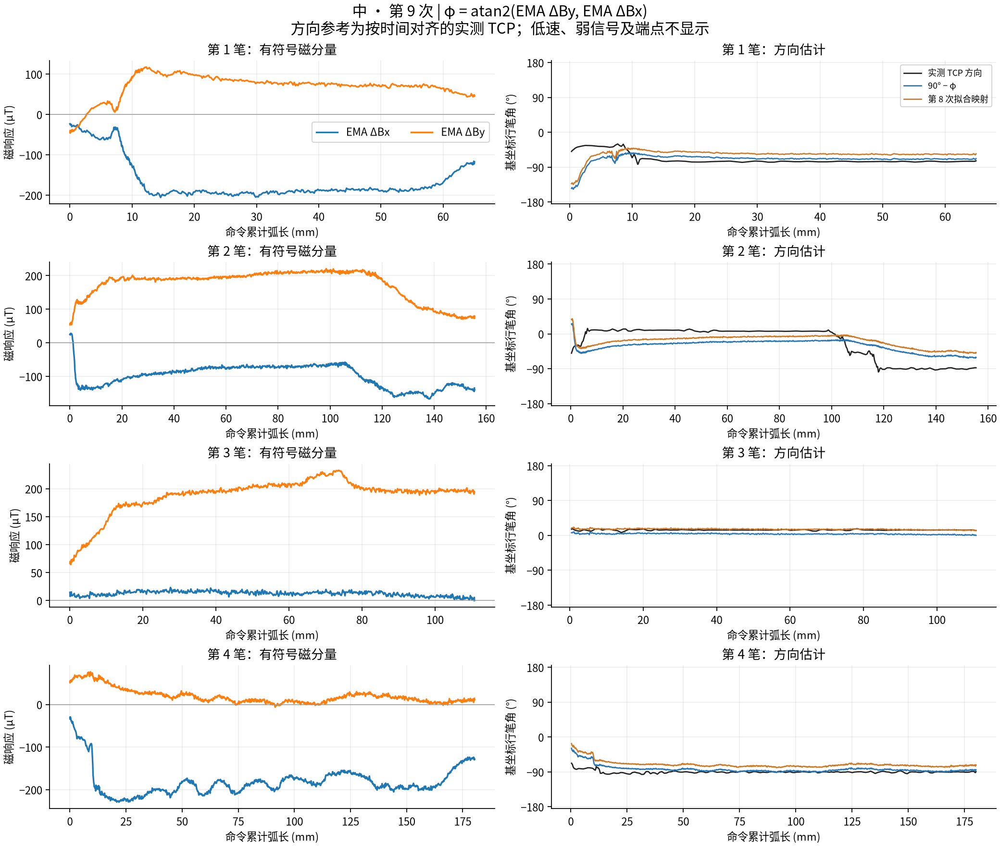
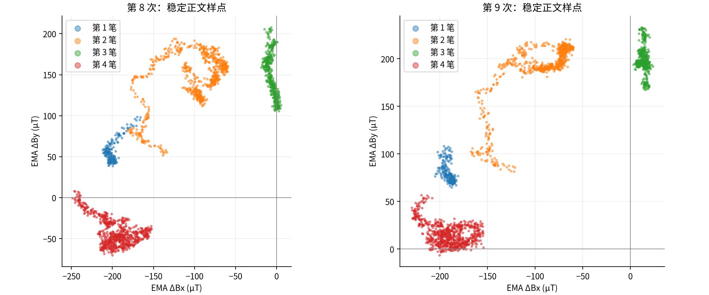

# 从 Bx、By 估计行笔方向：中字第 8、9 次记录

分析日期：2026-09-26。背景：[字符 StrokePlan 设计](../../../../../../docs/04-robot-control/character-strokeplan-design.md)。

结论：**有符号的 Bx、By 差分含有与行笔方向相关的信息。在这两次记录中，初步经验映射是 `atan2(滤波ΔBx, 滤波ΔBy)`；它能描述大致方向，但尚不能作为精确、通用的方向测量。** 尤其横折笔画的横段与竖段都有明显误差，增加一个固定角度补偿也不能稳定消除。

## 数据与方法

使用两次已完成的真机整字记录：

- 第 8 次：`20-58-43_中_整字_方向姿态_pi_第8次`，运行 ID `20260925T125843.882914Z-096f83`。
- 第 9 次：`21-09-54_中_整字_方向姿态_pi_第9次`，运行 ID `20260925T130954.025459Z-e37642`。

两个原始目录都位于本实验的 `raw/`。第 9 次第三笔比第 8 次长 5 mm，磁目标也有差别，不能视为完全相同条件下的重复实验。

1. 校验 manifest 内所有配置和计划快照哈希；保留原始日志 SHA-256。
2. 按 `control.jsonl.sample_seq` 精确关联 `sensor.csv.seq`，仅分析 `measure_00` 至 `measure_03`。
3. 使用各次运行自己的基线，按全部有效传感器样本重放 EMA，α=0.3；包含基线阶段的滤波预热。重建幅值与控制日志最大差异均为 `2.84e-14 µT`。
4. 实测 TCP 使用独立约 10 Hz 记录，以请求起止时间中点作为采样时间，和磁信号的接收单调时间对齐。由前后各 0.1 s 的 XY 位移求方向，未拟合额外时间延迟。
5. 有效行笔：实测速度 >2 mm/s、滤波差分幅值 >30 µT，方向计算的整个时间窗位于书写阶段内。稳定正文：再排除每笔前 15 mm、末 10 mm，并要求命令方向角变化率 ≤20°/s。

30 µT 是本次探索的弱信号门槛，尚不是标定过的角度置信度标准。稳定正文内幅值实际全部超过 100 µT，因此把门槛从 30 提高到 60 或 100 µT 不改变结果。把速度门槛提高到 5 mm/s，两次平均误差为 18.94°、14.68°，主要结论不变。

第 8、9 次分别有 2,914、2,939 个书写控制样点；有效行笔为 2,861、2,889 个，稳定正文为 2,085、2,110 个。指标按样点等权，长笔画权重更大；相邻样点有相关性，不能当作数千次独立实验。两份传感器日志均无标记无效样点。TCP 最大采样间隔分别为 115.4、109.7 ms，参考方向仍受异步采样和 0.2 s 时间窗平滑影响。

## 计算公式及坐标约定

先减去本次运行的基线，再滤波向量分量：

\[
\mathbf b_k=0.3(\mathbf B_k-\mathbf B_0)+0.7\mathbf b_{k-1}.
\]

原始磁向量角为：

\[
\phi=\operatorname{atan2}(b_y,b_x).
\]

它是传感器磁分量平面的角度，不能直接等同于机器人基坐标的行笔方向。这两次记录支持以下**初步经验映射**：

\[
\hat\theta_0=\operatorname{wrap}(90^\circ-\phi)
=\operatorname{atan2}(b_x,b_y).
\]

右侧 atan2 的结果需转换为度；`wrap` 将结果归一化至 [-180°, 180°)。这里 **atan2 的第一参数是滤波 ΔBx，第二参数是滤波 ΔBy**。行笔角约定为基坐标 +X=0°、+Y=90°、−Y=−90°，不是屏幕坐标。这个参数交换是本批数据的经验关系，尚未完成独立传感器到基坐标的方向标定。

第 9 次基线为 `(Bx0, By0) = (2096.3296, 2895.6722) µT`；第 8 次为 `(2102.8211, 2935.7786) µT`。不能把某次基线永久写死用于其他运行。原始 Bx、By 的背景量级约为数千 µT，书写差分约为数百 µT，直接对原始值取角度会主要反映背景磁场。

幅值 `sqrt(bx²+by²)` 用于描述磁响应强度，方向估计必须保留两个分量的正负号。不要先取绝对值，也不要用普通 `atan(By/Bx)` 丢掉象限。

## 误差与跨次验证

以下角误差均相对于实测 TCP 方向，并按圆周角差计算。

| 方法 | 第 8 次稳定正文 MAE | 第 9 次稳定正文 MAE | 第 9 次绝对误差 P95 |
|---|---:|---:|---:|
| 直接 `atan2(By, Bx)`，原始磁值 | 102.44° | 101.80° | 150.14° |
| 直接 `atan2(by, bx)`，已去基线滤波 | 96.39° | 100.55° | 143.81° |
| 经验映射 `90° − φ` | 19.45° | 15.47° | 40.26° |
| 第 8 次拟合后固定：`102.22° − φ` | 14.07°（拟合内） | 18.36°（留出运行） | 47.98° |

拟合只用第 8 次稳定正文，在 `θ = ±φ + c` 两个候选中按拟合内 MAE 选符号；各候选的偏置用圆周均值求得。第 9 次未参与这一参数拟合。经验式 `90°−φ` 是查看本批数据后的初步假设，不能把其第 9 次结果包装成预注册的独立验证。

固定角度补偿改善了第 8 次，却使第 9 次 MAE 从 15.47° 增至 18.36°。说明目前不能只靠一个固定零点偏置解决跨次差异。

在全部有效行笔样点上，经验映射的 MAE 为 20.10°、17.38°；第 9 次 P95 为 47.04°。稳定正文剔除了起收笔和急转角，并不代表整个书写过程的性能。

作为参考，稳定正文中命令轨迹方向与实测 TCP 方向的 MAE 仅 0.93°、0.94°。因此这里数十度的磁方向偏差不能简单归因于命令方向和实测方向混用。

### 各笔的差异

下表采用未经拟合补偿的经验式 `90°−φ`，范围均为稳定正文：

| 笔画 | 第 8 次 MAE | 第 9 次 MAE |
|---|---:|---:|
| 1：左竖 | 2.94° | 8.47° |
| 2：横折 | 34.48° | 31.52° |
| 3：下横 | 16.18° | 10.12° |
| 4：中竖 | 11.84° | 5.72° |

第二笔的偏差并非只发生在尖角瞬间：即使排除快速转向样点，正文误差仍然明显。不能仅通过进一步平滑角度来假定消除这些偏差。

第 9 次中，按靠近 +X 或 −Y（±15°）筛选稳定正文后得到：

| 笔画局部 | 实测方向圆周均值 | 磁向量角圆周均值 φ | 经验估计方向 |
|---|---:|---:|---:|
| 横折的横段 | +6.83° | +111.83° | −21.83° |
| 横折的竖段 | −90.26° | +137.53° | −47.53° |
| 下横 | +13.85° | +86.09° | +3.91° |
| 中竖 | −90.99° | +175.34° | −85.34° |

横折竖段与中竖的真实方向接近，但磁角均值相差约 38°。这是“同一行笔方向会对应不同磁响应方向”的直接观测；现有记录无法将其唯一归因于姿态、笔毛变形历史、加载、湿润状态或漂移中的某一项。

## 当前适用范围

- 可把 `atan2(bx, by)` 作为**本装配、本批书写条件下的大致方向特征**，同时保留幅值及有效性标记；低速停笔、离纸、信号接近零时不要强行解释为行笔方向。
- 两次中字数据的稳定正文主要覆盖偏 +X 和偏 −Y，实测角度范围约 −98° 至 +17°；尚未验证 +Y、−X 和完整 360°。
- 工具倾斜方位随行笔方向一起变化，方向与姿态的作用混在一起。现在能证明的是相关性，不能证明磁信号独立测出了行笔方向。
- 实测 TCP 是比较参考，尚无同步笔尖或纸面接触中心轨迹。因此结果不是毛笔接触点滑移方向或墨迹方向的测量精度。
- 尚未证实任何更复杂模型可以从单个 Bx、By 样点唯一恢复精确方向；本次也未把模型接入 XY 或姿态闭环。

若下一步要把它作为方向反馈，应优先离线比较：固定姿态下的多方向直线、同一路径的多种姿态、多加载水平及转弯前后过程，并按整次实验留出验证。若固定角度映射仍有明显系统偏差，再比较二维仿射标定或包含幅值、姿态及历史窗口的模型。2026-09-23 的“四方向阶梯实验”实际上四组都沿 +X 行进，仅姿态不同，不能当作四向行笔真值。

## 图表及复现





- [第 8 次方向对照](run8_directions.png)
- [完整数值、方法及源文件哈希](results.json)
- [第 8 次逐样点数据](run8_samples.csv)、[第 9 次逐样点数据](run9_samples.csv)：包括有效性掩码，便于检查被剔除的样点。
- [分析脚本](analyze.py)：仅读取记录、生成本目录结果，不连接机器人。

在仓库根目录复现：

```bash
MPLCONFIGDIR=/tmp/fyp-bxy-matplotlib python runs/brush2/2026-09-25/11_中字连续方向姿态/analysis/2026-09-26_Bxy方向分析/analyze.py
```
