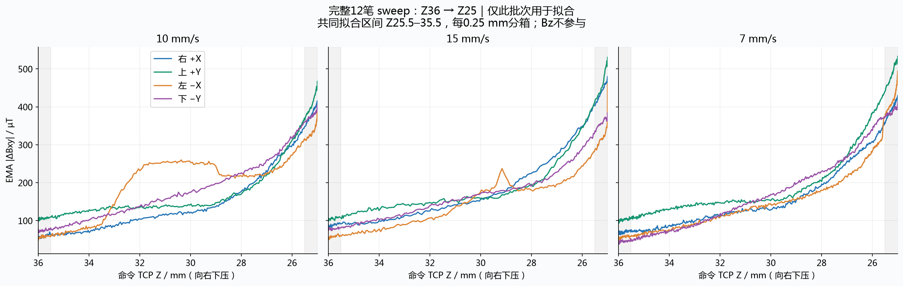
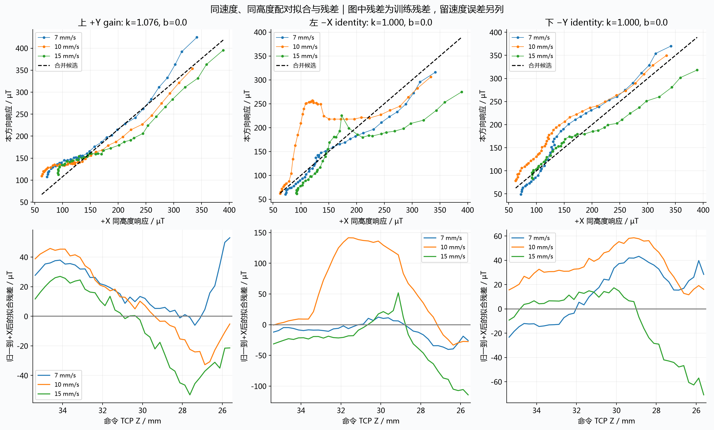

# Sweep批次分析与四方向候选标定

- 保留换笔后17:07开始的12笔完整sweep，四方向×三速度齐全；17:07之前旧笔数据及分析已按用户要求删除。
- 完整批次每笔前75 mm保持Z36，后75 mm按平滑曲线下压至Z25。高度、沿程位置与时间耦合；连续采样点不是独立重复。
- 完整批次传感帧104,033，无效0；TCP采样4,089，无效0；最大传感样本年龄6.343 ms。
- 以实测XY代入命令空间路径，sweep段TCP最大Z路径差0.127 mm。该指标不做时间同步，也不是笔毛接触深度。
- 用户已确认17:05–17:07之间换笔，并要求以新sweep为准。当前笔以17:07起的完整12笔为唯一标定依据；旧定高及前两笔sweep属于旧笔，不能混入。连续高度覆盖更好，但仍缺少同条件独立重复。
- 新笔左−X仍有明显非单调形状：10 mm/s在Z约33–32 mm快速增大，Z约32–29 mm形成平台，随后回落；15 mm/s在Z约29 mm附近有局部尖峰，7 mm/s相对平顺。统一线性k,b不能消除这些局部形状。
- 左−X最大相邻0.25 mm分箱下降量：10 mm/s为24.8 µT，15 mm/s为26.4 µT；其他方向各笔最大值不超过4.4 µT。这是结构异常线索，原因未确认，未据此静默删点。
- 跨速度通用校正未得到有力支持：+Y最佳倍率模型留速度RMSE仅由30.79降至30.01 µT（约2.5%）；左−X和下−Y校正模型均比不校正更差。因此不建议将本表作为已验证控制标定。

|方向|候选模型|k|b µT|留速度RMSE：未校正→候选 µT|
|---|---|---:|---:|---:|
|右 +X|identity|1.00000|0.00|0.00→0.00|
|上 +Y|gain|1.07583|0.00|30.79→30.01|
|左 −X|identity|1.00000|0.00|56.46→56.46|
|下 −Y|identity|1.00000|0.00|30.69→30.69|

只用sweep_down；Z25.5–35.5 mm每0.25 mm取EMA |ΔBxy|中位数，共40格/笔。各速度及高度格等权，按同速度同Z与+X配对。两端各0.5 mm统一排除过渡/终止段；没有按拟合好坏删笔或删局部点。

比较恒等、纯倍率、仿射：g方向=k*g参考+b，归一化=(g方向-b)/k。每次留出一个完整速度组，用另两个速度拟合。模型按留速度RMSE选择，选择与评价来自同一数据，仍是探索性内部检验。数百个采样点不当作独立试验，不给虚假置信区间。

此处对齐命令Z，未消除传感/EMA/材料响应滞后；速度变化也改变下压速度，因此不是静态纯深度标定。没有抬起扫描，不能评估迟滞。正斜率不保证每笔局部单调，不能凭全局k,b直接反解Z。

用户确认17:07前后换笔，旧笔记录已删除。表中identity表示模型检验未支持校正，不表示方向已标定等价，尤其不能把左−X的k=1当作有效标定。候选approved=false，未写入机器人配置。

## 完整批次响应

## 拟合与残差

