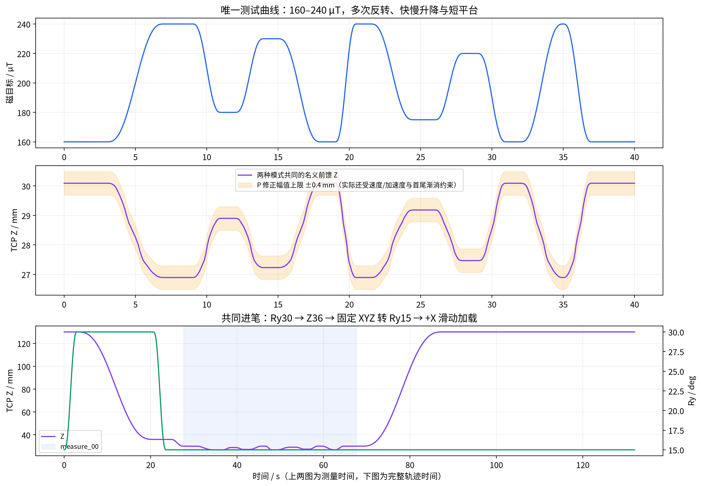

# 单条难曲线：非线性纯前馈 vs 非线性前馈＋P2

## 本批次

使用同一 [hard_160_240.npz](hard_160_240.npz)、[非线性表](feedforward.json)、[设置](settings.json) 和 [旋转进笔配置](entry_profile.json)。只比较 P 是否开启；保持沾水方式、装夹、纸张方向及起点一致。每种模式两笔，顺序 FF→P→P→FF，用于减轻线性顺序漂移，不能消除含水量和接触状态差异。



- XY 为 +X 直线；难度来自磁目标的快慢升降、短平台、多次反转，未引入曲线 XY 或姿态随笔画变化。
- 测量范围 160–240 µT，400 mm、40 s、10 mm/s，2001 个 20 ms 采样点。
- 全纸面行程 450 mm：X−370→80，Y500 mm；测量段 X−331→69。需要整段 450 mm 纸面可用。
- 前馈 Z 为 30.092–26.894 mm；P 的幅值极限下 Z 可能到 30.492–26.494 mm，最终仍受速度/加速度/深度/工作空间检查。
- 最快完整 160→240 过渡为 1.5 s；目标最大变化率约 100 µT/s。纯前馈最大测量 Z 速度约 4.972 mm/s、完整轨迹最大名义加速度约 59.86 mm/s²，未放宽现有运动限制。
- 每笔完整编译轨迹约 131.98 s，另需基线采集、沾水及人工确认。不是只有 40 s。

## 进笔和控制

等待位为 XYZ **[−370,500,130] mm**、RPY **[0,15,0]°**。先在等待姿态取空载基线，然后高位旋转至 Ry30，下降至 Z36，固定 XYZ 旋转回 Ry15。沿 X 滑动 1 s，再在行走中用 3 s 平滑加载到首个目标的前馈 Z；进入 measure_00 后执行难曲线。结束后继续短距离行走、抬笔、空中保持 2 s、返回等待位。

非测量阶段磁目标为空且 P 修正为零。FF 与 P 的名义轨迹逐点相同、传感采集与约 10 Hz 异步实际 TCP 均开启。反馈只使用原有磁信号，实际 TCP 不参与反馈。

P 参数见 [p_profile.json](p_profile.json)：kp=2、ki=0，修正限幅 ±0.4 mm，修正速度 5 mm/s、加速度 70 mm/s²，首尾 25 拍（0.5 s）渐消。

当前 P 沿用全表尺度换算，**并非局部 K 增益调度**。本表 S_cal≈0.039837 mm/µT，因此未经约束的 P 修正约为 0.079674×误差 mm；误差约 5.02 µT 即可能碰到 ±0.4 mm 幅值上限。后续必须同时查看限幅占比；不能仅凭 P 改善小就判定非线性表或反馈无效。

## 指令：先预检，再按顺序逐笔执行

在 `/home/ethan/FYP` 运行：

```bash
PYTHONPATH=src python scripts/run_nonlinear_ff_comparison.py --mode ff --dry-run
PYTHONPATH=src python scripts/run_nonlinear_ff_comparison.py --mode p --dry-run
```

四笔按以下顺序，每次只执行一条命令，每笔重新沾水、核对等待位与路径，看到提示后输入 `RUN`：

```bash
# 1. 纯前馈，第1次
PYTHONPATH=src python scripts/run_nonlinear_ff_comparison.py --mode ff --execute

# 2. 前馈＋P2，第1次
PYTHONPATH=src python scripts/run_nonlinear_ff_comparison.py --mode p --execute

# 3. 前馈＋P2，第2次
PYTHONPATH=src python scripts/run_nonlinear_ff_comparison.py --mode p --execute

# 4. 纯前馈，第2次
PYTHONPATH=src python scripts/run_nonlinear_ff_comparison.py --mode ff --execute
```

原 run_strokeplan_feedforward.py / run_strokeplan_p.py 仍指向旧套件，本批次用上述专用入口。

## 保存与后续分析

记录到 `runs/brush2/<当天日期>/06_非线性前馈难曲线对比/raw/`，模式和重复次数自动写入文件夹名。保留原有 control.jsonl、sensor.csv、events.jsonl、manifest.json、实际 TCP 与输入快照；增加 entry_profile.json，实际 P 参数保存于 resolved.json 的 control 字段。

后续主指标按完整 measure_00 的 40 s 计算：MAE、绝对误差 P95、±20 µT 比例、严重偏离持续时间及重复差。另分上升、回升、平台、首次保持段统计，检查滞后与 P 限幅占比；不在看见结果后任意删除差的片段。进笔和回程只做异常诊断，不混入目标跟踪 MAE。

## 证据与限制

- 两种模式的命令行离线预检通过，名义路径相同。图和 compiled_nominal.csv 表示编译命令，非实际机器人轨迹。
- 本次相关测试共 78 项通过，其中新旋转流程 11 项覆盖编译、快照、反馈阶段、错误输入、CLI 与断线抬笔；详见仓库 tests/test_strokeplan_rotational_entry.py。
- 合成回放 FF/P 均结束于 END_WAIT，P 调用 2001 次且修正 ≤0.4 mm。假传感器只有 50 Hz，因此仅在该模拟内将 baseline_min_samples 改为 80；真机配置仍为 400，未放宽。合成回放不证明真实跟踪改善。
- 原候选表保留 false，本批次复制的表按用户明确请求采用为 FF/P 试验，approved/transient_approved 为 true；该标志只表示试验采用，不是性能认证。所有运动仍需逐笔 --execute 和 RUN。
- 表来自 Z38 进笔的正常慢扫下压；本次采用 Z36 进笔，且含多次回升。是否有效需要这四笔实测。
- 本次未连接机器人。改动前全套测试为 736 通过、7 跳过、3 失败；3 个既有回原点断言与当前 X−370 设置冲突。本批次实际等待起点也是 X−370，不依赖旧测试期待的 X−200。最后一次全套复查在已有 test_monitor_cartesian_return 的 Qt 界面测试中发生进程段错误，因此不宣称全套通过；上面的 78 项相关测试是在最终改动后独立运行通过。

既有失败均在 tests/test_return_to_origin.py：

- test_confirmed_return_sends_one_direct_move_to_code_defined_origin
- test_main_uses_hardcoded_connection_defaults_without_cli_arguments
- test_main_allows_return_from_140_mm_high_position

原候选生成文件夹中的“旋转流程尚未接通”记录描述的是前一阶段；本批次通过显式 entry_profile 已接通旋转进笔。各批次文件保持独立。

## 2026-09-25 17:11 P 中止调查与调度修复

- 17-06-09 纯前馈第一笔完整完成，measure_00 有 2001 点、40 s；该笔可以保留。
- 17-11-37 P 第一笔的最后命令是全程 t=65.84 s、测量 t=38.20 s、X=51 mm、目标 160 µT。measure_00 有 1911 点，之后执行 abort_lift，manifest 为 aborted/acceleration_limit。49.9% 是完整 131.98 s 轨迹进度；正常回程尚未开始。最后 1.80 s 平台未执行。
- P 的 1911 个测量磁值均有限，测量段最大磁样本年龄约 1.070 ms；实际 TCP 为 757/757 有效，最大读取 15.805 ms。已有升降段可分析，完整 40 s 指标须补录；与 FF 初步比较时应统一使用 0–38.20 s 区间，不能将两段不同长度直接当作完整重复。
- 用该笔原始 EMA 逐点重放 P 控制器，3293 个已发送指令的 Z 与记录完全一致（最大差为零）。正常下一点通过；重复上一点或跳过一点均复现 acceleration_limit：10 mm/s 的 0.2 mm/拍 X 增量变成 0 或 0.4 mm，按固定 20 ms 算出约 500 mm/s²，超过 200 mm/s²。旧日志没有被拒绝点的索引，无法区分当时是哪一种，也无法归因于独立 TCP 读取。
- 本批次的旋转进笔 FF/P 现在统一按顺序发送每个 20 ms 轨迹点；过早/重复轮询不重复发送，短暂迟到不跳过中间点。仍按下一个待发送点计算迟到，超过既有 max_tick_lateness_s=0.1 s 时中止。新记录 resolved.json 带 timeline_policy=sequential_20ms。未修改目标、前馈表、P 参数或加速度上限；历史原始数据不改写。
- 新增 6 项延迟/重复轮询/超时测试。117 项相关测试通过；此次全套测试完成：753 通过、7 跳过，仍为上文列出的 3 项既有回原点失败。P 离线预检通过，修复尚待真机复测。

下一步：保留完整的 FF 第一笔，补录两笔完整 P，再录 FF 第二笔。P 中止笔保留为部分数据，不计入“两次完整重复”；因此自动目录中的“第几次”可能大于完整笔数。指令仍使用本说明中的同一入口。
