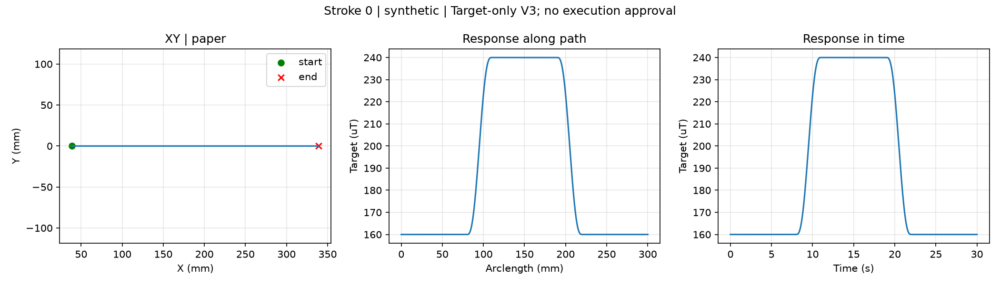

# 短平台：现有 P 与慢 PI 对比

本批次由用户授权生成，仅完成离线验证，尚无这条路径的真实跟踪结果。

## 目标与共同条件

| 测量时间 | 磁目标 | 用途 |
|---|---|---|
| 0–8 s | 160 µT | 首次平台 |
| 8–11 s | 160→240 µT，五次平滑过渡 | 下压 |
| 11–19 s | 240 µT | 深压平台 |
| 19–22 s | 240→160 µT，五次平滑过渡 | 返回 |
| 22–30 s | 160 µT | 深压后返回平台 |



- X 速度 10 mm/s，测量长 300 mm；包括滑动准备与收笔的纸面直线共 350 mm。
- 等待位姿 XYZ = **[-370, 500, 130] mm**，RPY = **[0, 15, 0]°**。
- 进笔沿用：高位转 Ry30 → 降到 Z36 → 固定 XYZ 转 Ry15 → +X 滑动 1 s → 3 s 平滑加载 → 测量。
- 160/240 µT 对应名义前馈 Z 约 **30.092 / 26.894 mm**；接触基准仍为 **Z40 mm**。Z36 是进笔高度。
- 测量 X 约 -331→-31 mm；整条纸面行走 X 为 -370→-20 mm。测量中始终继续向 +X 运动，平台指磁目标恒定，闭环 Z 可以调整。
- 抬笔到 Z130、高位回到等待位姿；整条轨迹 **112.60 s**，另加启动基线采集和手动沾水时间。
- 两组共用同一非线性前馈表、EMA α=0.3、20 ms 指令周期、独立 10 Hz 实际 TCP 采集。

## 参数与抗饱和

| 项目 | P | 慢 PI |
|---|---:|---:|
| Kp | 1 | 1 |
| Ki（脚本参数，1/s） | 0 | 0.05 |
| 总反馈修正 | ±0.8 mm | ±0.8 mm |
| 积分单独限幅 | — | ±0.2 mm |
| 修正速度 / 加速度 | 2 mm/s / 30 mm/s² | 相同 |
| 首尾渐入渐出 | 1 s | 1 s |

积分每笔开始清零，跨越本笔的平台和过渡时保留，测量结束后清零。正误差表示信号不足，P/I 请求增加压深。

积分增量为 `Ki × S × (目标－测量) × 0.02`，S 使用原 P 的全局标定比例，约 0.039837 mm/µT。20 µT 持续误差且未触发限制时，积分约以 0.03984 mm/s 增长。Ki=0.05 是保守的试验起点，不是由动态模型算出的最优值。

抗饱和采用条件积分：把候选 P+I 与最终可执行反馈区间比较；积分若继续推向饱和方向，本拍冻结。向可执行区间恢复的积分允许更新。区间覆盖总限幅、首尾渐变、修正速度/加速度、提前制动、深度/工作空间、合成 TCP 动态限制。积分单独限幅与总反馈限幅同时生效，不能相加成 ±1.0 mm。

完整回放发现原 P 在最后测量拍后切换为零反馈时，修正加速度可达到 40 mm/s²。本次共享限幅器补充了终点制动包络；P 公式和参数保留，P、PI 收尾都遵守 30 mm/s²。

## 依次执行：P1 → PI1 → PI2 → P2

在 `/home/ethan/FYP` 下运行。**每次只执行一条，完成后按原流程重新沾水、准备同等纸面条件**；输入 `RUN` 才连接硬件。尽量保持沾水方式、纸面状态、装夹和等待时间一致，记录明显挤压等异常。

先离线预览两组（不连接机器人）：

```bash
PYTHONPATH=src:. python scripts/run_short_plateau_pi_comparison.py --mode p --dry-run
PYTHONPATH=src:. python scripts/run_short_plateau_pi_comparison.py --mode pi --dry-run
```

### 第 1 笔：P1

```bash
PYTHONPATH=src:. python scripts/run_short_plateau_pi_comparison.py --mode p --execute
```

### 第 2 笔：PI1

```bash
PYTHONPATH=src:. python scripts/run_short_plateau_pi_comparison.py --mode pi --execute
```

### 第 3 笔：PI2

```bash
PYTHONPATH=src:. python scripts/run_short_plateau_pi_comparison.py --mode pi --execute
```

### 第 4 笔：P2

```bash
PYTHONPATH=src:. python scripts/run_short_plateau_pi_comparison.py --mode p --execute
```

顺序让两种模式在批次前后的平均位置相同，减少单向时间漂移与模式完全重合；两笔只提供初步重复性证据。

## 数据保存与比较

仍使用原 recorder，自动保存到：

`runs/brush2/<上海日期>/08_短平台P与PI对比/raw/<时间>_平台160到240回160_<模式参数>_第N次/`

保留 `sensor.csv`、`control.jsonl`、`events.jsonl`、`resolved.json`、`setup.json`、`timeline.npz`、`compiled_plan.npz`、目标/前馈/设置/进笔输入快照、manifest，以及原独立 TCP 记录。实际解析后的 P/PI 参数位于 `resolved.json` 的 `control`。

PI 的 `control.jsonl` 每拍额外记录：

- `p_request_m`：限幅前 P 请求；`i_correction_m`：已接受的积分状态。
- `pi_candidate_m`：抗饱和判断前的 P+候选 I；`pi_request_m`：判断后的 P+I 请求。
- `integral_delta_requested_m`：本拍原始积分增量。
- `integral_blocked`：输出约束是否冻结本拍积分；`integral_limit_active`：候选积分是否达到单独限幅。
- `feedback_lower_m` / `feedback_upper_m`：本拍可执行的总反馈区间。
- 实际总反馈仍使用原 `depth_fb_m`；限幅原因仍使用 `limit_reasons`。积分冻结与积分单独到顶需分别统计。

预先约定测量第一拍为 t=0，三个等长统计窗口为 **5–7 s、16–18 s、27–29 s**（均包含端点）。首次与返回平台都取进入平台后的第 5–7 秒，避开收尾的最后 1 秒。窗口也写入 `protocol.json`，后续不因某笔结果好坏而更改。

比较各窗口的有符号平均误差（目标－测量）、MAE、±20 µT 比例、P95 绝对误差、P/I 状态及限幅比例；另看 8–16 s、19–27 s 的过渡与恢复，以及整条曲线峰值偏离。

判断重点：PI 是否在两次都减小平台偏差，同时没有使深压后返回的超调或恢复变差。若积分一直被冻结或达到 ±0.2 mm，而误差仍大，需要结合总限幅、前馈偏差和实际 TCP 判断，不能仅凭这一组认定 PI 无效或直接加大 Ki。

首次/返回平台位于不同 X、不同时间，差异可能同时包含纸面、湿润状态和接触历史影响；该实验不能单独把差异归因于材料滞回。

## 离线证据与范围

- V3 目标重载校验、XY/目标预览、P 与 PI 实际 CLI 离线预检通过。
- FakeArm 完整进笔、30 s 测量和回程运行结束，1501 个测量点与 PI 诊断字段写入原始记录；这属于软件模拟。
- 真实前馈表配合 5 种人工误差输入、两种控制模式，共 **10 组完整指令回放**通过。最大总反馈约 0.8 mm、最大修正速度约 2 mm/s、最大修正加速度约 30 mm/s²，含测量结束边界。详见 `validation.json`；不代表真实跟踪效果预测。
- 独立代码审查未发现阻碍项，包含新增终点制动检查。
- 全量测试 **786 通过、7 跳过、3 个原有失败**，日志见 `test_results.txt`。三个 `test_return_to_origin.py` 失败涉及返回 X=-200/-370 mm 的旧测试预期；本次未修改独立返回原点脚本。本实验使用自身已编译的高位回程。

生成器为 `scripts/generate_short_plateau_trial.py`；输出目录存在时拒绝覆盖。新的批次前馈表只作为本次用户授权的试用副本，保留标定与来源哈希，不改变原始未验证候选表。
