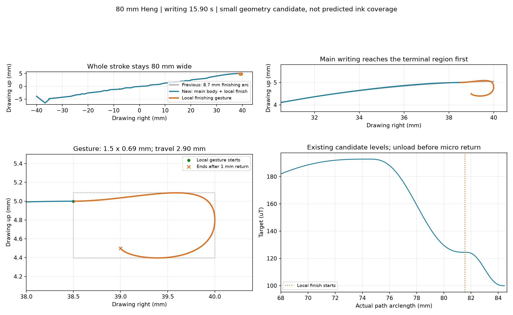

# brush2 长横80mm：局部收笔小于5mm

主体先到末端区域，再作微小回收。局部收笔总路程2.90mm，范围1.5×0.69mm，向左回收1mm；总路程和范围均小于5mm。几何目标是把弯折限制在末端小区域内，尚未证明真实墨迹能覆盖它。

书写15.90秒，名义完整运动37.80秒，基线与启动定位另计。主体参考速度上限9.9mm/s，为最终重采样留出余量，实际目标速度不超过10mm/s；局部收笔由1.5渐降至0.8mm/s。

15度倾角的方位仅跟随主体和主体末端的直线延长参考，不追随微小回折；本次局部收笔方位变化1.56度。时间／姿态参考与真实XY按等弧长对应，复用现有方向规划器，之后单独检查真实XY与名义Z的完整轨迹。无需修改生产生成器或执行器。

磁目标档位仍是候选值100..192.8228uT：在进入微小收笔区前由L4降至L2，在小区域内再降至L1。阶段按新弧长重算。这不是起收笔磁目标或笔宽标定完成；L1仍表示接触。独立entry_profile中的5mm反向进笔、加载和抬笔流程仍沿用旧配置，需继续讨论。

离线编译显式使用“中”实验的PI配置，反馈只在书写阶段启用。未连接硬件；通过预检不代表墨迹效果已验证。

目标：[heng/strokeplan.npz](heng/strokeplan.npz)；几何：[heng/geometry.json](heng/geometry.json)；报告：[summary.json](summary.json)。本包recipe.json是局部配方，由generate.py:build_candidate重建，不能直接传给通用JSON生成CLI。preflight/内为独立派生名义轨迹，包含查表Z，不是实际反馈或原始目标。
