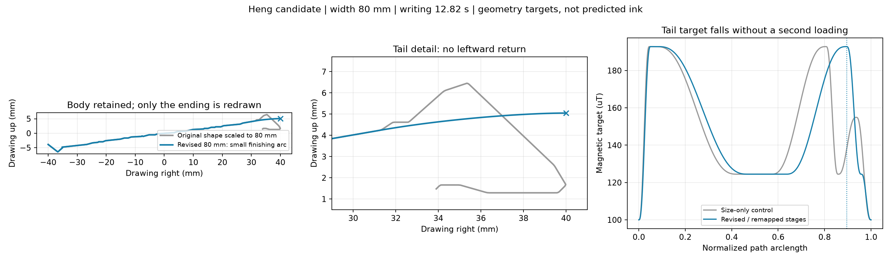
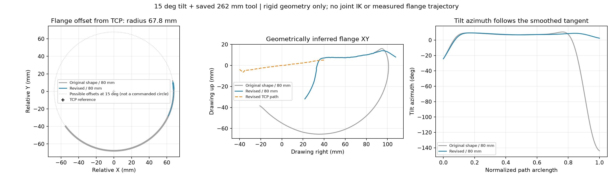

# brush2 长横80mm：小弧收笔候选

保留v3主体，统一缩为80mm宽；从源点34开始，用切线连续的三次Bezier小弧替换原来的尾部大回折。新尾部向前约8.68mm、上升0.8mm，不向左回移。起笔形状与进出笔配置未修改。

书写段12.82秒，名义完整运动34.76秒，基线和启动定位另计。主体速度上限10mm/s；起笔3mm/s，收笔7渐降至3mm/s，以约束缩小后的名义加速度。沿用15度切线倾斜、5mm姿态平滑和原执行器限值。目标使用100..192.8228uT，仍为合成宽度意图。

磁阶段按新几何重新映射；收笔L4→L2→L1，不再中途加回L3。L1仍是接触档位，之后执行器按原流程抬笔。

离线编译显式采用“中”实验目录的PI配置（kp=1、ki=0.1、修正限幅±0.8mm），反馈仅在书写阶段启用。该配置记录在preflight/resolved_control.json；目标文件本身不包含控制器配置。现有低层CLI仅改--control-mode pi不能传入这份PI配置，本包未附带会回落到纯前馈的执行指令。

已通过V3重载、几何／阶段断言和现有方向执行器的名义轨迹检查。compiled_heng_pi.npz是独立的派生名义轨迹，不包含真实反馈修正。未连接机器人，未验证墨迹质量或新的标定适用性。

15度是笔杆倾角，倾斜方位仍随平滑切线变化。姿态构造Rz(h)Ry(15)Rz(-h)避免把行笔方向直接变成绕笔轴整圈旋转，但长工具的法兰仍需绕TCP发生位置变化。按保存的刚性TCP变换推算，262mm工具在15度时水平偏置半径约67.8mm。图中的虚线圆只是可能偏置的集合，不是机器人要执行一整圈；图中法兰来自刚性几何推算，未做关节逆解、碰撞检查或真实法兰测量，笔毛接触形态也不包含在这个模型中。

目标：[heng/strokeplan.npz](heng/strokeplan.npz)；配方：[heng/recipe.json](heng/recipe.json)；阶段：[heng/phase_table.csv](heng/phase_table.csv)；报告：[summary.json](summary.json)。源计划和现场配置的哈希已核对不变。
