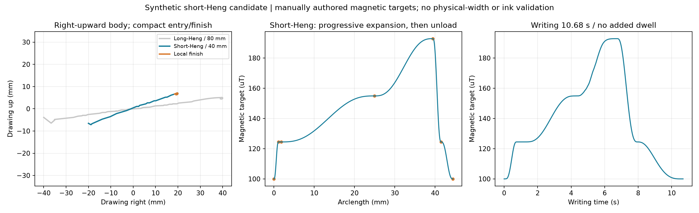

# brush2 短横40mm：渐行渐粗候选

参考短横原图及描述“向右上行笔，宽度逐渐展开；末端转向收笔”。默认宽40mm，为当前长横80mm的一半；采用原图笛卡尔引导线的主体，起笔动作另缩为1.8mm路程，收笔另设为2.90mm路程的小区域动作。该40mm尺寸和数值均是本轮工程初值。

磁目标按短横规则单次渐增：100→124.47→154.92→192.82→124.47→100uT。L2在进入主体处短暂保持，此后主体逐渐升至L4，右端提锋后回落。可用五档仍是100..240uT，本笔未使用L5。磁目标是人工合成宽度意图，未标定真实笔宽或起收笔接触状态。

书写10.68秒，名义完整运动32.38秒，基线与启动定位另计。主体速度上限8mm/s，起笔1.5..2mm/s，末端局部动作1.5渐降至0.8mm/s；未加原地停驻。

沿用15度书写倾角，倾斜方位参考主体与其直线延长，不追随局部回收。小收笔范围约1.50×0.83mm，总路程小于5mm；是否能藏在墨迹内仍需试写。

已通过V3重载、短横磁目标单调阶段检查、20秒上限和独立方向执行器的名义预检。离线编译显式加载“中”实验PI配置；反馈仅在书写阶段启用。未连接机器人，未提高限值。

本包仅生成书写目标。独立旧entry_profile仍有额外5mm反向进笔，加载与抬笔流程也未修改，不能把计划内1.8mm起笔理解成整个落笔流程都已缩短。旧+X固定Ry15前馈表在不同方位和低速下的适用性仍属实验假设。

目标：[heng_short/strokeplan.npz](heng_short/strokeplan.npz)；配方：[heng_short/recipe.json](heng_short/recipe.json)；阶段：[heng_short/phase_table.csv](heng_short/phase_table.csv)；报告：[summary.json](summary.json)。本地配方由generate.py:build_candidate重建，不直接兼容通用JSON生成CLI。preflight内为独立派生名义轨迹，不是原始目标或真实反馈记录。原模板、长横与现场配置哈希均保持不变。
