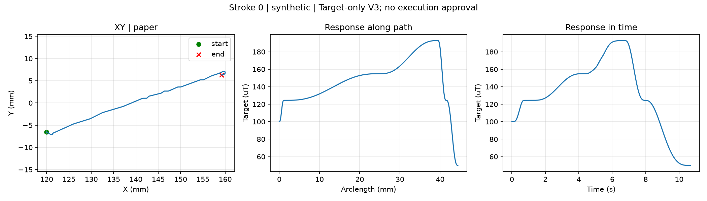

# 短横40mm：收笔末端50uT

按用户最新要求，后续候选的末端收缩目标取50uT；起笔仍100uT，原100..240uT五档继续用于主体。当前短横序列为100→124.47→154.92→192.82→124.47→50uT。50不等于离纸或已标定的笔宽。

本版严格保留v1的XY、s、时间和姿态，主体与收笔前的磁目标也保持相同。仅最后一段由124.47平滑降至50，原终点是100。宽40mm，书写10.68秒，局部收笔几何仍沿用v1。

当前前馈表实测范围72.52..323.54uT，不覆盖50。现有方向执行器的离线预检按预期拒绝该目标：`target outside measured range; extrapolation disabled`。新文件可用于目标讨论与预览，补齐低响应段标定后再检查执行；未外推、裁剪目标或修改原表，未生成名义Z轨迹，未连接硬件。

目标：[heng_short/strokeplan.npz](heng_short/strokeplan.npz)；阶段：[heng_short/phase_table.csv](heng_short/phase_table.csv)；[收笔规则](terminal_policy.json)；[预检报告](preflight.json)。v1和历史现场配置均保留原值。
