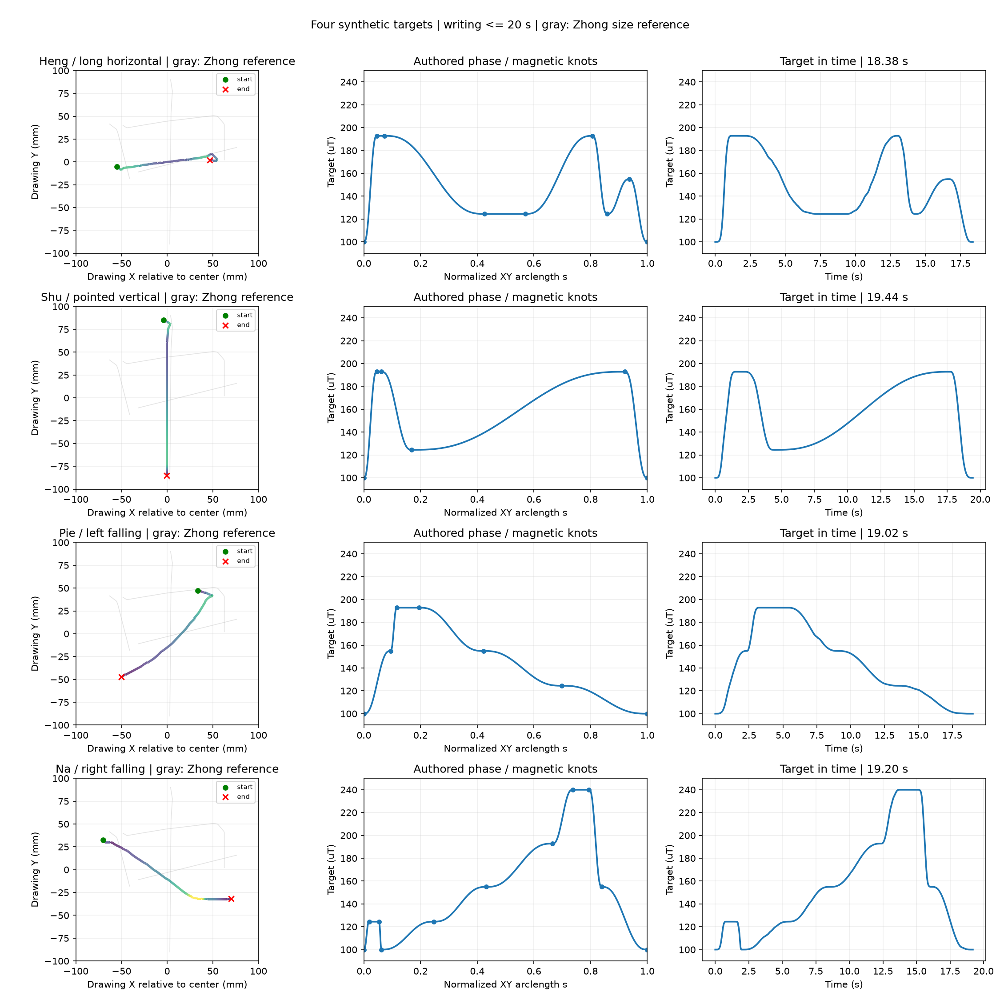

# brush2 四笔画：书写段不超过20秒

四笔均通过 V3 重新加载、书写段时长检查及现有方向姿态执行器的离线预检。未连接硬件，未提高执行器限值。

| STROKE | 笔画 | 尺寸：宽 × 高 / mm | 书写段 / s | 含进出笔、转场的运动 / s |
| --- | --- | --- | --- | --- |
| `heng` | 长横 | 110.0 × 17.8 | 18.38 | 40.38 |
| `shu` | 悬针竖 | 7.6 × 170.0 | 19.44 | 42.52 |
| `pie` | 斜撇 | 100.0 × 94.1 | 19.02 | 41.16 |
| `na` | 斜捺 | 140.0 × 64.6 | 19.20 | 41.92 |

20秒约束指沿XY书写段；进笔、接触旋转、加载、抬笔、返回和基线另计。表中的计划运动时长也不包含从当前位姿启动自动定位的时间。作为参照，“中”的原四笔书写时间为8.02、20.32、11.42、18.94秒；本组执行严格的20秒上限。

保留教学图的笔画形状和100–240 µT等比五档磁目标。横缩至110 mm宽，竖缩至170 mm高，撇缩至100 mm宽，捺保留140 mm宽。原撇路径约217 mm，在10 mm/s上限下必须缩放才能满足20秒。

取消原来长距离低速和整笔2–3倍放慢；主体期望速度10 mm/s，起收采用短局部减速，转弯继续受现有运动约束限制。姿态切线平滑参数从1 mm调整为横/竖5 mm、撇/捺6 mm；XY仍来自原图引导线。未插入额外原地停驻。磁档位仍是合成宽度意图，未标定实际宽度。



## 运行

在已有Brushbot Python环境、项目根目录中先做单笔预检：

```bash
cd /home/ethan/FYP
PLAN_DIR=runs/brush2/plans/template_four_strokes_100_240_zhong180_v3
SETUP_DIR=runs/brush2/plans/11_中字底横延长30mm_实测第9次
STROKE=heng

PYTHONPATH=src:. python scripts/run_strokeplan_experiment.py \
  "$PLAN_DIR/$STROKE/strokeplan.npz" \
  --feedforward "$SETUP_DIR/feedforward.json" \
  --settings "$SETUP_DIR/settings.json" \
  --entry-profile "$SETUP_DIR/entry_profile.json" \
  --control-mode feedforward \
  --record-actual-tcp \
  --run-label "template_${STROKE}_100_240_v3" \
  --dry-run
```

确认当前brush2仍匹配这套现场配置，手动沾水并确认自动回位与书写路径净空后，把末尾`--dry-run`改为`--execute`，按终端提示输入`RUN`。脚本先自动抬笔、高位移动并对齐到下述等待位，到位检查通过后清空旧磁数据，再重新采集基线并开始书写。其余笔画将`STROKE`改为`shu`、`pie`、`na`，逐笔预检、执行并更换纸张。

现场配置沿用先前“中”字：TCP_brush / Base，接触参考Z40 mm；等待XYZ = [-370, 500, 130] mm，RPY = [0, 15, 0]°。进笔倾角30°、书写倾角15°，接触旋转时反向移动5 mm。绘图右方为机器人+X、上方为+Y。默认IP192.168.0.10，串口/dev/ttyACM0，波特率115200；连接参数可通过`--ip`、`--serial-port`、`--baud`指定。

本组仍假设其他方向、局部低速和动态姿态可沿用brush2旧+X、10 mm/s、固定Ry15°前馈表，需通过试写验证。运行数据保存在`runs/brush2/`。

[预检报告](preflight.json)包含时长、配置哈希和限值实测差分。`preflight/compiled_*.npz`为独立派生的名义轨迹，包含前馈Z；不回填到目标StrokePlan。各笔`preview/`含独立预览、CSV及目标哈希。v1、v2和历史配置均保留原值。

启动自动定位的[回归验证记录](startup-validation.json)：149项执行相关测试通过；全量检查中20项受沙箱限制的浏览器和通信测试在沙箱外复测全部通过。未连接机械臂，四份目标文件与已有编译轨迹未改变。
